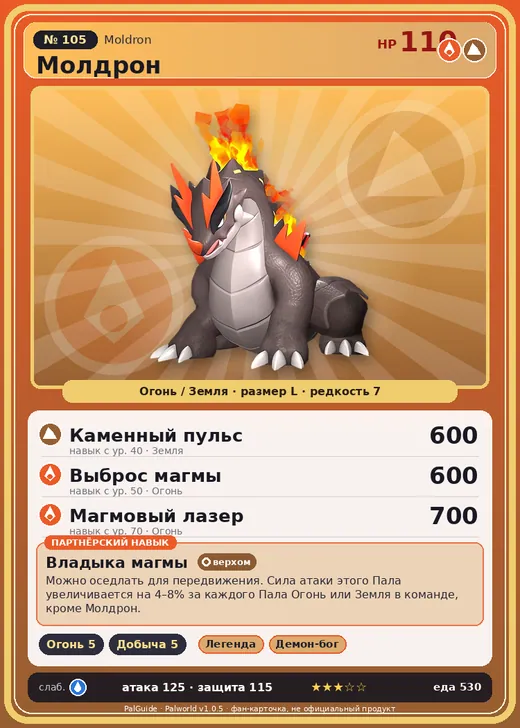

# #105 Молдрон (Moldron)

#105 · Moldron

ОгоньЗемля

Слабость: ВодаТрава

🔥 Разжигание огня <b>5</b>⛏️ Добыча <b>5</b>

<b>Владыка магмы</b> 🐾 выпущен 🐎 верхом

❤️ 110 · ⚔️ 125 · 🛡 115

| Поле | Значение |
|---|---|
| Стихия | Огонь, Земля |
| Слабость (кто бьёт сильнее) | Вода, Трава |
| Редкость | 7 |
| Размер | L |
| HP / Атака / Защита (база вида) | 110 / 125 / 115 |
| Сколько ест | 530 |
| Цена продажи | 2911 |
| Множитель поимки | ×1 |
| Скорость рывка верхом | 850 |

## Работа на базе
- Разжигание огня — ур. 5
- Добыча — ур. 5

## Партнёрский навык: Владыка магмы
Можно оседлать для передвижения. Сила атаки этого Пала увеличивается на (4~8)% за каждого Пала Огонь или Земля в команде, кроме Молдрон . Технологии 36 level value 1 ShotAttack_PartnerSkill_SpecificElement 4 2 ShotAttack_PartnerSkill_SpecificElement 5 3 ShotAttack_PartnerSkill_SpecificElement 6 4 ShotAttack_PartnerSkill_SpecificElement 7 5 ShotAttack_PartnerSkill_SpecificElement 8

## Атаки по уровням
- ур. 1: Расщеплённый огонь (Огонь, сила 80)
- ур. 7: Огненное дыхание (Огонь, сила 160)
- ур. 15: Огненная стена (Огонь, сила 250)
- ур. 22: Камнепад (Земля, сила 300)
- ур. 30: Вулканический дождь (Огонь, сила 450)
- ур. 40: Каменный пульс (Земля, сила 600)
- ур. 50: Выброс магмы (Огонь, сила 600)
- ур. 70: Магмовый лазер (Огонь, сила 700)

## Где водится
- В дикой природе: да; точек появления днём: 102, ночью: 102; уровни в первых точках: 32–34
- Может продаваться у торговца/рекрутера
- Яйцо: Большое раскалённое яйцо

## Дроп
- Огненный орган — 4–5 шт., 100%
- Кожа — 2–3 шт., 100%

**Дроп альфы:**
- Деталь древней цивилизации — 6–8 шт., 100%
- Ценный драконий самоцвет — 2–3 шт., 100%

## Разведение
- Ранг разведения (CombiRank): 750
- Участвует в особых парах: Рептиро Крист → Молдрон Крист

## Лучшие пассивки по роли
- боец: Легенда, Демон-бог, Хладнокровный, Бессмертие, Император огня (вместо Бессмертия, если нет мутации)
- рабочий: Дьявольские руки, Виртуоз, Мастеровитый, Небожитель/Трудоголик
- ездовой: Божественная скорость, Легенда, Вечный двигатель, Небесное скольжение

## Чем хорош / чем плох
- ✅ очень высокая атака (125); отличный рабочий (пригодность 5); можно оседлать
- ❌ много ест (530)

> У здоровых особей поток лавы на спине течёт бесперебойно. При плохих привычках течение замедляется, а в худшем случае возникает лавовый затор, приводящий к внезапному и мощному взрыву.

См. также: [Стихии](../../2_mehaniki/stihii.md) · [Разведение](../../2_mehaniki/razvedenie.md) · [Все палы](README.md)
