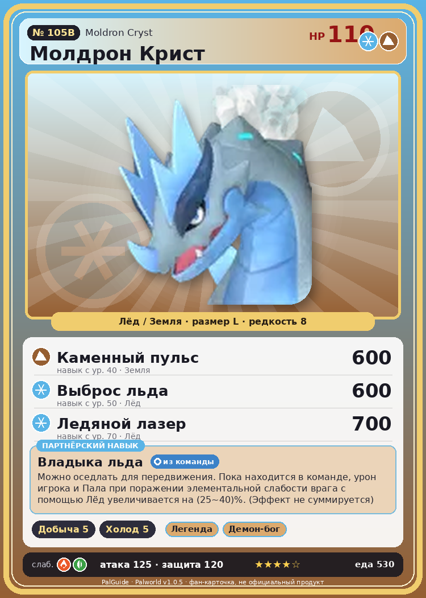

# #105B Молдрон Крист (Moldron Cryst)

{ width=360 }

| Поле | Значение |
|---|---|
| Стихия | Лёд, Земля |
| Слабость (кто бьёт сильнее) | Огонь, Трава |
| Редкость | 8 |
| Размер | L |
| HP / Атака / Защита (база вида) | 110 / 125 / 120 |
| Сколько ест | 530 |
| Цена продажи | 3328 |
| Множитель поимки | ×1 |
| Скорость рывка верхом | 850 |

## Работа на базе
- Добыча — ур. 5
- Охлаждение — ур. 5

## Партнёрский навык: Владыка льда
Можно оседлать для передвижения. Пока находится в команде, урон игрока и Пала при поражении элементальной слабости врага с помощью Лёд увеличивается на (25~40)% . (Эффект не суммируется) Технологии 70 level value 1 ElementBoostWeakness_Ice_PartnerSkill 25 2 ElementBoostWeakness_Ice_PartnerSkill 27 3 ElementBoostWeakness_Ice_PartnerSkill 30 4 ElementBoostWeakness_Ice_PartnerSkill 34 5 ElementBoostWeakness_Ice_PartnerSkill 40

## Атаки по уровням
- ур. 1: Айсберг (Лёд, сила 120)
- ур. 7: Ледяное дыхание (Лёд, сила 160)
- ур. 15: Ледяной след (Лёд, сила 300)
- ур. 22: Камнепад (Земля, сила 300)
- ур. 30: Шип метели (Лёд, сила 450)
- ур. 40: Каменный пульс (Земля, сила 600)
- ур. 50: Выброс льда (Лёд, сила 600)
- ур. 70: Ледяной лазер (Лёд, сила 700)

## Где водится
- В дикой природе: нет/особый способ; точек появления днём: 0, ночью: 0
- Яйцо: Огромное яйцо льда

## Дроп
- Ледяной орган — 4–5 шт., 100%
- Кожа — 2–3 шт., 100%

**Дроп альфы:**
- Деталь древней цивилизации — 6–8 шт., 100%
- Ценный драконий самоцвет — 2–3 шт., 100%

## Разведение
- Ранг разведения (CombiRank): 380
- **Особая пара:** [Молдрон](../../4_spravochniki/paly/moldron.md) + [Рептиро Крист](../../4_spravochniki/paly/reptyro_cryst.md)

## Лучшие пассивки по роли
- боец: Легенда, Демон-бог, Хладнокровный, Бессмертие, Император льда (вместо Бессмертия, если нет мутации)
- рабочий: Дьявольские руки, Виртуоз, Мастеровитый, Небожитель/Трудоголик
- ездовой: Божественная скорость, Легенда, Вечный двигатель, Небесное скольжение

## Чем хорош / чем плох
- ✅ очень высокая атака (125); крепкая защита (120); отличный рабочий (пригодность 5); можно оседлать
- ❌ много ест (530); разводится только особой парой

> У здоровых особей температура потока на спине течёт стабильно. При волнении она становится нестабильной, а в худших случаях это вызывает испарение или затвердевание и внезапную смерть от шока.

См. также: [Стихии](../../2_mehaniki/stihii.md) · [Разведение](../../2_mehaniki/razvedenie.md) · [Все палы](README.md)
_Источник: paldb.cc v1.0.5_
