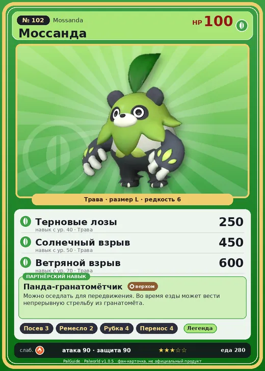

# Моссанда

<canvas id="fx"></canvas>

№ 102 · Mossanda

Трава

Слабость: Огонь

🌱 Посев семян <b>3</b>🖐️ Ручная работа <b>2</b>🪓 Рубка деревьев <b>4</b>📦 Транспортировка <b>4</b>

<b>Панда-гранатомётчик</b> 🐎 верхом

❤️ 100 · ⚔️ 90 · 🛡 90

| Поле | Значение |
|---|---|
| Стихия | Трава |
| Слабость (кто бьёт сильнее) | Огонь |
| Редкость | 6 |
| Размер | L |
| HP / Атака / Защита (база вида) | 100 / 90 / 90 |
| Сколько ест | 280 |
| Цена продажи | 1475 |
| Множитель поимки | ×1 |
| Скорость рывка верхом | 1000 |

=== "Обзор"

    #### Работа на базе
    - Посев семян — ур. 3
    - Ручная работа — ур. 2
    - Рубка деревьев — ур. 4
    - Транспортировка — ур. 4

    #### Партнёрский навык: Панда-гранатомётчик
    Можно оседлать для передвижения. Во время езды может вести непрерывную стрельбу из гранатомёта. Технологии 32.

    #### Чем хорош / чем плох
    - ✅ можно оседлать
    - ❌ явных минусов нет

    > Обладает невероятной силой. В одном из экспериментов этому Палу удалось порвать стопку из 3000 листов бумаги. К большому счастью, эти существа не плотоядные.

    См. также: [Стихии](../../guide/06_stihii.md) · [Разведение](../../guide/07_razvedenie.md) · [Все палы](README.md)

=== "Атаки"

    #### Атаки по уровням
    - ур. 1: Силовой выстрел (Нейтральный, сила 80)
    - ур. 7: Семенной пулемёт (Трава, сила 80)
    - ур. 15: Камнемёт (Земля, сила 120)
    - ур. 22: Мощный удар (Трава, сила 120)
    - ур. 30: Семенная мина (Трава, сила 120)
    - ур. 40: Терновые лозы (Трава, сила 250)
    - ур. 50: Солнечный взрыв (Трава, сила 450)
    - ур. 70: Ветряной взрыв (Трава, сила 600)

=== "Где живёт"

    #### Где водится
    - В дикой природе: да; точек появления днём: 52, ночью: 52; уровни в первых точках: 32–36
    - Подземелья: Пещера Горного Потока
    - Может продаваться у торговца/рекрутера
    - Яйцо: Большое яйцо свежей листвы

=== "Дроп"

    #### Дроп
    - Твёрдая древесина — 1–3 шт., 100%
    - Кожа — 2–3 шт., 100%
    - Семена моркови — 1–2 шт., 100%

    **Дроп альфы:**
    - Деталь древней цивилизации — 2–4 шт., 100%
    - Ценный мех — 2–4 шт., 100%

=== "Разведение"

    #### Разведение
    - Ранг разведения (CombiRank): 2060
    - Участвует в особых парах: Гриззболт → Моссанда Лакс

=== "Пассивки"

    #### Лучшие пассивки по роли

    

⚔️ Боец

максимум урона и живучести в бою

<a class="psv r-4" data-psv="Легенда" href="../../../passivki/legend/">Легенда</a><a class="psv r-4" data-psv="Демон-бог" href="../../../passivki/demon_god/">Демон-бог</a><a class="psv r-3" data-psv="Король духов" href="../../../passivki/spirit_emperor/">Король духов</a><a class="psv r-3" data-psv="Хладнокровный" href="../../../passivki/serenity/">Хладнокровный</a>

🛠 Рабочий

работает быстрее и меньше устаёт на базе

<a class="psv r-5" data-psv="Дьявольские руки" href="../../../passivki/demons_hand/">Дьявольские руки</a><a class="psv r-4" data-psv="Виртуоз" href="../../../passivki/remarkable_craftsmanship/">Виртуоз</a><a class="psv r-3" data-psv="Мастеровитый" href="../../../passivki/artisan/">Мастеровитый</a><a class="psv r-3" data-psv="Трудоголик" href="../../../passivki/workaholic/">Трудоголик</a>

🐎 Ездовой

быстрее бегает или летает с тобой верхом

<a class="psv r-4" data-psv="Божественная скорость" href="../../../passivki/swift/">Божественная скорость</a><a class="psv r-4" data-psv="Легенда" href="../../../passivki/legend/">Легенда</a><a class="psv r-4" data-psv="Вечный двигатель" href="../../../passivki/eternal_engine/">Вечный двигатель</a><a class="psv r-4" data-psv="Небесное скольжение" href="../../../passivki/sky_strider/">Небесное скольжение</a>

    <small>Нажми на пассивку, чтобы узнать, что она даёт и где её взять.</small>

<a class="card-link" href="../reindrix/">← Рейндрикс</a><a class="card-link" href="../mossanda_lux/">Моссанда Лакс →</a>

