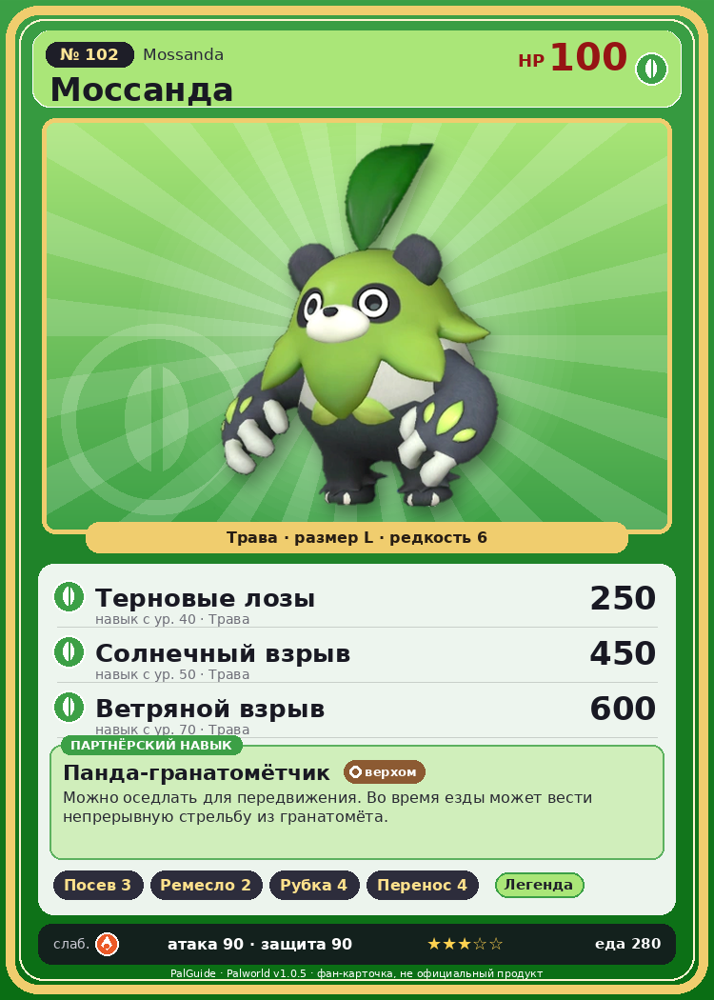

# #102 Моссанда (Mossanda)

{ width=360 }

| Поле | Значение |
|---|---|
| Стихия | Трава |
| Слабость (кто бьёт сильнее) | Огонь |
| Редкость | 6 |
| Размер | L |
| HP / Атака / Защита (база вида) | 100 / 90 / 90 |
| Сколько ест | 280 |
| Цена продажи | 1475 |
| Множитель поимки | ×1 |
| Скорость рывка верхом | 1000 |

## Работа на базе
- Посев семян — ур. 3
- Ручная работа — ур. 2
- Рубка деревьев — ур. 4
- Транспортировка — ур. 4

## Партнёрский навык: Панда-гранатомётчик
Можно оседлать для передвижения. Во время езды может вести непрерывную стрельбу из гранатомёта. Технологии 32 level value 1 MainValue 110 Пробуждение : 2 MainValue 125 Пробуждение : (Увеличение урона: Небольшое ) 3 MainValue 145 Пробуждение : (Увеличение урона: Среднее ) 4 MainValue 180 Пробуждение : (Увеличение урона: Большое ) 5 MainValue 225 Пробуждение : (Увеличение урона: Очень большое )

## Атаки по уровням
- ур. 1: Силовой выстрел (Нейтральный, сила 80)
- ур. 7: Семенной пулемёт (Трава, сила 80)
- ур. 15: Камнемёт (Земля, сила 120)
- ур. 22: Мощный удар (Трава, сила 120)
- ур. 30: Семенная мина (Трава, сила 120)
- ур. 40: Терновые лозы (Трава, сила 250)
- ур. 50: Солнечный взрыв (Трава, сила 450)
- ур. 70: Ветряной взрыв (Трава, сила 600)

## Где водится
- В дикой природе: да; точек появления днём: 52, ночью: 52; уровни в первых точках: 32–36
- Подземелья: Пещера Горного Потока
- Может продаваться у торговца/рекрутера
- Яйцо: Большое яйцо свежей листвы

## Дроп
- Твёрдая древесина — 1–3 шт., 100%
- Кожа — 2–3 шт., 100%
- Семена моркови — 1–2 шт., 100%

**Дроп альфы:**
- Деталь древней цивилизации — 2–4 шт., 100%
- Ценный мех — 2–4 шт., 100%

## Разведение
- Ранг разведения (CombiRank): 2060
- Участвует в особых парах: Гриззболт → Моссанда Лакс

## Лучшие пассивки по роли
- боец: Легенда, Демон-бог, Хладнокровный, Бессмертие, Король духов (вместо Бессмертия, если нет мутации)
- рабочий: Дьявольские руки, Виртуоз, Мастеровитый, Небожитель/Трудоголик
- ездовой: Божественная скорость, Легенда, Вечный двигатель, Небесное скольжение

## Чем хорош / чем плох
- ✅ можно оседлать
- ❌ явных минусов нет

> Обладает невероятной силой. В одном из экспериментов этому Палу удалось порвать стопку из 3000 листов бумаги. К большому счастью, эти существа не плотоядные.

См. также: [Стихии](../../2_mehaniki/stihii.md) · [Разведение](../../2_mehaniki/razvedenie.md) · [Все палы](README.md)
_Источник: paldb.cc v1.0.5_
