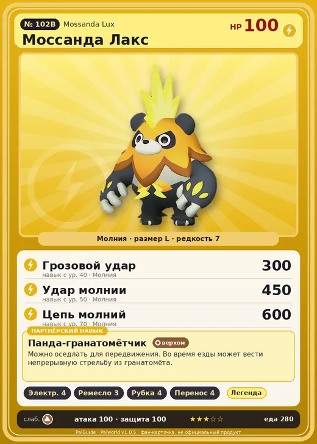

# #102B Моссанда Лакс (Mossanda Lux)

№ 102B

Молния

Слабость: Земля

⚡ Генерация энергии <b>4</b>🖐️ Ручная работа <b>3</b>🪓 Рубка деревьев <b>4</b>📦 Транспортировка <b>4</b>

<b>Панда-гранатомётчик</b> 🐎 верхом

❤️ 100 · ⚔️ 100 · 🛡 100

| Поле | Значение |
|---|---|
| Стихия | Молния |
| Слабость (кто бьёт сильнее) | Земля |
| Редкость | 7 |
| Размер | L |
| HP / Атака / Защита (база вида) | 100 / 100 / 100 |
| Сколько ест | 280 |
| Цена продажи | 1806 |
| Множитель поимки | ×1 |
| Скорость рывка верхом | 1000 |

=== "Обзор"

    #### Работа на базе
    - Генерация энергии — ур. 4
    - Ручная работа — ур. 3
    - Рубка деревьев — ур. 4
    - Транспортировка — ур. 4

    #### Партнёрский навык: Панда-гранатомётчик
    Можно оседлать для передвижения. Во время езды может вести непрерывную стрельбу из гранатомёта. Технологии 34 level value 1 MainValue 110 Пробуждение : 2 MainValue 125 Пробуждение : (Увеличение урона: Небольшое ) 3 MainValue 145 Пробуждение : (Увеличение урона: Среднее ) 4 MainValue 180 Пробуждение : (Увеличение урона: Большое ) 5 MainValue 225 Пробуждение : (Увеличение урона: Очень большое )

    #### Чем хорош / чем плох
    - ✅ хорошая атака (100); можно оседлать
    - ❌ разводится только особой парой

    > Обладает невероятной силой. Преобразуя электричество в сигналы, он превзошёл пределы физических возможностей. Стоит только заговорить о сильнейших существах — он тут как тут.

    См. также: [Стихии](../../guide/06_stihii.md) · [Разведение](../../guide/07_razvedenie.md) · [Все палы](README.md)

=== "Атаки"

    #### Атаки по уровням
    - ур. 1: Искровой выстрел (Молния, сила 50)
    - ур. 7: Шоковая волна (Молния, сила 80)
    - ур. 15: Грозовая линия (Молния, сила 160)
    - ур. 22: Бласт-панч (Молния, сила 180)
    - ур. 30: Тройная молния (Молния, сила 200)
    - ур. 40: Грозовой удар (Молния, сила 300)
    - ур. 50: Удар молнии (Молния, сила 450)
    - ур. 70: Цепь молний (Молния, сила 600)

=== "Где живёт"

    #### Где водится
    - В дикой природе: да; точек появления днём: 1, ночью: 1
    - Яйцо: Большое яйцо молнии

=== "Дроп"

    #### Дроп
    - Твёрдая древесина — 1–3 шт., 100%
    - Электрический орган — 1–2 шт., 100%
    - Кожа — 2–3 шт., 100%

    **Дроп альфы:**
    - Деталь древней цивилизации — 4–6 шт., 100%
    - Ценный мех — 4–6 шт., 100%

=== "Разведение"

    #### Разведение
    - Ранг разведения (CombiRank): 1440
    - **Особая пара:** [Моссанда](../../4_spravochniki/paly/mossanda.md) + [Гриззболт](../../4_spravochniki/paly/grizzbolt.md)

=== "Пассивки"

    #### Лучшие пассивки по роли
    - боец: Легенда, Демон-бог, Хладнокровный, Бессмертие, Император молнии (вместо Бессмертия, если нет мутации)
    - рабочий: Дьявольские руки, Виртуоз, Мастеровитый, Небожитель/Трудоголик
    - ездовой: Божественная скорость, Легенда, Вечный двигатель, Небесное скольжение

<a class="card-link" href="../mossanda/">← Моссанда</a><a class="card-link" href="../chillet/">Чиллет →</a>

