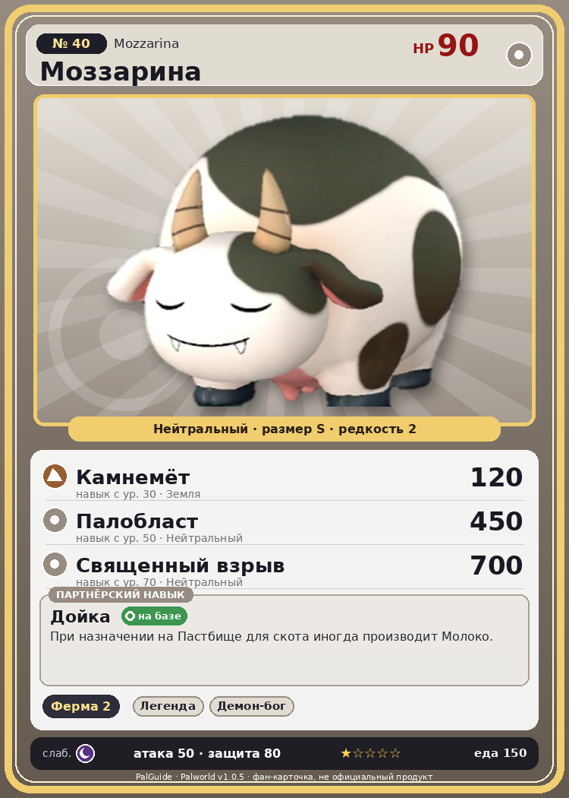

# #40 Моззарина (Mozzarina)

{ width=360 }

| Поле | Значение |
|---|---|
| Стихия | Нейтральный |
| Слабость (кто бьёт сильнее) | Тьма |
| Редкость | 2 |
| Размер | S |
| HP / Атака / Защита (база вида) | 90 / 50 / 80 |
| Сколько ест | 150 |
| Цена продажи | 502 |
| Множитель поимки | ×1 |
| Скорость рывка верхом | 700 |

## Работа на базе
- Фермерство — ур. 2

## Партнёрский навык: Дойка
При назначении на Пастбище для скота иногда производит Молоко .

## Атаки по уровням
- ур. 1: Силовой выстрел (Нейтральный, сила 80)
- ур. 7: Грязевой выстрел (Земля, сила 40)
- ур. 15: Воздушная пушка (Нейтральный, сила 40)
- ур. 22: Каменный залп (Земля, сила 80)
- ур. 30: Камнемёт (Земля, сила 120)
- ур. 40: Силовая бомба (Нейтральный, сила 120)
- ур. 50: Палобласт (Нейтральный, сила 450)
- ур. 70: Священный взрыв (Нейтральный, сила 700)

## Где водится
- В дикой природе: да; точек появления днём: 115, ночью: 115; уровни в первых точках: 9–11
- Подземелья: Пещера Ущелья
- Яйцо: Обычное яйцо

## Дроп
- Мясо Моззарины — 2–3 шт., 100%
- Молоко — 1 шт., 100%

**Дроп альфы:**
- Деталь древней цивилизации — 1–2 шт., 100%
- Ценный мех — 1–2 шт., 100%

## Разведение
- Ранг разведения (CombiRank): 2800

## Лучшие пассивки по роли
- по обзору: Мастеровитый
- боец: Легенда, Демон-бог, Хладнокровный, Бессмертие, Святое небо (вместо Бессмертия, если нет мутации)
- ездовой: Божественная скорость, Легенда, Вечный двигатель, Небесное скольжение

## Чем хорош / чем плох
- ✅ Молоко; можно оседлать
- ❌ Слабая; слабая атака (50)

> Молоко хлещет, как из крана, даже без особого ухода. Мужские особи тоже дают молоко. Загадка природы, не иначе.

См. также: [Стихии](../../2_mehaniki/stihii.md) · [Разведение](../../2_mehaniki/razvedenie.md) · [Все палы](README.md)
_Источник: paldb.cc v1.0.5_
