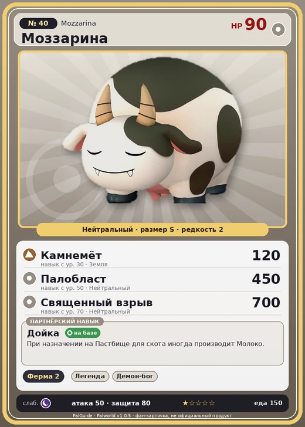

# Моззарина

<canvas id="fx"></canvas>

№ 40 · Mozzarina

Нейтральный

Слабость: Тьма

🐑 Фермерство <b>2</b>

<b>Дойка</b> 🏠 на базе

❤️ 90 · ⚔️ 50 · 🛡 80

| Поле | Значение |
|---|---|
| Стихия | Нейтральный |
| Слабость (кто бьёт сильнее) | Тьма |
| Редкость | 2 |
| Размер | S |
| HP / Атака / Защита (база вида) | 90 / 50 / 80 |
| Сколько ест | 150 |
| Цена продажи | 502 |
| Множитель поимки | ×1 |
| Скорость рывка верхом | 700 |

=== "Обзор"

    #### Работа на базе
    - Фермерство — ур. 2

    #### Партнёрский навык: Дойка
    При назначении на Пастбище для скота иногда производит Молоко.

    #### Чем хорош / чем плох
    - ✅ Молоко
    - ❌ Слабая; слабая атака (50)

    > Молоко хлещет, как из крана, даже без особого ухода. Мужские особи тоже дают молоко. Загадка природы, не иначе.

    См. также: [Стихии](../../guide/06_stihii.md) · [Разведение](../../guide/07_razvedenie.md) · [Все палы](README.md)

=== "Атаки"

    #### Атаки по уровням
    - ур. 1: Силовой выстрел (Нейтральный, сила 80)
    - ур. 7: Грязевой выстрел (Земля, сила 40)
    - ур. 15: Воздушная пушка (Нейтральный, сила 40)
    - ур. 22: Каменный залп (Земля, сила 80)
    - ур. 30: Камнемёт (Земля, сила 120)
    - ур. 40: Силовая бомба (Нейтральный, сила 120)
    - ур. 50: Палобласт (Нейтральный, сила 450)
    - ур. 70: Священный взрыв (Нейтральный, сила 700)

=== "Где живёт"

    #### Где водится
    - В дикой природе: да; точек появления днём: 115, ночью: 115; уровни в первых точках: 9–11
    - Подземелья: Пещера Ущелья
    - Яйцо: Обычное яйцо

=== "Дроп"

    #### Дроп
    - Мясо Моззарины — 2–3 шт., 100%
    - Молоко — 1 шт., 100%

    **Дроп альфы:**
    - Деталь древней цивилизации — 1–2 шт., 100%
    - Ценный мех — 1–2 шт., 100%

=== "Разведение"

    #### Разведение
    - Ранг разведения (CombiRank): 2800

=== "Пассивки"

    #### Лучшие пассивки по роли

    

⚔️ Боец

максимум урона и живучести в бою

<a class="psv r-4" data-psv="Легенда" href="../../../passivki/legend/">Легенда</a><a class="psv r-4" data-psv="Демон-бог" href="../../../passivki/demon_god/">Демон-бог</a><a class="psv r-3" data-psv="Святое небо" href="../../../passivki/celestial_emperor/">Святое небо</a><a class="psv r-3" data-psv="Хладнокровный" href="../../../passivki/serenity/">Хладнокровный</a>

    <small>Нажми на пассивку, чтобы узнать, что она даёт и где её взять.</small>

<a class="card-link" href="../woolipop_terra/">← Вулипоп Терра</a><a class="card-link" href="../azurobe/">Азуроб →</a>

