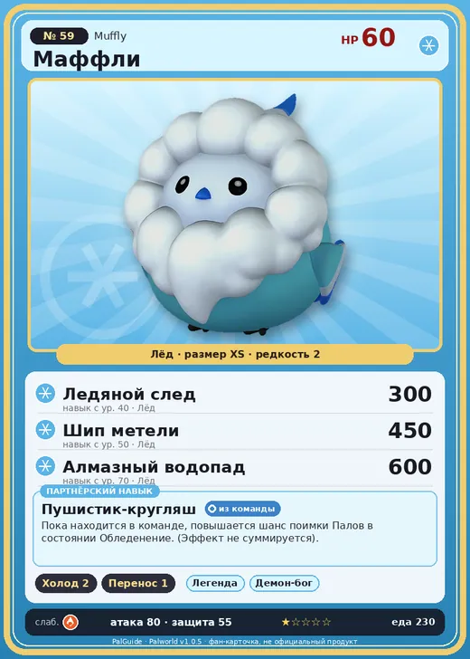

# Маффли

<canvas id="fx"></canvas>

№ 59 · Muffly

Лёд

Слабость: Огонь

❄️ Охлаждение <b>2</b>📦 Транспортировка <b>1</b>

<b>Пушистик-кругляш</b> 🎒 из команды

❤️ 60 · ⚔️ 80 · 🛡 55

Основное

💎Редкость <button class="hlp" data-tip="Чем выше число, тем реже встречается пал. 1–4 — обычные, 5–7 — редкие, 8+ — легендарные.">?</button><b>2</b>

📏Размер<b>XS</b>

💰Цена продажи <button class="hlp" data-tip="Сколько золота даст торговец за пала.">?</button><b>385</b>

Бой

🎯Множитель поимки <button class="hlp" data-tip="Насколько легче или труднее поймать: ×1 — обычно, меньше — сложнее.">?</button><b>×1</b>

🐎Скорость рывка верхом <button class="hlp" data-tip="Скорость, если сесть на пала и бежать рывком.">?</button><b>450</b>

Ферма и еда

🍖Сколько ест <button class="hlp" data-tip="Сколько сытости пал тратит — чем больше, тем больше еды нужно на базе.">?</button><b>230</b>

Разведение

🧬Сила разведения <button class="hlp" data-tip="Скрытое число игры: у детёныша оно примерно среднее от родителей. Чем меньше — тем «сильнее» пал.">?</button><b>2480</b>

=== "Обзор"

    #### Работа на базе
    - Охлаждение — ур. 2
    - Транспортировка — ур. 1

    #### Партнёрский навык: Пушистик-кругляш
    Пока находится в команде, повышается шанс поимки Палов в состоянии Обледенение. (Эффект не суммируется).

    #### Чем хорош / чем плох
    - ✅
    - ❌ мало здоровья (60)

    > Пух вокруг лица смягчает удары. Даже если слегка сдувает, это не страшно, но ухаживать за перьями неудобно, а почесать зудящее место невозможно — в итоге постоянно что-то раздражает.

    См. также: [Стихии](../../guide/06_stihii.md) · [Разведение](../../guide/07_razvedenie.md) · [Все палы](README.md)

=== "Атаки"

    #### Атаки по уровням
    - ур. 1: Воздушная пушка (Нейтральный, сила 40)
    - ур. 7: Ледяной резак (Лёд, сила 80)
    - ур. 15: Воздушные клинки (Нейтральный, сила 160)
    - ур. 22: Ледяное дыхание (Лёд, сила 160)
    - ур. 30: Ледяные пули (Лёд, сила 250)
    - ур. 40: Ледяной след (Лёд, сила 300)
    - ур. 50: Шип метели (Лёд, сила 450)
    - ур. 70: Алмазный водопад (Лёд, сила 600)

=== "Где живёт"

    #### Где водится
    - В дикой природе: да; точек появления днём: 270, ночью: 270
    - Яйцо: Яйцо льда

=== "Дроп"

    #### Дроп
    - Ледяной орган — 1 шт., 100%

    **Дроп альфы:**
    - Деталь древней цивилизации — 1–2 шт., 100%
    - Ценное перо — 2–3 шт., 100%

=== "Разведение"

    #### Разведение
    - Ранг разведения (CombiRank): 2480

=== "Пассивки"

    #### Лучшие пассивки по роли

    

⚔️ Боец

максимум урона и живучести в бою

<a class="psv r-4" data-psv="Легенда" href="../../../passivki/legend/">Легенда</a><a class="psv r-4" data-psv="Демон-бог" href="../../../passivki/demon_god/">Демон-бог</a><a class="psv r-3" data-psv="Император льда" href="../../../passivki/ice_emperor/">Император льда</a><a class="psv r-3" data-psv="Хладнокровный" href="../../../passivki/serenity/">Хладнокровный</a>

    <small>Нажми на пассивку, чтобы узнать, что она даёт и где её взять.</small>

<a class="card-link" href="../arsox/">← Арсокс</a><a class="card-link" href="../bristla/">Бристла →</a>

