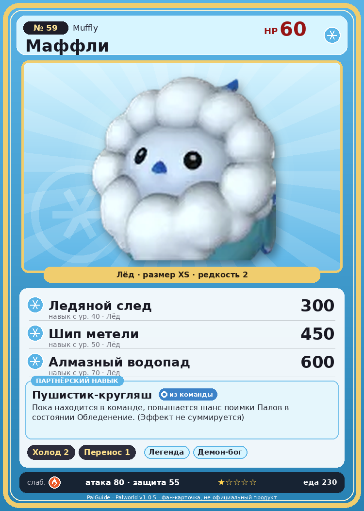

# #59 Маффли (Muffly)

{ width=360 }

| Поле | Значение |
|---|---|
| Стихия | Лёд |
| Слабость (кто бьёт сильнее) | Огонь |
| Редкость | 2 |
| Размер | XS |
| HP / Атака / Защита (база вида) | 60 / 80 / 55 |
| Сколько ест | 230 |
| Цена продажи | 385 |
| Множитель поимки | ×1 |
| Скорость рывка верхом | 450 |

## Работа на базе
- Охлаждение — ур. 2
- Транспортировка — ур. 1

## Партнёрский навык: Пушистик-кругляш
Пока находится в команде, повышается шанс поимки Палов в состоянии Обледенение . (Эффект не суммируется) level value 1 CaptureLevelUpIfTarget_Freeze_PartnerSkill_FluffyBird 1 Пробуждение : 2 CaptureLevelUpIfTarget_Freeze_PartnerSkill_FluffyBird 2 Пробуждение : (Повышение шанса поимки: Небольшое ) 3 CaptureLevelUpIfTarget_Freeze_PartnerSkill_FluffyBird 3 Пробуждение : (Повышение шанса поимки: Среднее ) 4 CaptureLevelUpIfTarget_Freeze_PartnerSkill_FluffyBird 4 Пробуждение : (Повышение шанса поимки: Большое ) 5 CaptureLevelUpIfTarget_Freeze_PartnerSkill_FluffyBird 5 Пробуждение : (Повышение шанса поимки: Очень большое )

## Атаки по уровням
- ур. 1: Воздушная пушка (Нейтральный, сила 40)
- ур. 7: Ледяной резак (Лёд, сила 80)
- ур. 15: Воздушные клинки (Нейтральный, сила 160)
- ур. 22: Ледяное дыхание (Лёд, сила 160)
- ур. 30: Ледяные пули (Лёд, сила 250)
- ур. 40: Ледяной след (Лёд, сила 300)
- ур. 50: Шип метели (Лёд, сила 450)
- ур. 70: Алмазный водопад (Лёд, сила 600)

## Где водится
- В дикой природе: да; точек появления днём: 270, ночью: 270
- Яйцо: Яйцо льда

## Дроп
- Ледяной орган — 1 шт., 100%

**Дроп альфы:**
- Деталь древней цивилизации — 1–2 шт., 100%
- Ценное перо — 2–3 шт., 100%

## Разведение
- Ранг разведения (CombiRank): 2480

## Лучшие пассивки по роли
- боец: Легенда, Демон-бог, Хладнокровный, Бессмертие, Император льда (вместо Бессмертия, если нет мутации)
- ездовой: Божественная скорость, Легенда, Вечный двигатель, Небесное скольжение

## Чем хорош / чем плох
- ✅ можно оседлать
- ❌ мало здоровья (60)

> Пух вокруг лица смягчает удары. Даже если слегка сдувает, это не страшно, но ухаживать за перьями неудобно, а почесать зудящее место невозможно — в итоге постоянно что-то раздражает.

См. также: [Стихии](../../2_mehaniki/stihii.md) · [Разведение](../../2_mehaniki/razvedenie.md) · [Все палы](README.md)
_Источник: paldb.cc v1.0.5_
