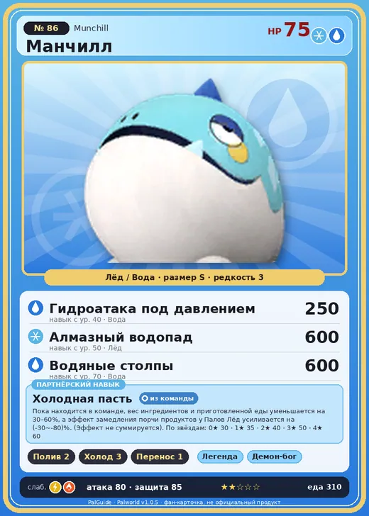

# #86 Манчилл (Munchill)

№ 86

ЛёдВода

Слабость: МолнияОгонь

💧 Полив <b>2</b>❄️ Охлаждение <b>3</b>📦 Транспортировка <b>1</b>

<b>Холодная пасть</b> 🎒 из команды

❤️ 75 · ⚔️ 80 · 🛡 85

| Поле | Значение |
|---|---|
| Стихия | Лёд, Вода |
| Слабость (кто бьёт сильнее) | Молния, Огонь |
| Редкость | 3 |
| Размер | S |
| HP / Атака / Защита (база вида) | 75 / 80 / 85 |
| Сколько ест | 310 |
| Цена продажи | 798 |
| Множитель поимки | ×1 |
| Скорость рывка верхом | 450 |

=== "Обзор"

    #### Работа на базе
    - Полив — ур. 2
    - Охлаждение — ур. 3
    - Транспортировка — ур. 1

    #### Партнёрский навык: Холодная пасть
    Пока находится в команде, вес ингредиентов и приготовленной еды уменьшается на 30–60%, а эффект замедления порчи продуктов у Палов Лёд усиливается на (-30~-80)%. (Эффект не суммируется). По звёздам: 0★ 30 · 1★ 35 · 2★ 40 · 3★ 50 · 4★ 60

    #### Чем хорош / чем плох
    - ✅
    - ❌ явных минусов нет

    > Во рту у него очень прохладно, а если он его закрывает — становится прямо-таки как в холодильнике. Особые вещества в его слюне предотвращают порчу пищи. Теоретически его можно использовать как хранилище для продуктов, но с точки зрения гигиены — лучше держать рот закрытым.

    См. также: [Стихии](../../guide/06_stihii.md) · [Разведение](../../guide/07_razvedenie.md) · [Все палы](README.md)

=== "Атаки"

    #### Атаки по уровням
    - ур. 1: Водяной выстрел (Вода, сила 50)
    - ур. 7: Ледяной резак (Лёд, сила 80)
    - ур. 15: Ледяное дыхание (Лёд, сила 160)
    - ур. 22: Хаотичные залпы (Лёд, сила 180)
    - ур. 30: Ледяная стена (Лёд, сила 200)
    - ур. 40: Гидроатака под давлением (Вода, сила 250)
    - ур. 50: Алмазный водопад (Лёд, сила 600)
    - ур. 70: Водяные столпы (Вода, сила 600)

=== "Где живёт"

    #### Где водится
    - В дикой природе: да; точек появления днём: 228, ночью: 228; уровни в первых точках: 10–20
    - Подземелья: Пещера Священной Горы
    - Яйцо: Яйцо льда

=== "Дроп"

    #### Дроп
    - Крокодилье мясо Манчиллы — 1 шт., 100%
    - Жидкость водного Пала — 1–2 шт., 100%
    - Ледяной орган — 1–2 шт., 100%

    **Дроп альфы:**
    - Деталь древней цивилизации — 2–3 шт., 100%
    - Ценные внутренности — 2–3 шт., 100%

=== "Разведение"

    #### Разведение
    - Ранг разведения (CombiRank): 2130
    - Участвует в особых парах: Смоки → Смоки Крист

=== "Пассивки"

    #### Лучшие пассивки по роли

    

⚔️ Боец

максимум урона и живучести в бою

<a class="psv r-4" data-psv="Легенда" href="../../../passivki/legend/">Легенда</a><a class="psv r-4" data-psv="Демон-бог" href="../../../passivki/demon_god/">Демон-бог</a><a class="psv r-3" data-psv="Император льда" href="../../../passivki/ice_emperor/">Император льда</a><a class="psv r-3" data-psv="Хладнокровный" href="../../../passivki/serenity/">Хладнокровный</a>

🛠 Рабочий

работает быстрее и меньше устаёт на базе

<a class="psv r-5" data-psv="Дьявольские руки" href="../../../passivki/demons_hand/">Дьявольские руки</a><a class="psv r-4" data-psv="Виртуоз" href="../../../passivki/remarkable_craftsmanship/">Виртуоз</a><a class="psv r-3" data-psv="Мастеровитый" href="../../../passivki/artisan/">Мастеровитый</a><a class="psv r-3" data-psv="Трудоголик" href="../../../passivki/workaholic/">Трудоголик</a>

    <small>Нажми на пассивку, чтобы узнать, что она даёт и где её взять.</small>

<a class="card-link" href="../bushi_noct/">← Буси Нокт</a><a class="card-link" href="../mammorest/">Мамморест →</a>

