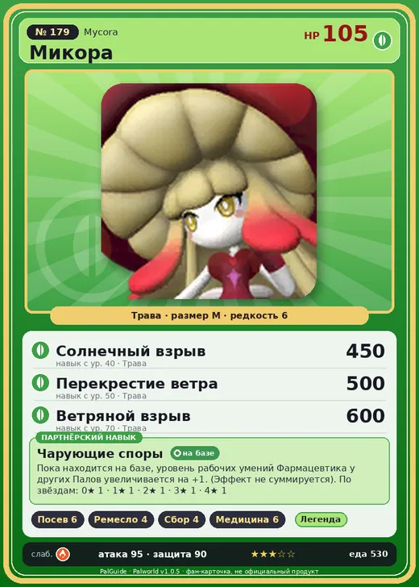

# #179 Микора (Mycora)

№ 179

Трава

Слабость: Огонь

🌱 Посев семян <b>6</b>🖐️ Ручная работа <b>4</b>🌾 Сбор <b>4</b>💊 Фармацевтика <b>6</b>

<b>Чарующие споры</b> 🏠 на базе

❤️ 105 · ⚔️ 95 · 🛡 90

| Поле | Значение |
|---|---|
| Стихия | Трава |
| Слабость (кто бьёт сильнее) | Огонь |
| Редкость | 6 |
| Размер | M |
| HP / Атака / Защита (база вида) | 105 / 95 / 90 |
| Сколько ест | 530 |
| Цена продажи | 3087 |
| Множитель поимки | ×1 |
| Скорость рывка верхом | 600 |

=== "Обзор"

    #### Работа на базе
    - Посев семян — ур. 6
    - Ручная работа — ур. 4
    - Сбор — ур. 4
    - Фармацевтика — ур. 6

    #### Партнёрский навык: Чарующие споры
    Пока находится на базе, уровень рабочих умений Фармацевтика у других Палов увеличивается на +1. (Эффект не суммируется). По звёздам: 0★ 1 · 1★ 1 · 2★ 1 · 3★ 1 · 4★ 1

    #### Чем хорош / чем плох
    - ✅ отличный рабочий (пригодность 6)
    - ❌ много ест (530)

    > Смотрит на людей только как на удобную цель для паразитирования. Микора принял этот облик, чтобы люди были расслаблены и споры распространялись максимально эффективно.

    См. также: [Стихии](../../guide/06_stihii.md) · [Разведение](../../guide/07_razvedenie.md) · [Все палы](README.md)

=== "Атаки"

    #### Атаки по уровням
    - ур. 1: Ветряной клинок (Трава, сила 40)
    - ур. 7: Ядовитый выстрел (Тьма, сила 30)
    - ур. 15: Травяной торнадо (Трава, сила 200)
    - ур. 22: Веер клинков (Трава, сила 200)
    - ур. 30: Ядовитый душ (Тьма, сила 160)
    - ур. 40: Солнечный взрыв (Трава, сила 450)
    - ур. 50: Перекрестие ветра (Трава, сила 500)
    - ур. 70: Ветряной взрыв (Трава, сила 600)

=== "Где живёт"

    #### Где водится
    - В дикой природе: нет/особый способ; точек появления днём: 0, ночью: 0
    - Яйцо: Большое яйцо свежей листвы

=== "Дроп"

    #### Дроп
    - Гриб — 2–3 шт., 100%
    - Загадочный гриб — 2–3 шт., 50%

    **Дроп альфы:**
    - Деталь древней цивилизации — 7–9 шт., 100%
    - Ценные внутренности — 2–3 шт., 100%

=== "Разведение"

    #### Разведение
    - Ранг разведения (CombiRank): 760

=== "Пассивки"

    #### Лучшие пассивки по роли

    

⚔️ Боец

максимум урона и живучести в бою

<a class="psv r-4" data-psv="Легенда" href="../../../passivki/legend/">Легенда</a><a class="psv r-4" data-psv="Демон-бог" href="../../../passivki/demon_god/">Демон-бог</a><a class="psv r-3" data-psv="Король духов" href="../../../passivki/spirit_emperor/">Король духов</a><a class="psv r-3" data-psv="Хладнокровный" href="../../../passivki/serenity/">Хладнокровный</a>

🛠 Рабочий

работает быстрее и меньше устаёт на базе

<a class="psv r-5" data-psv="Дьявольские руки" href="../../../passivki/demons_hand/">Дьявольские руки</a><a class="psv r-4" data-psv="Виртуоз" href="../../../passivki/remarkable_craftsmanship/">Виртуоз</a><a class="psv r-3" data-psv="Мастеровитый" href="../../../passivki/artisan/">Мастеровитый</a><a class="psv r-3" data-psv="Трудоголик" href="../../../passivki/workaholic/">Трудоголик</a>

    <small>Нажми на пассивку, чтобы узнать, что она даёт и где её взять.</small>

<a class="card-link" href="../venusa/">← Медуна</a><a class="card-link" href="../loomen/">Люмен →</a>

