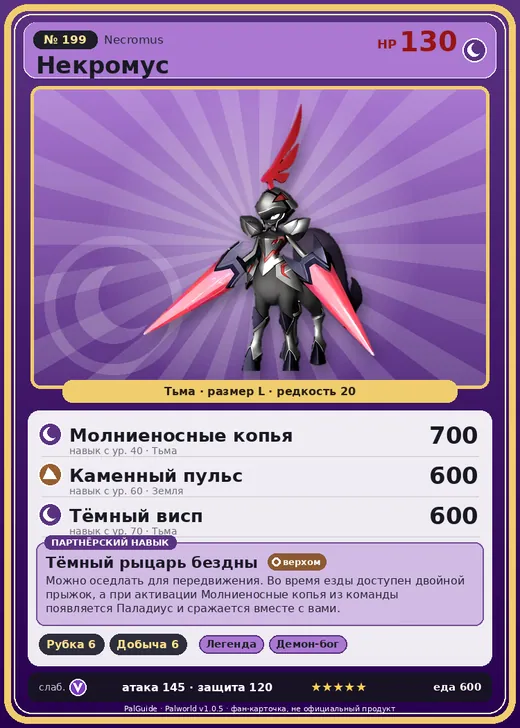

# Некромус

<canvas id="fx"></canvas>

№ 199

Тьма

Слабость: Дракон <b class="mx">×1,5</b> <button class="hlp" data-tip="Множители перемножаются по обеим стихиям: ×1,5 за стихию, которую атака бьёт, ×0,65 за ту, что её держит.">?</button>

Устойчив: Нейтральный <b class="mx">×0,65</b>

🪓 Рубка деревьев <b>6</b>⛏️ Добыча <b>6</b>

<b>Тёмный рыцарь бездны</b> 🐎 Верхом

❤️ 130 · ⚔️ 145 · 🛡 120

Основное

💎Редкость <button class="hlp" data-tip="Чем выше число, тем реже встречается пал. 1–4 — обычные, 5–7 — редкие, 8+ — легендарные.">?</button><b>20</b>

📏Размер<b>L</b>

💰Цена продажи <button class="hlp" data-tip="Сколько золота даст торговец за пала.">?</button><b>4339</b>

Бой

🎯Множитель поимки <button class="hlp" data-tip="Насколько легче или труднее поймать: ×1 — обычно, меньше — сложнее.">?</button><b>×1</b>

🐎Скорость рывка верхом <button class="hlp" data-tip="Скорость, если сесть на пала и бежать рывком.">?</button><b>1900</b>

Ферма и еда

🍖Сколько ест <button class="hlp" data-tip="Сколько сытости пал тратит — чем больше, тем больше еды нужно на базе.">?</button><b>600</b>

Разведение

🧬Сила разведения <button class="hlp" data-tip="Скрытое число игры: у детёныша оно примерно среднее от родителей. Чем меньше — тем «сильнее» пал.">?</button><b>190</b>

💞Особая пара <button class="hlp" data-tip="Этого пала можно вывести только от этой пары.">?</button><b>Некромус + Некромус</b>

=== "Обзор"

    #### Работа на базе

    
<a class="wbar" href="../../../2_mehaniki/rabota/?w=lumbering&lv=6">🪓 Рубка деревьев<i style="--v:60%"></i><b>6</b></a><a class="wbar" href="../../../2_mehaniki/rabota/?w=mining&lv=6">⛏️ Добыча<i style="--v:60%"></i><b>6</b></a><a class="wb-more" href="../../../2_mehaniki/rabota/">Что значат уровни работы →</a>

    #### Партнёрский навык: Тёмный рыцарь бездны
    Можно оседлать для передвижения. Во время езды доступен двойной прыжок, а при активации Молниеносные копья из команды появляется Паладиус и сражается вместе с вами. Технологии 61.

    #### Чем хорош / чем плох
    - ✅ Тёмный легендарный, быстрый маунт; очень высокая атака (145); много здоровья (130); крепкая защита (120); отличный рабочий (пригодность 6); можно оседлать
    - ❌ Слаб к драконам; много ест (600); разводится только особой парой

    > Некогда этот Пал и Паладиус были единым существом. Считается, что он — воплощение отделившихся негативных эмоций, однако в глубине его глаз теплятся едва заметные угольки сострадания.

    См. также: [Стихии](../../guide/06_stihii.md) · [Разведение](../../guide/07_razvedenie.md) · [Все палы](README.md)

=== "Атаки"

    #### Атаки по уровням
    - ур. 1: Теневой взрыв (Тьма, сила 80)
    - ур. 7: Расщеплённый огонь (Огонь, сила 80)
    - ур. 15: Духовное пламя (Тьма, сила 200)
    - ур. 22: Кошмарная сфера (Тьма, сила 300)
    - ур. 30: Каменные копья (Земля, сила 400)
    - ур. 40: Молниеносные копья (Тьма, сила 700)
    - ур. 50: Тёмный лазер (Тьма, сила 450)
    - ур. 55: Апокалипсис (Тьма, сила 400)
    - ур. 60: Каменный пульс (Земля, сила 600)
    - ур. 70: Тёмный висп (Тьма, сила 600)

=== "Где живёт"

    #### Где водится

    

<button data-k="d" class="on">☀️ День</button><button data-k="n">🌙 Ночь</button>

<a class="btn hm-full" href="../../../map/?pal=BlackCentaur">Показать на большой карте</a>

🥚 Яйцо<b>Огромное яйцо тьмы</b>

=== "Дроп"

    #### Дроп
    - Гексолит — 10 шт., 100%
    - Алмаз — 1 шт., 100%
    - Большая душа Пала — 1 шт., 100%

    **Дроп альфы:**
    - Деталь древней цивилизации — 6–8 шт., 100%
    - Ценные внутренности — 6–8 шт., 100%

=== "Разведение"

    #### Разведение
    - Ранг разведения: 190
    - **Особая пара:** [Некромус](../../4_spravochniki/paly/necromus.md) + [Некромус](../../4_spravochniki/paly/necromus.md)
    - Участвует в особых парах: Некромус → Некромус; Некромус → Некромус

=== "Пассивки"

    #### Лучшие пассивки по роли

    

⚔️ Боец

максимум урона и живучести в бою

<a class="psv r-4" data-psv="Легенда" href="../../../passivki/legend/">Легенда</a><a class="psv r-4" data-psv="Демон-бог" href="../../../passivki/demon_god/">Демон-бог</a><a class="psv r-3" data-psv="Король тьмы" href="../../../passivki/lord_of_the_underworld/">Король тьмы</a><a class="psv r-3" data-psv="Хладнокровный" href="../../../passivki/serenity/">Хладнокровный</a>

🛠 Рабочий

работает быстрее и меньше устаёт на базе

<a class="psv r-5" data-psv="Дьявольские руки" href="../../../passivki/demons_hand/">Дьявольские руки</a><a class="psv r-4" data-psv="Виртуоз" href="../../../passivki/remarkable_craftsmanship/">Виртуоз</a><a class="psv r-3" data-psv="Мастеровитый" href="../../../passivki/artisan/">Мастеровитый</a><a class="psv r-3" data-psv="Трудоголик" href="../../../passivki/workaholic/">Трудоголик</a>

🐎 Ездовой

быстрее бегает или летает с тобой верхом

<a class="psv r-4" data-psv="Божественная скорость" href="../../../passivki/swift/">Божественная скорость</a><a class="psv r-4" data-psv="Легенда" href="../../../passivki/legend/">Легенда</a><a class="psv r-4" data-psv="Вечный двигатель" href="../../../passivki/eternal_engine/">Вечный двигатель</a><a class="psv r-4" data-psv="Небесное скольжение" href="../../../passivki/sky_strider/">Небесное скольжение</a>

    <small>Нажми на пассивку, чтобы узнать, что она даёт и где её взять.</small>

<a class="card-link" href="../paladius/">← Паладиус</a><a class="card-link" href="../frostallion/">Фросталлион →</a>

