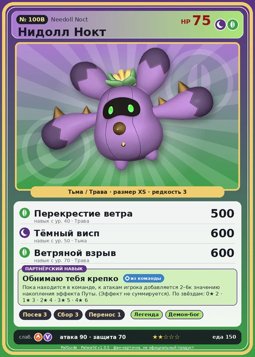

# Нидолл Нокт

<canvas id="fx"></canvas>

№ 100B · Needoll Noct

ТьмаТрава

Слабость: ДраконОгонь

🌱 Посев семян <b>3</b>🌾 Сбор <b>3</b>📦 Транспортировка <b>1</b>

<b>Обнимаю тебя крепко</b> 🎒 из команды

❤️ 75 · ⚔️ 90 · 🛡 70

| Поле | Значение |
|---|---|
| Стихия | Тьма, Трава |
| Слабость (кто бьёт сильнее) | Дракон, Огонь |
| Редкость | 3 |
| Размер | XS |
| HP / Атака / Защита (база вида) | 75 / 90 / 70 |
| Сколько ест | 150 |
| Цена продажи | 749 |
| Множитель поимки | ×1 |
| Скорость рывка верхом | 630 |

=== "Обзор"

    #### Работа на базе
    - Посев семян — ур. 3
    - Сбор — ур. 3
    - Транспортировка — ур. 1

    #### Партнёрский навык: Обнимаю тебя крепко
    Пока находится в команде, к атакам игрока добавляется 2–6к значению накопления эффекта Путы. (Эффект не суммируется). По звёздам: 0★ 2 · 1★ 3 · 2★ 4 · 3★ 5 · 4★ 6

    #### Чем хорош / чем плох
    - ✅
    - ❌ разводится только особой парой

    > При усилении эмоций шипы выдвигаются и втягиваются. Выращенный с любовью Нидолл Нокт склонен прижиматься к хозяину, однако принятие этой любви неизбежно сопряжено с болью.

    См. также: [Стихии](../../guide/06_stihii.md) · [Разведение](../../guide/07_razvedenie.md) · [Все палы](README.md)

=== "Атаки"

    #### Атаки по уровням
    - ур. 1: Ядовитый выстрел (Тьма, сила 30)
    - ур. 7: Семенная мина (Трава, сила 120)
    - ур. 15: Ядовитый душ (Тьма, сила 160)
    - ур. 22: Кольцевая лоза (Трава, сила 300)
    - ур. 30: Тёмный лазер (Тьма, сила 450)
    - ур. 40: Перекрестие ветра (Трава, сила 500)
    - ур. 50: Тёмный висп (Тьма, сила 600)
    - ур. 70: Ветряной взрыв (Трава, сила 600)

=== "Где живёт"

    #### Где водится
    - В дикой природе: нет/особый способ; точек появления днём: 0, ночью: 325
    - Яйцо: Яйцо тьмы

=== "Дроп"

    #### Дроп
    - Волокно — 1–2 шт., 100%
    - Ядовитая железа — 1 шт., 100%

    **Дроп альфы:**
    - Деталь древней цивилизации — 1–2 шт., 100%
    - Ценные внутренности — 2–3 шт., 100%

=== "Разведение"

    #### Разведение
    - Ранг разведения (CombiRank): 1580
    - **Особая пара:** [Нидолл](../../4_spravochniki/paly/needoll.md) + [Прунелия](../../4_spravochniki/paly/prunelia.md)

=== "Пассивки"

    #### Лучшие пассивки по роли

    

⚔️ Боец

максимум урона и живучести в бою

<a class="psv r-4" data-psv="Легенда" href="../../../passivki/legend/">Легенда</a><a class="psv r-4" data-psv="Демон-бог" href="../../../passivki/demon_god/">Демон-бог</a><a class="psv r-3" data-psv="Король тьмы" href="../../../passivki/lord_of_the_underworld/">Король тьмы</a><a class="psv r-3" data-psv="Хладнокровный" href="../../../passivki/serenity/">Хладнокровный</a>

🛠 Рабочий

работает быстрее и меньше устаёт на базе

<a class="psv r-5" data-psv="Дьявольские руки" href="../../../passivki/demons_hand/">Дьявольские руки</a><a class="psv r-4" data-psv="Виртуоз" href="../../../passivki/remarkable_craftsmanship/">Виртуоз</a><a class="psv r-3" data-psv="Мастеровитый" href="../../../passivki/artisan/">Мастеровитый</a><a class="psv r-3" data-psv="Трудоголик" href="../../../passivki/workaholic/">Трудоголик</a>

    <small>Нажми на пассивку, чтобы узнать, что она даёт и где её взять.</small>

<a class="card-link" href="../needoll/">← Нидолл</a><a class="card-link" href="../reindrix/">Рейндрикс →</a>

