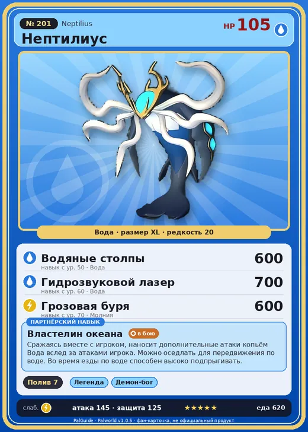

# #201 Нептилиус (Neptilius)

№ 201

Вода

Слабость: Молния

💧 Полив <b>7</b>

<b>Властелин океана</b> 🐾 выпущен 🐎 верхом

❤️ 105 · ⚔️ 145 · 🛡 125

| Поле | Значение |
|---|---|
| Стихия | Вода |
| Слабость (кто бьёт сильнее) | Молния |
| Редкость | 20 |
| Размер | XL |
| HP / Атака / Защита (база вида) | 105 / 145 / 125 |
| Сколько ест | 620 |
| Цена продажи | 4277 |
| Множитель поимки | ×1 |
| Скорость рывка верхом | 1120 |

## Работа на базе
- Полив — ур. 7

## Партнёрский навык: Властелин океана
Сражаясь вместе с игроком, наносит дополнительные атаки копьём Вода вслед за атаками игрока. Можно оседлать для передвижения по воде. Во время езды по воде способен высоко подпрыгивать. Технологии 64 level value 2 SwimSpeed_up_PartnerSkill_1 10 OverWriteCoolTime 3 Пробуждение : (Скорость передвижения по воде: +10% , сокращение перезарядки: Небольшое ) 3 SwimSpeed_up_PartnerSkill_2 14 OverWriteCoolTime 2.4 Пробуждение : (Скорость передвижения по воде: +14% , сокращение перезарядки: Среднее ) 4 SwimSpeed_up_PartnerSkill_3 18 OverWriteCoolTime 1.8 Пробуждение : (Скорость передвижения по воде: +18% , сокращение перезарядки: Большое ) 5 SwimSpeed_up_PartnerSkill_4 25 OverWriteCoolTime 1 Пробуждение : (Скорость передвижения по воде: +25% , сокращение перезарядки: Очень большое ) 1 OverWriteCoolTime 3.6 Пробуждение :

## Атаки по уровням
- ур. 1: Водяной выстрел (Вода, сила 50)
- ур. 7: Пузырьковый выстрел (Вода, сила 80)
- ур. 15: Полоса брызг (Вода, сила 160)
- ур. 22: Гидроатака под давлением (Вода, сила 250)
- ур. 30: Водяная стена (Вода, сила 300)
- ур. 40: Цунами (Вода, сила 500)
- ур. 50: Водяные столпы (Вода, сила 600)
- ур. 60: Гидрозвуковой лазер (Вода, сила 700)
- ур. 70: Грозовая буря (Молния, сила 600)

## Где водится
- В дикой природе: да; точек появления днём: 1, ночью: 1
- Яйцо: Огромное яйцо воды

## Дроп
- Кораллиновая руда — 10 шт., 100%
- Гексолит — 10 шт., 100%
- Алмаз — 1 шт., 30%
- Большая душа Пала — 1 шт., 1%

**Дроп альфы:**
- Деталь древней цивилизации — 6–8 шт., 100%
- Ценный драконий самоцвет — 2–3 шт., 100%

## Разведение
- Ранг разведения (CombiRank): 160
- **Особая пара:** [Нептилиус](../../4_spravochniki/paly/neptilius.md) + [Нептилиус](../../4_spravochniki/paly/neptilius.md)
- Участвует в особых парах: Нептилиус → Нептилиус; Нептилиус → Нептилиус

## Лучшие пассивки по роли
- боец: Легенда, Демон-бог, Хладнокровный, Бессмертие, Владыка морей (вместо Бессмертия, если нет мутации)
- рабочий: Дьявольские руки, Виртуоз, Мастеровитый, Небожитель/Трудоголик
- ездовой: Божественная скорость, Легенда, Вечный двигатель, Небесное скольжение

## Чем хорош / чем плох
- ✅ очень высокая атака (145); крепкая защита (125); отличный рабочий (пригодность 7); можно оседлать
- ❌ много ест (620); разводится только особой парой

> После того как катастрофа была запечатана, ему повстречался воин, павший с небес. С тех пор он возникает в прибрежных водах — лишь перед теми, кто достоин. Такая встреча — не случайна, она предначертана.

См. также: [Стихии](../../guide/06_stihii.md) · [Разведение](../../guide/07_razvedenie.md) · [Все палы](README.md)
