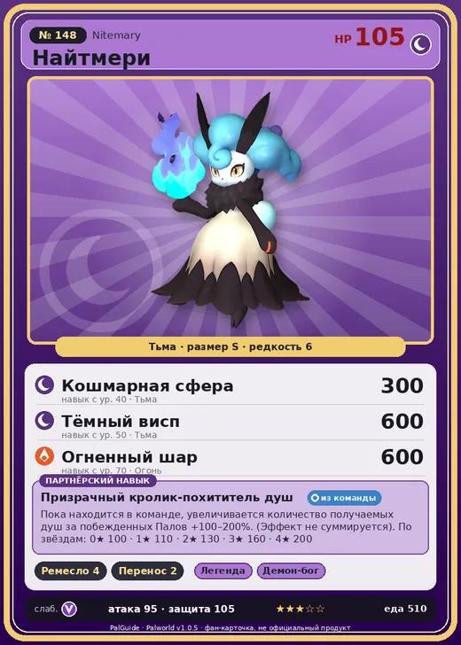

# #148 Найтмери (Nitemary)

#148 · Nitemary

Тьма

Слабость: Дракон

🖐️ Ручная работа <b>4</b>📦 Транспортировка <b>2</b>

<b>Призрачный кролик-похититель душ</b> 🎒 из команды

❤️ 105 · ⚔️ 95 · 🛡 105

| Поле | Значение |
|---|---|
| Стихия | Тьма |
| Слабость (кто бьёт сильнее) | Дракон |
| Редкость | 6 |
| Размер | S |
| HP / Атака / Защита (база вида) | 105 / 95 / 105 |
| Сколько ест | 510 |
| Цена продажи | 2594 |
| Множитель поимки | ×1 |
| Скорость рывка верхом | 500 |

## Работа на базе
- Ручная работа — ур. 4
- Транспортировка — ур. 2

## Партнёрский навык: Призрачный кролик-похититель душ
Пока находится в команде, увеличивается количество получаемых душ за побежденных Палов +(100~200)% . (Эффект не суммируется) level value 1 AddItemDrop_PartnerSkill_GhostRabbit_Soul 100 2 AddItemDrop_PartnerSkill_GhostRabbit_Soul 110 3 AddItemDrop_PartnerSkill_GhostRabbit_Soul 130 4 AddItemDrop_PartnerSkill_GhostRabbit_Soul 160 5 AddItemDrop_PartnerSkill_GhostRabbit_Soul 200

## Атаки по уровням
- ур. 1: Тёмный шар (Тьма, сила 50)
- ур. 7: Распространение тьмы (Тьма, сила 60)
- ур. 15: Тёмная пушка (Тьма, сила 70)
- ур. 22: Стрелы тьмы (Тьма, сила 120)
- ур. 30: Духовное пламя (Тьма, сила 200)
- ур. 40: Кошмарная сфера (Тьма, сила 300)
- ур. 50: Тёмный висп (Тьма, сила 600)
- ур. 70: Огненный шар (Огонь, сила 600)

## Где водится
- В дикой природе: да; точек появления днём: 138, ночью: 138; уровни в первых точках: 65–66
- Подземелья: Пещера Тэнраку
- Яйцо: Большое яйцо тьмы

## Дроп
- Маленькая душа Пала — 1 шт., 100%

**Дроп альфы:**
- Деталь древней цивилизации — 6–7 шт., 100%
- Ценный мех — 2–3 шт., 100%

## Разведение
- Ранг разведения (CombiRank): 1230
- Участвует в особых парах: Петаллия → Найтмери Ботан

## Лучшие пассивки по роли
- боец: Легенда, Демон-бог, Хладнокровный, Бессмертие, Король тьмы (вместо Бессмертия, если нет мутации)
- рабочий: Дьявольские руки, Виртуоз, Мастеровитый, Небожитель/Трудоголик
- ездовой: Божественная скорость, Легенда, Вечный двигатель, Небесное скольжение

## Чем хорош / чем плох
- ✅ можно оседлать
- ❌ много ест (510)

> Держит в руках свою душу. Влюбившись, насильно вырывает чужую душу, смешивает со своей и стремится стать единым целым.

См. также: [Стихии](../../2_mehaniki/stihii.md) · [Разведение](../../2_mehaniki/razvedenie.md) · [Все палы](README.md)
_Источник: paldb.cc v1.0.5_
