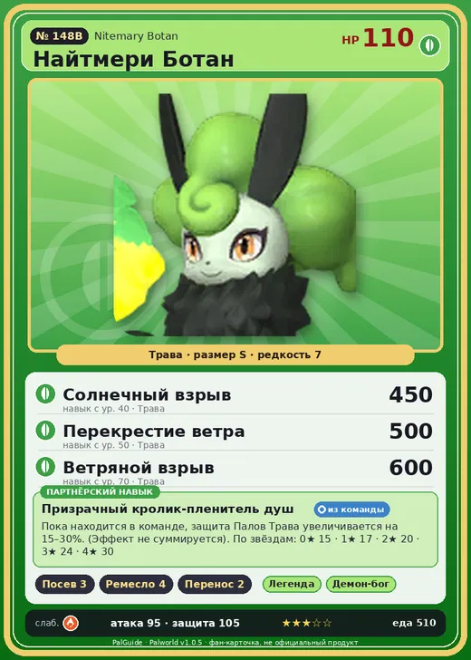

# #148B Найтмери Ботан (Nitemary Botan)

#148B · Nitemary Botan

Трава

Слабость: Огонь

🌱 Посев семян <b>3</b>🖐️ Ручная работа <b>4</b>📦 Транспортировка <b>2</b>

<b>Призрачный кролик-пленитель душ</b> 🎒 из команды

❤️ 110 · ⚔️ 95 · 🛡 105

| Поле | Значение |
|---|---|
| Стихия | Трава |
| Слабость (кто бьёт сильнее) | Огонь |
| Редкость | 7 |
| Размер | S |
| HP / Атака / Защита (база вида) | 110 / 95 / 105 |
| Сколько ест | 510 |
| Цена продажи | 2134 |
| Множитель поимки | ×1 |
| Скорость рывка верхом | 500 |

## Работа на базе
- Посев семян — ур. 3
- Ручная работа — ур. 4
- Транспортировка — ур. 2

## Партнёрский навык: Призрачный кролик-пленитель душ
Пока находится в команде, защита Палов Трава увеличивается на (15~30)% . (Эффект не суммируется) level value 1 DefenseUp_Leaf_PartnerSkill 15 2 DefenseUp_Leaf_PartnerSkill 17 3 DefenseUp_Leaf_PartnerSkill 20 4 DefenseUp_Leaf_PartnerSkill 24 5 DefenseUp_Leaf_PartnerSkill 30

## Атаки по уровням
- ур. 1: Ветряной клинок (Трава, сила 40)
- ур. 7: Семенная мина (Трава, сила 120)
- ур. 15: Травяной торнадо (Трава, сила 200)
- ур. 22: Кольцевая лоза (Трава, сила 300)
- ур. 30: Отражающий лист (Трава, сила 400)
- ур. 40: Солнечный взрыв (Трава, сила 450)
- ур. 50: Перекрестие ветра (Трава, сила 500)
- ур. 70: Ветряной взрыв (Трава, сила 600)

## Где водится
- В дикой природе: да; точек появления днём: 13, ночью: 13
- Яйцо: Большое яйцо свежей листвы

## Дроп
- Средняя душа Пала — 1 шт., 100%

**Дроп альфы:**
- Деталь древней цивилизации — 6–7 шт., 100%
- Ценный мех — 2–3 шт., 100%

## Разведение
- Ранг разведения (CombiRank): 1320
- **Особая пара:** [Найтмери](../../4_spravochniki/paly/nitemary.md) + [Петаллия](../../4_spravochniki/paly/petallia.md)

## Лучшие пассивки по роли
- боец: Легенда, Демон-бог, Хладнокровный, Бессмертие, Король духов (вместо Бессмертия, если нет мутации)
- рабочий: Дьявольские руки, Виртуоз, Мастеровитый, Небожитель/Трудоголик
- ездовой: Божественная скорость, Легенда, Вечный двигатель, Небесное скольжение

## Чем хорош / чем плох
- ✅ можно оседлать
- ❌ много ест (510); разводится только особой парой

> Держит в руках свою душу. Влюбившись, швыряет её в чужую, смешивает со своей и стремится стать единым целым.

См. также: [Стихии](../../2_mehaniki/stihii.md) · [Разведение](../../2_mehaniki/razvedenie.md) · [Все палы](README.md)
_Источник: paldb.cc v1.0.5_
