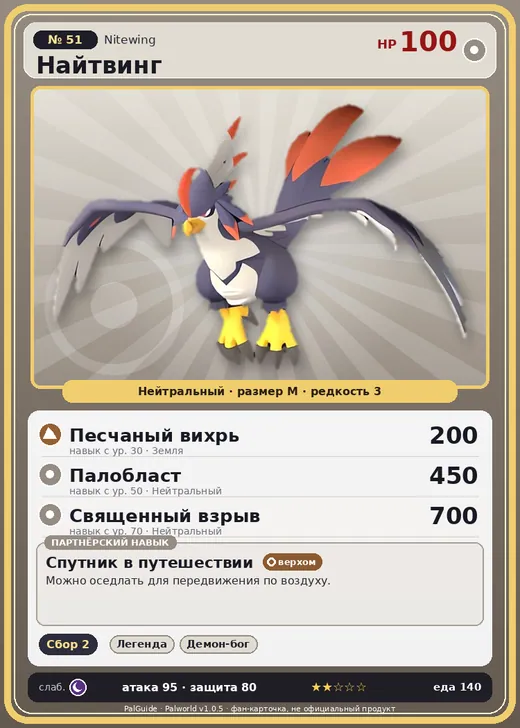

# #51 Найтвинг (Nitewing)

#51 · Nitewing

Нейтральный

Слабость: Тьма

🌾 Сбор <b>2</b>

<b>Спутник в путешествии</b> 🐎 верхом

❤️ 100 · ⚔️ 95 · 🛡 80

| Поле | Значение |
|---|---|
| Стихия | Нейтральный |
| Слабость (кто бьёт сильнее) | Тьма |
| Редкость | 3 |
| Размер | M |
| HP / Атака / Защита (база вида) | 100 / 95 / 80 |
| Сколько ест | 140 |
| Цена продажи | 1012 |
| Множитель поимки | ×1 |
| Скорость рывка верхом | 750 |

## Работа на базе
- Сбор — ур. 2

## Партнёрский навык: Спутник в путешествии
Можно оседлать для передвижения по воздуху. Технологии 15 level value 2 MoveSpeed_up_PartnerSkill_Ride_1 10 Пробуждение : (Скорость передвижения верхом: +10% ) 3 MoveSpeed_up_PartnerSkill_Ride_2 12 Пробуждение : (Скорость передвижения верхом: +12% ) 4 MoveSpeed_up_PartnerSkill_Ride_3 15 Пробуждение : (Скорость передвижения верхом: +15% ) 5 MoveSpeed_up_PartnerSkill_Ride_4 20 Пробуждение : (Скорость передвижения верхом: +20% ) 1 Пробуждение :

## Атаки по уровням
- ур. 1: Воздушная пушка (Нейтральный, сила 40)
- ур. 7: Атака торнадо (Нейтральный, сила 80)
- ур. 15: Ветряной клинок (Трава, сила 40)
- ур. 22: Силовая бомба (Нейтральный, сила 120)
- ур. 30: Песчаный вихрь (Земля, сила 200)
- ур. 40: Травяной торнадо (Трава, сила 200)
- ур. 50: Палобласт (Нейтральный, сила 450)
- ур. 70: Священный взрыв (Нейтральный, сила 700)

## Где водится
- В дикой природе: да; точек появления днём: 231, ночью: 231; уровни в первых точках: 12–13
- Подземелья: Пещера Песчаных Дюн
- Может продаваться у торговца/рекрутера
- Яйцо: Обычное яйцо

## Дроп
- Кожа — 1–3 шт., 100%

**Дроп альфы:**
- Деталь древней цивилизации — 3–4 шт., 100%
- Ценное перо — 3–4 шт., 100%

## Разведение
- Ранг разведения (CombiRank): 2560

## Лучшие пассивки по роли
- боец: Легенда, Демон-бог, Хладнокровный, Бессмертие, Святое небо (вместо Бессмертия, если нет мутации)
- ездовой: Божественная скорость, Легенда, Вечный двигатель, Небесное скольжение

## Чем хорош / чем плох
- ✅ можно оседлать; летает (ездовой)
- ❌ явных минусов нет

> Уносит в своё гнездо новорождённых Палов и выращивает их, заменяя родителей. Когда они готовы к употреблению, убивает их и съедает.

См. также: [Стихии](../../2_mehaniki/stihii.md) · [Разведение](../../2_mehaniki/razvedenie.md) · [Все палы](README.md)
_Источник: paldb.cc v1.0.5_
