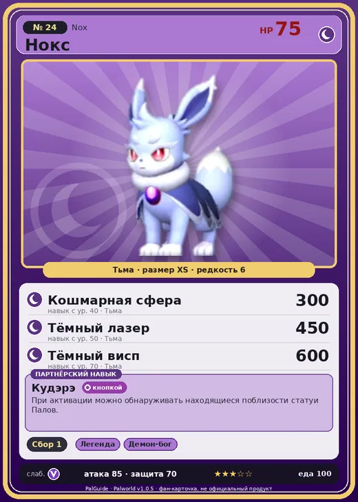

# #24 Нокс (Nox)

#24 · Nox

Тьма

Слабость: Дракон

🌾 Сбор <b>1</b>

<b>Кудэрэ</b> 🔘 кнопкой

❤️ 75 · ⚔️ 85 · 🛡 70

| Поле | Значение |
|---|---|
| Стихия | Тьма |
| Слабость (кто бьёт сильнее) | Дракон |
| Редкость | 6 |
| Размер | XS |
| HP / Атака / Защита (база вида) | 75 / 85 / 70 |
| Сколько ест | 100 |
| Цена продажи | 502 |
| Множитель поимки | ×1 |
| Скорость рывка верхом | 500 |

## Работа на базе
- Сбор — ур. 1

## Партнёрский навык: Кудэрэ
При активации можно обнаруживать находящиеся поблизости статуи Палов . Lv. Range Extend Range per Sec 1 15000 3000 2 16000 3500 3 18000 4000 4 21000 4500 5 25000 5000 level value 1 OverWriteCoolTime 60 Пробуждение : 2 OverWriteCoolTime 50 Пробуждение : (Увеличение радиуса обнаружения и сокращение перезарядки: Небольшое ) 3 OverWriteCoolTime 45 Пробуждение : (Увеличение радиуса обнаружения и сокращение перезарядки: Среднее ) 4 OverWriteCoolTime 40 Пробуждение : (Увеличение радиуса обнаружения и сокращение перезарядки: Большое ) 5 OverWriteCoolTime 30 Пробуждение : (Увеличение радиуса обнаружения и сокращение перезарядки: Очень большое )

## Атаки по уровням
- ур. 1: Воздушная пушка (Нейтральный, сила 40)
- ур. 7: Тёмный шар (Тьма, сила 50)
- ур. 15: Теневой взрыв (Тьма, сила 80)
- ур. 22: Силовая бомба (Нейтральный, сила 120)
- ур. 30: Духовное пламя (Тьма, сила 200)
- ур. 40: Кошмарная сфера (Тьма, сила 300)
- ур. 50: Тёмный лазер (Тьма, сила 450)
- ур. 70: Тёмный висп (Тьма, сила 600)

## Где водится
- В дикой природе: да; точек появления днём: 1, ночью: 154; уровни в первых точках: 4–7
- Подземелья: Пещера Ущелья
- Яйцо: Большое яйцо тьмы

## Дроп
- Кожа — 1 шт., 100%
- Маленькая душа Пала — 1 шт., 40%

**Дроп альфы:**
- Деталь древней цивилизации — 2–3 шт., 100%
- Ценный мех — 2–3 шт., 100%

## Разведение
- Ранг разведения (CombiRank): 2920

## Лучшие пассивки по роли
- боец: Легенда, Демон-бог, Хладнокровный, Бессмертие, Король тьмы (вместо Бессмертия, если нет мутации)
- ездовой: Божественная скорость, Легенда, Вечный двигатель, Небесное скольжение

## Чем хорош / чем плох
- ✅ Показывает статуэтки рядом; можно оседлать
- ❌ Слабый боец

> Если на ночной дороге вы нашли волосок Нокс , лучше его не трогать. Это билет в один конец в мир вечной ночи.

См. также: [Стихии](../../guide/06_stihii.md) · [Разведение](../../guide/07_razvedenie.md) · [Все палы](README.md)
