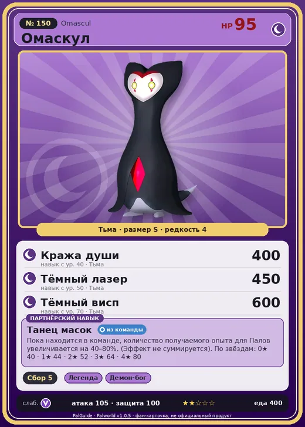

# #150 Омаскул (Omascul)

№ 150

Тьма

Слабость: Дракон

🌾 Сбор <b>5</b>

<b>Танец масок</b> 🎒 из команды

❤️ 95 · ⚔️ 105 · 🛡 100

| Поле | Значение |
|---|---|
| Стихия | Тьма |
| Слабость (кто бьёт сильнее) | Дракон |
| Редкость | 4 |
| Размер | S |
| HP / Атака / Защита (база вида) | 95 / 105 / 100 |
| Сколько ест | 400 |
| Цена продажи | 2431 |
| Множитель поимки | ×1 |
| Скорость рывка верхом | 520 |

=== "Обзор"

    #### Работа на базе
    - Сбор — ур. 5

    #### Партнёрский навык: Танец масок
    Пока находится в команде, количество получаемого опыта для Палов увеличивается на 40–80%. (Эффект не суммируется). По звёздам: 0★ 40 · 1★ 44 · 2★ 52 · 3★ 64 · 4★ 80

    #### Чем хорош / чем плох
    - ✅ хорошая атака (105); отличный рабочий (пригодность 5)
    - ❌ явных минусов нет

    > Говорят, что то, что выглядит как маска, — вовсе не лицо. Кажется, он перед вами, но на самом деле — нет. Говорят, он всегда наблюдает… откуда-то. Говорят, стоит обернуться — и он будет там.

    См. также: [Стихии](../../guide/06_stihii.md) · [Разведение](../../guide/07_razvedenie.md) · [Все палы](README.md)

=== "Атаки"

    #### Атаки по уровням
    - ур. 1: Тёмный шар (Тьма, сила 50)
    - ур. 7: Распространение тьмы (Тьма, сила 60)
    - ур. 15: Тёмная пушка (Тьма, сила 70)
    - ур. 22: Теневой взрыв (Тьма, сила 80)
    - ур. 30: Кошмарная сфера (Тьма, сила 300)
    - ур. 40: Кража души (Тьма, сила 400)
    - ур. 50: Тёмный лазер (Тьма, сила 450)
    - ур. 70: Тёмный висп (Тьма, сила 600)

=== "Где живёт"

    #### Где водится
    - В дикой природе: да; точек появления днём: 1683, ночью: 1683; уровни в первых точках: 50–52
    - Подземелья: Пещера Тэнраку
    - Яйцо: Яйцо тьмы

=== "Дроп"

    #### Дроп
    - Осколок тьмы — 1–2 шт., 100%

    **Дроп альфы:**
    - Деталь древней цивилизации — 6–8 шт., 100%
    - Ценные внутренности — 2–3 шт., 100%

=== "Разведение"

    #### Разведение
    - Ранг разведения (CombiRank): 1140
    - Участвует в особых парах: Даззи → Даззи Нокт

=== "Пассивки"

    #### Лучшие пассивки по роли

    

⚔️ Боец

максимум урона и живучести в бою

<a class="psv r-4" data-psv="Легенда" href="../../../passivki/legend/">Легенда</a><a class="psv r-4" data-psv="Демон-бог" href="../../../passivki/demon_god/">Демон-бог</a><a class="psv r-3" data-psv="Король тьмы" href="../../../passivki/lord_of_the_underworld/">Король тьмы</a><a class="psv r-3" data-psv="Хладнокровный" href="../../../passivki/serenity/">Хладнокровный</a>

🛠 Рабочий

работает быстрее и меньше устаёт на базе

<a class="psv r-5" data-psv="Дьявольские руки" href="../../../passivki/demons_hand/">Дьявольские руки</a><a class="psv r-4" data-psv="Виртуоз" href="../../../passivki/remarkable_craftsmanship/">Виртуоз</a><a class="psv r-3" data-psv="Мастеровитый" href="../../../passivki/artisan/">Мастеровитый</a><a class="psv r-3" data-psv="Трудоголик" href="../../../passivki/workaholic/">Трудоголик</a>

    <small>Нажми на пассивку, чтобы узнать, что она даёт и где её взять.</small>

<a class="card-link" href="../smokie_cryst/">← Смоки Крист</a><a class="card-link" href="../whalaska/">Валаска →</a>

