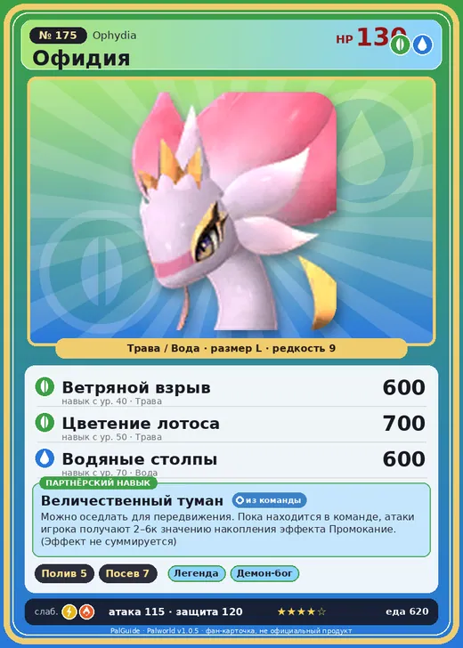

# #175 Офидия (Ophydia)

№ 175

ТраваВода

Слабость: МолнияОгонь

💧 Полив <b>5</b>🌱 Посев семян <b>7</b>

<b>Величественный туман</b> 🎒 из команды 🐎 верхом

❤️ 130 · ⚔️ 115 · 🛡 120

| Поле | Значение |
|---|---|
| Стихия | Трава, Вода |
| Слабость (кто бьёт сильнее) | Молния, Огонь |
| Редкость | 9 |
| Размер | L |
| HP / Атака / Защита (база вида) | 130 / 115 / 120 |
| Сколько ест | 620 |
| Цена продажи | 3884 |
| Множитель поимки | ×1 |
| Скорость рывка верхом | 1500 |

=== "Обзор"

    #### Работа на базе
    - Полив — ур. 5
    - Посев семян — ур. 7

    #### Партнёрский навык: Величественный туман
    Можно оседлать для передвижения. Пока находится в команде, атаки игрока получают (2~6) к значению накопления эффекта Промокание . (Эффект не суммируется) Технологии 72 level value 1 AdditionalEffect_Wetness_PartnerSkill_SleeveRabbit 2 2 AdditionalEffect_Wetness_PartnerSkill_SleeveRabbit 3 3 AdditionalEffect_Wetness_PartnerSkill_SleeveRabbit 4 4 AdditionalEffect_Wetness_PartnerSkill_SleeveRabbit 5 5 AdditionalEffect_Wetness_PartnerSkill_SleeveRabbit 6

    #### Чем хорош / чем плох
    - ✅ хорошая атака (115); много здоровья (130); крепкая защита (120); отличный рабочий (пригодность 7); можно оседлать
    - ❌ много ест (620)

    > В водоёмах, где обитает Офидия , растёт множество цветов, внешне очень похожих на него. Не раз предпринимались попытки размножить только этот цветок, но стоит вмешаться человеку — и он неизбежно вянет.

    См. также: [Стихии](../../guide/06_stihii.md) · [Разведение](../../guide/07_razvedenie.md) · [Все палы](README.md)

=== "Атаки"

    #### Атаки по уровням
    - ур. 1: Пузырьковый выстрел (Вода, сила 80)
    - ур. 7: Семенная мина (Трава, сила 120)
    - ур. 15: Гидроатака под давлением (Вода, сила 250)
    - ур. 22: Кольцевая лоза (Трава, сила 300)
    - ур. 30: Гидроструя (Вода, сила 450)
    - ур. 40: Ветряной взрыв (Трава, сила 600)
    - ур. 50: Цветение лотоса (Трава, сила 700)
    - ур. 70: Водяные столпы (Вода, сила 600)

=== "Где живёт"

    #### Где водится
    - В дикой природе: да; точек появления днём: 1, ночью: 1
    - Яйцо: Огромное яйцо свежей листвы

=== "Дроп"

    #### Дроп
    - Качественное масло Пала — 4–5 шт., 100%
    - Большая душа Пала — 1–2 шт., 100%

    **Дроп альфы:**
    - Деталь древней цивилизации — 7–9 шт., 100%
    - Ценный драконий самоцвет — 2–3 шт., 100%

=== "Разведение"

    #### Разведение
    - Ранг разведения (CombiRank): 230

=== "Пассивки"

    #### Лучшие пассивки по роли
    - боец: Легенда, Демон-бог, Хладнокровный, Бессмертие, Король духов (вместо Бессмертия, если нет мутации)
    - рабочий: Дьявольские руки, Виртуоз, Мастеровитый, Небожитель/Трудоголик
    - ездовой: Божественная скорость, Легенда, Вечный двигатель, Небесное скольжение

<a class="card-link" href="../flaracle/">← Фларакл</a><a class="card-link" href="../dupin/">Дупин →</a>

