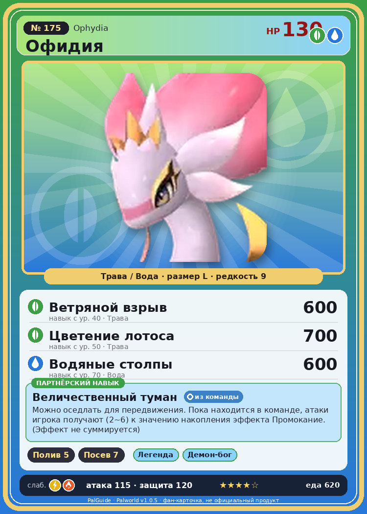

# #175 Офидия (Ophydia)

{ width=360 }

| Поле | Значение |
|---|---|
| Стихия | Трава, Вода |
| Слабость (кто бьёт сильнее) | Молния, Огонь |
| Редкость | 9 |
| Размер | L |
| HP / Атака / Защита (база вида) | 130 / 115 / 120 |
| Сколько ест | 620 |
| Цена продажи | 3884 |
| Множитель поимки | ×1 |
| Скорость рывка верхом | 1500 |

## Работа на базе
- Полив — ур. 5
- Посев семян — ур. 7

## Партнёрский навык: Величественный туман
Можно оседлать для передвижения. Пока находится в команде, атаки игрока получают (2~6) к значению накопления эффекта Промокание . (Эффект не суммируется) Технологии 72 level value 1 AdditionalEffect_Wetness_PartnerSkill_SleeveRabbit 2 2 AdditionalEffect_Wetness_PartnerSkill_SleeveRabbit 3 3 AdditionalEffect_Wetness_PartnerSkill_SleeveRabbit 4 4 AdditionalEffect_Wetness_PartnerSkill_SleeveRabbit 5 5 AdditionalEffect_Wetness_PartnerSkill_SleeveRabbit 6

## Атаки по уровням
- ур. 1: Пузырьковый выстрел (Вода, сила 80)
- ур. 7: Семенная мина (Трава, сила 120)
- ур. 15: Гидроатака под давлением (Вода, сила 250)
- ур. 22: Кольцевая лоза (Трава, сила 300)
- ур. 30: Гидроструя (Вода, сила 450)
- ур. 40: Ветряной взрыв (Трава, сила 600)
- ур. 50: Цветение лотоса (Трава, сила 700)
- ур. 70: Водяные столпы (Вода, сила 600)

## Где водится
- В дикой природе: да; точек появления днём: 1, ночью: 1
- Яйцо: Огромное яйцо свежей листвы

## Дроп
- Качественное масло Пала — 4–5 шт., 100%
- Большая душа Пала — 1–2 шт., 100%

**Дроп альфы:**
- Деталь древней цивилизации — 7–9 шт., 100%
- Ценный драконий самоцвет — 2–3 шт., 100%

## Разведение
- Ранг разведения (CombiRank): 230

## Лучшие пассивки по роли
- боец: Легенда, Демон-бог, Хладнокровный, Бессмертие, Король духов (вместо Бессмертия, если нет мутации)
- рабочий: Дьявольские руки, Виртуоз, Мастеровитый, Небожитель/Трудоголик
- ездовой: Божественная скорость, Легенда, Вечный двигатель, Небесное скольжение

## Чем хорош / чем плох
- ✅ хорошая атака (115); много здоровья (130); крепкая защита (120); отличный рабочий (пригодность 7); можно оседлать
- ❌ много ест (620)

> В водоёмах, где обитает Офидия , растёт множество цветов, внешне очень похожих на него. Не раз предпринимались попытки размножить только этот цветок, но стоит вмешаться человеку — и он неизбежно вянет.

См. также: [Стихии](../../2_mehaniki/stihii.md) · [Разведение](../../2_mehaniki/razvedenie.md) · [Все палы](README.md)
_Источник: paldb.cc v1.0.5_
