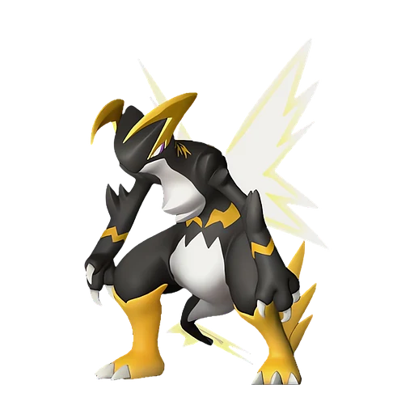

# Орсерк

<canvas id="fx"></canvas>

№ 187 · Orserk

ДраконМолния

Слабость: Лёд <b class="mx">×1,5</b>Земля <b class="mx">×1,5</b> <button class="hlp" data-tip="Множители перемножаются по обеим стихиям пала: ×1,5 за каждую стихию, которую атака бьёт, ×0,65 за каждую, которая её держит. Если одна стихия слаба, а другая устойчива (×1,5 × 0,65 ≈ ×0,98), слабости нет.">?</button>

Устойчив: Вода <b class="mx">×0,65</b>Тьма <b class="mx">×0,65</b>

⚡ Генерация энергии <b>8</b>🖐️ Ручная работа <b>3</b>📦 Транспортировка <b>4</b>

<b>Свирепый громовой дракон</b> 🎒 из команды

❤️ 120 · ⚔️ 130 · 🛡 115

Основное

💎Редкость <button class="hlp" data-tip="Чем выше число, тем реже встречается пал. 1–4 — обычные, 5–7 — редкие, 8+ — легендарные.">?</button><b>9</b>

📏Размер<b>L</b>

💰Цена продажи <button class="hlp" data-tip="Сколько золота даст торговец за пала.">?</button><b>4136</b>

Бой

🎯Множитель поимки <button class="hlp" data-tip="Насколько легче или труднее поймать: ×1 — обычно, меньше — сложнее.">?</button><b>×1</b>

🐎Скорость рывка верхом <button class="hlp" data-tip="Скорость, если сесть на пала и бежать рывком.">?</button><b>1200</b>

Ферма и еда

🍖Сколько ест <button class="hlp" data-tip="Сколько сытости пал тратит — чем больше, тем больше еды нужно на базе.">?</button><b>620</b>

Разведение

🧬Сила разведения <button class="hlp" data-tip="Скрытое число игры: у детёныша оно примерно среднее от родителей. Чем меньше — тем «сильнее» пал.">?</button><b>120</b>

💞Особая пара <button class="hlp" data-tip="Этого пала можно вывести только от этой пары.">?</button><b>Орсерк + Орсерк</b>

=== "Обзор"

    #### Работа на базе
    - Генерация энергии — ур. 8
    - Ручная работа — ур. 3
    - Транспортировка — ур. 4

    #### Партнёрский навык: Свирепый громовой дракон
    Пока находится в команде, при попадании по врагу выстрелом атака и защита Палов, сражающихся вместе с вами, увеличиваются на 1–5%. Эффект действует 5 секунд и может суммироваться до 30 раз. (Эффект не суммируется). По звёздам: 0★ 1 · 1★ 2 · 2★ 3 · 3★ 4 · 4★ 5

    #### Чем хорош / чем плох
    - ✅ Бафф атаки/защиты палов от твоих попаданий; лучший генератор (8); очень высокая атака (130); много здоровья (120); отличный рабочий (пригодность 8)
    - ❌ Нужно стрелять самому; много ест (620); разводится только особой парой

    > Пропускает электрический разряд через раны противника, обжигая его тело изнутри. Когда два Орсерк сталкиваются — всё решается в одно мгновение.

    См. также: [Стихии](../../guide/06_stihii.md) · [Разведение](../../guide/07_razvedenie.md) · [Все палы](README.md)

=== "Атаки"

    #### Атаки по уровням
    - ур. 1: Керавнос (Молния, сила 250)
    - ур. 7: Грозовой удар (Молния, сила 300)
    - ур. 15: Искровой выстрел (Молния, сила 50)
    - ур. 22: Дыхание дракона (Дракон, сила 160)
    - ур. 30: Грозовая линия (Молния, сила 160)
    - ур. 40: Тройная молния (Молния, сила 200)
    - ур. 50: Удар молнии (Молния, сила 450)
    - ур. 55: Поликеравнос (Молния, сила 600)
    - ур. 70: Метеоритный дождь (Дракон, сила 700)

=== "Где живёт"

    #### Где водится

    

<button data-k="d" class="on">☀️ День</button><button data-k="n">🌙 Ночь</button>

ур. 74–80<a class="btn hm-full" href="../../../map/?pal=ThunderDragonMan">Показать на большой карте</a>

🥚 Яйцо<b>Огромное яйцо дракона</b>

=== "Дроп"

    #### Дроп
    - Электрический орган — 1–2 шт., 100%

    **Дроп альфы:**
    - Деталь древней цивилизации — 5–7 шт., 100%
    - Ценный драконий самоцвет — 5–7 шт., 100%

=== "Разведение"

    #### Разведение
    - Ранг разведения (CombiRank): 120
    - **Особая пара:** [Орсерк](../../4_spravochniki/paly/orserk.md) + [Орсерк](../../4_spravochniki/paly/orserk.md)
    - Участвует в особых парах: Орсерк → Орсерк; Орсерк → Орсерк

=== "Пассивки"

    #### Лучшие пассивки по роли

    

⚔️ Боец

максимум урона и живучести в бою

<a class="psv r-4" data-psv="Легенда" href="../../../passivki/legend/">Легенда</a><a class="psv r-4" data-psv="Демон-бог" href="../../../passivki/demon_god/">Демон-бог</a><a class="psv r-3" data-psv="Божественный дракон" href="../../../passivki/divine_dragon/">Божественный дракон</a><a class="psv r-3" data-psv="Хладнокровный" href="../../../passivki/serenity/">Хладнокровный</a>

🛠 Рабочий

работает быстрее и меньше устаёт на базе

<a class="psv r-5" data-psv="Дьявольские руки" href="../../../passivki/demons_hand/">Дьявольские руки</a><a class="psv r-4" data-psv="Виртуоз" href="../../../passivki/remarkable_craftsmanship/">Виртуоз</a><a class="psv r-3" data-psv="Мастеровитый" href="../../../passivki/artisan/">Мастеровитый</a><a class="psv r-3" data-psv="Трудоголик" href="../../../passivki/workaholic/">Трудоголик</a>

    <small>Нажми на пассивку, чтобы узнать, что она даёт и где её взять.</small>

<a class="card-link" href="../lyleen_noct/">← Лилин Нокт</a><a class="card-link" href="../faleris/">Фалерис →</a>

