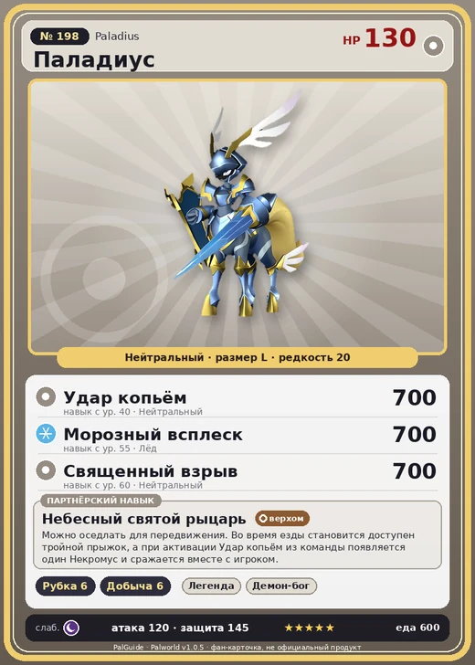

# #198 Паладиус (Paladius)

#198 · Paladius

Нейтральный

Слабость: Тьма

🪓 Рубка деревьев <b>6</b>⛏️ Добыча <b>6</b>

<b>Небесный святой рыцарь</b> 🐎 верхом

❤️ 130 · ⚔️ 120 · 🛡 145

| Поле | Значение |
|---|---|
| Стихия | Нейтральный |
| Слабость (кто бьёт сильнее) | Тьма |
| Редкость | 20 |
| Размер | L |
| HP / Атака / Защита (база вида) | 130 / 120 / 145 |
| Сколько ест | 600 |
| Цена продажи | 4339 |
| Множитель поимки | ×1 |
| Скорость рывка верхом | 1800 |

## Работа на базе
- Рубка деревьев — ур. 6
- Добыча — ур. 6

## Партнёрский навык: Небесный святой рыцарь
Можно оседлать для передвижения. Во время езды становится доступен тройной прыжок , а при активации Удар копьём из команды появляется один Некромус и сражается вместе с игроком. Технологии 61 level value 2 MoveSpeed_up_PartnerSkill_Ride_1 10 Пробуждение : (Скорость передвижения верхом: +10% ) 3 MoveSpeed_up_PartnerSkill_Ride_2 12 Пробуждение : (Скорость передвижения верхом: +12% ) 4 MoveSpeed_up_PartnerSkill_Ride_3 15 Пробуждение : (Скорость передвижения верхом: +15% ) 5 MoveSpeed_up_PartnerSkill_Ride_4 20 Пробуждение : (Скорость передвижения верхом: +20% ) 1 Пробуждение :

## Атаки по уровням
- ур. 1: Силовой выстрел (Нейтральный, сила 80)
- ур. 7: Ледяная ракета (Лёд, сила 40)
- ур. 15: Айсберг (Лёд, сила 120)
- ур. 22: Силовая бомба (Нейтральный, сила 120)
- ур. 30: Шип метели (Лёд, сила 450)
- ур. 40: Удар копьём (Нейтральный, сила 700)
- ур. 50: Палобласт (Нейтральный, сила 450)
- ур. 55: Морозный всплеск (Лёд, сила 700)
- ур. 60: Священный взрыв (Нейтральный, сила 700)
- ур. 70: Сияющий залп (Нейтральный, сила 700)

## Где водится
- В дикой природе: да; точек появления днём: 1, ночью: 1
- Яйцо: Огромное обычное яйцо

## Дроп
- Гексолит — 10 шт., 100%
- Алмаз — 1 шт., 100%
- Большая душа Пала — 1 шт., 100%

**Дроп альфы:**
- Деталь древней цивилизации — 6–8 шт., 100%
- Ценные внутренности — 6–8 шт., 100%

## Разведение
- Ранг разведения (CombiRank): 180
- **Особая пара:** [Паладиус](../../4_spravochniki/paly/paladius.md) + [Паладиус](../../4_spravochniki/paly/paladius.md)
- Участвует в особых парах: Паладиус → Паладиус; Паладиус → Паладиус

## Лучшие пассивки по роли
- по обзору: Легенда, Демон-бог, Хладнокровный, Святое небо
- боец: Легенда, Демон-бог, Хладнокровный, Бессмертие, Святое небо (вместо Бессмертия, если нет мутации)
- рабочий: Дьявольские руки, Виртуоз, Мастеровитый, Небожитель/Трудоголик
- ездовой: Божественная скорость, Легенда, Вечный двигатель, Небесное скольжение

## Чем хорош / чем плох
- ✅ Нейтральный легендарный, быстрый маунт; очень высокая атака (120); много здоровья (130); крепкая защита (145); отличный рабочий (пригодность 6); можно оседлать
- ❌ Нейтральный урон без бонуса по слабостям; много ест (600); разводится только особой парой

> Некогда этот Пал и Некромус были единым существом. Считается, что он лишён негативных эмоций, однако в глубине его глаз теплятся едва заметные угольки ненависти.

См. также: [Стихии](../../guide/06_stihii.md) · [Разведение](../../guide/07_razvedenie.md) · [Все палы](README.md)
