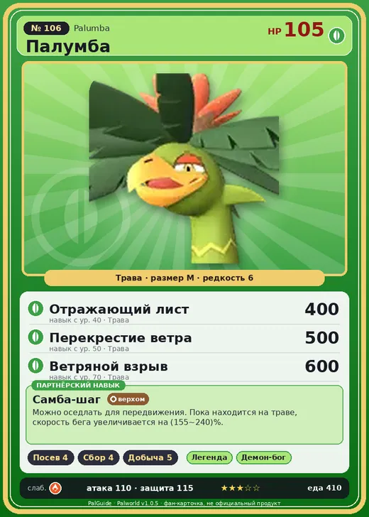

# #106 Палумба (Palumba)

№ 106

Трава

Слабость: Огонь

🌱 Посев семян <b>4</b>🌾 Сбор <b>4</b>⛏️ Добыча <b>5</b>

<b>Самба-шаг</b> 🐎 верхом

❤️ 105 · ⚔️ 110 · 🛡 115

| Поле | Значение |
|---|---|
| Стихия | Трава |
| Слабость (кто бьёт сильнее) | Огонь |
| Редкость | 6 |
| Размер | M |
| HP / Атака / Защита (база вида) | 105 / 110 / 115 |
| Сколько ест | 410 |
| Цена продажи | 2529 |
| Множитель поимки | ×1 |
| Скорость рывка верхом | 1000 |

=== "Обзор"

    #### Работа на базе
    - Посев семян — ур. 4
    - Сбор — ур. 4
    - Добыча — ур. 5

    #### Партнёрский навык: Самба-шаг
    Можно оседлать для передвижения. Пока находится на траве, скорость бега увеличивается на 155–240%. Технологии 35. По звёздам: 0★ 155 · 1★ 175 · 2★ 195 · 3★ 215 · 4★ 240

    #### Чем хорош / чем плох
    - ✅ хорошая атака (110); отличный рабочий (пригодность 5); можно оседлать
    - ❌ явных минусов нет

    > Сбивает противника с ритма своим фирменным танцем. В борьбе за территорию проигрывает тот, кто первым поддался ритму другого. Он танцует всегда — и в ухаживаниях, и от скуки, и просто так! Так что же значит танец, если он адресован человеку?

    См. также: [Стихии](../../guide/06_stihii.md) · [Разведение](../../guide/07_razvedenie.md) · [Все палы](README.md)

=== "Атаки"

    #### Атаки по уровням
    - ур. 1: Семенной пулемёт (Трава, сила 80)
    - ур. 7: Семенная мина (Трава, сила 120)
    - ур. 15: Травяной торнадо (Трава, сила 200)
    - ур. 22: Веер клинков (Трава, сила 200)
    - ур. 30: Пинок с разбега (Трава, сила 300)
    - ур. 40: Отражающий лист (Трава, сила 400)
    - ур. 50: Перекрестие ветра (Трава, сила 500)
    - ур. 70: Ветряной взрыв (Трава, сила 600)

=== "Где живёт"

    #### Где водится
    - В дикой природе: да; точек появления днём: 42, ночью: 42; уровни в первых точках: 32–38
    - Подземелья: Пещера Цветущей Сакуры
    - Может продаваться у торговца/рекрутера
    - Яйцо: Большое яйцо свежей листвы

=== "Дроп"

    #### Дроп
    - Твёрдая древесина — 2–4 шт., 100%
    - Семена лука — 1–2 шт., 100%
    - Семена моркови — 1–2 шт., 100%

    **Дроп альфы:**
    - Деталь древней цивилизации — 4–6 шт., 100%
    - Ценное перо — 2–3 шт., 100%

=== "Разведение"

    #### Разведение
    - Ранг разведения (CombiRank): 1240

=== "Пассивки"

    #### Лучшие пассивки по роли

    

⚔️ Боец

максимум урона и живучести в бою

<a class="psv r-4" data-psv="Легенда" href="../../../passivki/legend/">Легенда</a><a class="psv r-4" data-psv="Демон-бог" href="../../../passivki/demon_god/">Демон-бог</a><a class="psv r-3" data-psv="Король духов" href="../../../passivki/spirit_emperor/">Король духов</a><a class="psv r-3" data-psv="Хладнокровный" href="../../../passivki/serenity/">Хладнокровный</a>

🛠 Рабочий

работает быстрее и меньше устаёт на базе

<a class="psv r-5" data-psv="Дьявольские руки" href="../../../passivki/demons_hand/">Дьявольские руки</a><a class="psv r-4" data-psv="Виртуоз" href="../../../passivki/remarkable_craftsmanship/">Виртуоз</a><a class="psv r-3" data-psv="Мастеровитый" href="../../../passivki/artisan/">Мастеровитый</a><a class="psv r-3" data-psv="Трудоголик" href="../../../passivki/workaholic/">Трудоголик</a>

🐎 Ездовой

быстрее бегает или летает с тобой верхом

<a class="psv r-4" data-psv="Божественная скорость" href="../../../passivki/swift/">Божественная скорость</a><a class="psv r-4" data-psv="Легенда" href="../../../passivki/legend/">Легенда</a><a class="psv r-4" data-psv="Вечный двигатель" href="../../../passivki/eternal_engine/">Вечный двигатель</a><a class="psv r-4" data-psv="Небесное скольжение" href="../../../passivki/sky_strider/">Небесное скольжение</a>

    <small>Нажми на пассивку, чтобы узнать, что она даёт и где её взять.</small>

<a class="card-link" href="../moldron_cryst/">← Молдрон Крист</a><a class="card-link" href="../digtoise/">Дигтос →</a>

