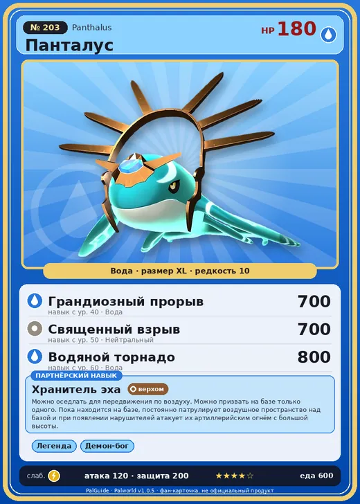

# #203 Панталус (Panthalus)

№ 203

Вода

Слабость: Молния

<b>Хранитель эха</b> 🐎 верхом 🏠 на базе

❤️ 180 · ⚔️ 120 · 🛡 200

| Поле | Значение |
|---|---|
| Стихия | Вода |
| Слабость (кто бьёт сильнее) | Молния |
| Редкость | 10 |
| Размер | XL |
| HP / Атака / Защита (база вида) | 180 / 120 / 200 |
| Сколько ест | 600 |
| Цена продажи | 4913 |
| Множитель поимки | ×1 |
| Скорость рывка верхом | 3000 |

=== "Обзор"

    #### Работа на базе
    - не работает

    #### Партнёрский навык: Хранитель эха
    Можно оседлать для передвижения по воздуху. Можно призвать на базе только одного. Пока находится на базе, постоянно патрулирует воздушное пространство над базой и при появлении нарушителей атакует их артиллерийским огнём с большой высоты.

    #### Чем хорош / чем плох
    - ✅ очень высокая атака (120); много здоровья (180); крепкая защита (200); можно оседлать; летает (ездовой)
    - ❌ много ест (600); не работает на базе; разводится только особой парой

    > Последний выживший представитель своего рода, который с честью исполнил свой долг. Сколько бы он ни звал мать — в ответ слышно лишь эхо.

    См. также: [Стихии](../../guide/06_stihii.md) · [Разведение](../../guide/07_razvedenie.md) · [Все палы](README.md)

=== "Атаки"

    #### Атаки по уровням
    - ур. 1: Дождь пузырей (Вода, сила 200)
    - ур. 7: Марш пузырей (Вода, сила 200)
    - ур. 15: Морской клинок (Вода, сила 300)
    - ур. 22: Приливный рывок (Вода, сила 400)
    - ур. 30: Водоворот (Вода, сила 500)
    - ур. 40: Грандиозный прорыв (Вода, сила 700)
    - ур. 50: Священный взрыв (Нейтральный, сила 700)
    - ур. 60: Водяной торнадо (Вода, сила 800)

=== "Где живёт"

    #### Где водится
    - В дикой природе: нет/особый способ; точек появления днём: 0, ночью: 0
    - Яйцо: Огромное яйцо воды

=== "Дроп"

    #### Дроп
    - Алмаз — 1 шт., 100%
    - Абсолютная душа Пала — 1 шт., 100%

    **Дроп альфы:**
    - Деталь древней цивилизации — 8–9 шт., 100%
    - Ценные внутренности — 2–3 шт., 100%

=== "Разведение"

    #### Разведение
    - Ранг разведения (CombiRank): 20
    - **Особая пара:** [Панталус](../../4_spravochniki/paly/panthalus.md) + [Панталус](../../4_spravochniki/paly/panthalus.md)
    - Участвует в особых парах: Панталус → Панталус; Панталус → Панталус

=== "Пассивки"

    #### Лучшие пассивки по роли

    

⚔️ Боец

максимум урона и живучести в бою

<a class="psv r-4" data-psv="Легенда" href="../../../passivki/legend/">Легенда</a><a class="psv r-4" data-psv="Демон-бог" href="../../../passivki/demon_god/">Демон-бог</a><a class="psv r-3" data-psv="Владыка морей" href="../../../passivki/lord_of_the_sea/">Владыка морей</a><a class="psv r-3" data-psv="Хладнокровный" href="../../../passivki/serenity/">Хладнокровный</a>

🐎 Ездовой

быстрее бегает или летает с тобой верхом

<a class="psv r-4" data-psv="Божественная скорость" href="../../../passivki/swift/">Божественная скорость</a><a class="psv r-4" data-psv="Легенда" href="../../../passivki/legend/">Легенда</a><a class="psv r-4" data-psv="Вечный двигатель" href="../../../passivki/eternal_engine/">Вечный двигатель</a><a class="psv r-3" data-psv="Умелый бегун" href="../../../passivki/runner/">Умелый бегун</a>

    <small>Нажми на пассивку, чтобы узнать, что она даёт и где её взять.</small>

<a class="card-link" href="../jetragon/">← Джетрагон</a><a class="card-link" href="../astralym/">Астралим →</a>

