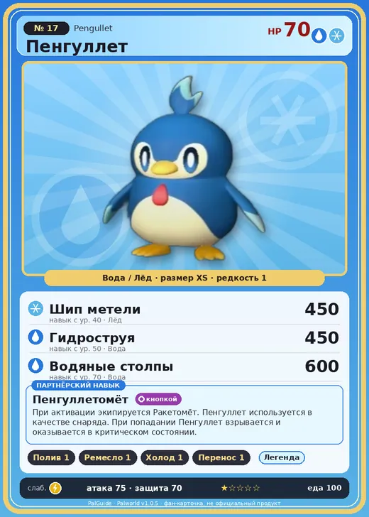

# #17 Пенгуллет (Pengullet)

#17 · Pengullet

ВодаЛёд

Слабость: МолнияОгонь

💧 Полив <b>1</b>🖐️ Ручная работа <b>1</b>❄️ Охлаждение <b>1</b>📦 Транспортировка <b>1</b>

<b>Пенгуллетомёт</b> 🔘 кнопкой

❤️ 70 · ⚔️ 75 · 🛡 70

| Поле | Значение |
|---|---|
| Стихия | Вода, Лёд |
| Слабость (кто бьёт сильнее) | Молния, Огонь |
| Редкость | 1 |
| Размер | XS |
| HP / Атака / Защита (база вида) | 70 / 75 / 70 |
| Сколько ест | 100 |
| Цена продажи | 463 |
| Множитель поимки | ×1 |
| Скорость рывка верхом | 650 |

## Работа на базе
- Полив — ур. 1
- Ручная работа — ур. 1
- Охлаждение — ур. 1
- Транспортировка — ур. 1

## Партнёрский навык: Пенгуллетомёт
При активации экипируется Ракетомёт . Пенгуллет используется в качестве снаряда. При попадании Пенгуллет взрывается и оказывается в критическом состоянии. Технологии 17 level value 1 MainValue 250 Пробуждение : 2 MainValue 285 Пробуждение : (Увеличение урона: Небольшое ) 3 MainValue 325 Пробуждение : (Увеличение урона: Среднее ) 4 MainValue 400 Пробуждение : (Увеличение урона: Большое ) 5 MainValue 500 Пробуждение : (Увеличение урона: Очень большое )

## Атаки по уровням
- ур. 1: Ледяная ракета (Лёд, сила 40)
- ур. 7: Акваджет (Вода, сила 40)
- ур. 15: Водяной выстрел (Вода, сила 50)
- ур. 22: Ледяной резак (Лёд, сила 80)
- ур. 30: Айсберг (Лёд, сила 120)
- ур. 40: Шип метели (Лёд, сила 450)
- ур. 50: Гидроструя (Вода, сила 450)
- ур. 70: Водяные столпы (Вода, сила 600)

## Где водится
- В дикой природе: да; точек появления днём: 1129, ночью: 1129; уровни в первых точках: 1–10
- Подземелья: Пещера Отдалённого Острова, Пещера Священной Горы, Пещера Холмов
- Может продаваться у торговца/рекрутера
- Яйцо: Яйцо воды

## Дроп
- Ледяной орган — 1–2 шт., 100%
- Жидкость водного Пала — 1 шт., 100%

**Дроп альфы:**
- Деталь древней цивилизации — 1–2 шт., 100%
- Ценный мех — 1–2 шт., 100%

## Разведение
- Ранг разведения (CombiRank): 2960
- Участвует в особых парах: Джолтхог → Джолтхог Крист; Спаркит → Пенгуллет Лакс; Мау → Мау Крист

## Лучшие пассивки по роли
- боец: Легенда, Демон-бог, Хладнокровный, Бессмертие, Владыка морей (вместо Бессмертия, если нет мутации)
- ездовой: Божественная скорость, Легенда, Вечный двигатель, Небесное скольжение

## Чем хорош / чем плох
- ✅ можно оседлать
- ❌ слабая атака (75)

> Его крылья давно утратили способность к полёту. Но в его генах всё ещё живёт тоска по небу, и он изо всех сил пытается снова подняться ввысь.

См. также: [Стихии](../../guide/06_stihii.md) · [Разведение](../../guide/07_razvedenie.md) · [Все палы](README.md)
