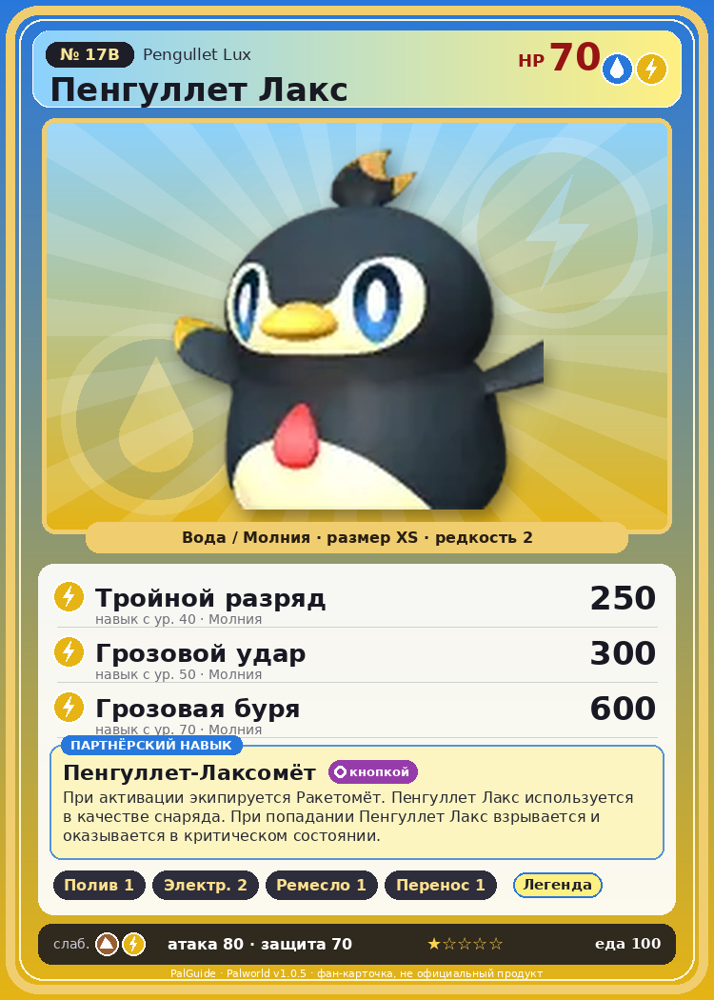

# #17B Пенгуллет Лакс (Pengullet Lux)

{ width=360 }

| Поле | Значение |
|---|---|
| Стихия | Вода, Молния |
| Слабость (кто бьёт сильнее) | Земля, Молния |
| Редкость | 2 |
| Размер | XS |
| HP / Атака / Защита (база вида) | 70 / 80 / 70 |
| Сколько ест | 100 |
| Цена продажи | 561 |
| Множитель поимки | ×0.9 |
| Скорость рывка верхом | 650 |

## Работа на базе
- Полив — ур. 1
- Генерация энергии — ур. 2
- Ручная работа — ур. 1
- Транспортировка — ур. 1

## Партнёрский навык: Пенгуллет-Лаксомёт
При активации экипируется Ракетомёт . Пенгуллет Лакс используется в качестве снаряда. При попадании Пенгуллет Лакс взрывается и оказывается в критическом состоянии. Технологии 18 level value 1 MainValue 300 Пробуждение : 2 MainValue 335 Пробуждение : (Увеличение урона: Небольшое ) 3 MainValue 375 Пробуждение : (Увеличение урона: Среднее ) 4 MainValue 450 Пробуждение : (Увеличение урона: Большое ) 5 MainValue 550 Пробуждение : (Увеличение урона: Очень большое )

## Атаки по уровням
- ур. 1: Грозовое копьё (Молния, сила 40)
- ур. 7: Шаровая молния (Молния, сила 100)
- ур. 15: Пузырьковый выстрел (Вода, сила 80)
- ур. 22: Полоса брызг (Вода, сила 160)
- ур. 30: Водяная бомба (Вода, сила 200)
- ур. 40: Тройной разряд (Молния, сила 250)
- ур. 50: Грозовой удар (Молния, сила 300)
- ур. 70: Грозовая буря (Молния, сила 600)

## Где водится
- В дикой природе: нет/особый способ; точек появления днём: 0, ночью: 653
- Яйцо: Яйцо воды

## Дроп
- Электрический орган — 1–2 шт., 100%
- Жидкость водного Пала — 1 шт., 100%

**Дроп альфы:**
- Деталь древней цивилизации — 2–3 шт., 100%
- Ценный мех — 2–3 шт., 100%

## Разведение
- Ранг разведения (CombiRank): 2490
- **Особая пара:** [Пенгуллет](../../4_spravochniki/paly/pengullet.md) + [Спаркит](../../4_spravochniki/paly/sparkit.md)

## Лучшие пассивки по роли
- боец: Легенда, Демон-бог, Хладнокровный, Бессмертие, Владыка морей (вместо Бессмертия, если нет мутации)
- ездовой: Божественная скорость, Легенда, Вечный двигатель, Небесное скольжение

## Чем хорош / чем плох
- ✅ можно оседлать
- ❌ разводится только особой парой

> Его крылья полностью атрофировались — летать он больше не в силах. Тоска по небу превратилась в жгучую зависть. Теперь у него электрическая сила, способная сбивать летунов прямо с небес!

См. также: [Стихии](../../2_mehaniki/stihii.md) · [Разведение](../../2_mehaniki/razvedenie.md) · [Все палы](README.md)
_Источник: paldb.cc v1.0.5_
