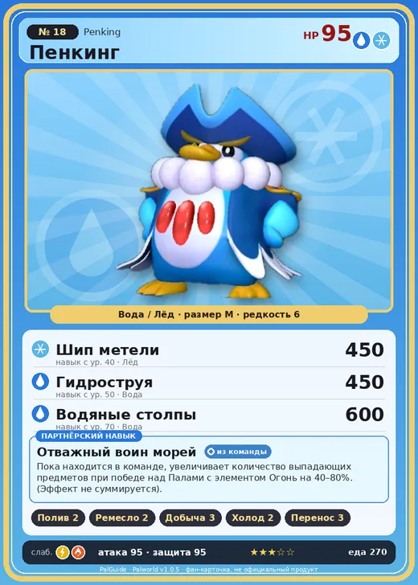

# #18 Пенкинг (Penking)

№ 18

ВодаЛёд

Слабость: МолнияОгонь

💧 Полив <b>2</b>🖐️ Ручная работа <b>2</b>⛏️ Добыча <b>3</b>❄️ Охлаждение <b>2</b>📦 Транспортировка <b>3</b>

<b>Отважный воин морей</b> 🎒 из команды

❤️ 95 · ⚔️ 95 · 🛡 95

| Поле | Значение |
|---|---|
| Стихия | Вода, Лёд |
| Слабость (кто бьёт сильнее) | Молния, Огонь |
| Редкость | 6 |
| Размер | M |
| HP / Атака / Защита (база вида) | 95 / 95 / 95 |
| Сколько ест | 270 |
| Цена продажи | 1442 |
| Множитель поимки | ×1 |
| Скорость рывка верхом | 600 |

## Работа на базе
- Полив — ур. 2
- Ручная работа — ур. 2
- Добыча — ур. 3
- Охлаждение — ур. 2
- Транспортировка — ур. 3

## Партнёрский навык: Отважный воин морей
Пока находится в команде, увеличивает количество выпадающих предметов при победе над Палами с элементом Огонь на (40~80)% . (Эффект не суммируется) level value 1 , 40 2 , 50 3 , 60 4 , 70 5 , 80

## Атаки по уровням
- ур. 1: Водяной выстрел (Вода, сила 50)
- ур. 7: Айсберг (Лёд, сила 120)
- ур. 15: Капитанское скольжение (Лёд, сила 140)
- ур. 22: Ледяное дыхание (Лёд, сила 160)
- ур. 30: Водяная бомба (Вода, сила 200)
- ур. 40: Шип метели (Лёд, сила 450)
- ур. 50: Гидроструя (Вода, сила 450)
- ур. 70: Водяные столпы (Вода, сила 600)

## Где водится
- В дикой природе: да; точек появления днём: 314, ночью: 314; уровни в первых точках: 20–23
- Яйцо: Большое яйцо воды

## Дроп
- Ледяной орган — 1–3 шт., 100%
- Перо Пенкинга — 1 шт., 50%

**Дроп альфы:**
- Деталь древней цивилизации — 3–4 шт., 100%
- Ценный мех — 3–4 шт., 100%

## Разведение
- Ранг разведения (CombiRank): 2070
- Участвует в особых парах: Райхаунд → Пенкинг Лакс

## Лучшие пассивки по роли
- по обзору: Мастеровитый, Легенда, Император льда, Трудоголик
- боец: Легенда, Демон-бог, Хладнокровный, Бессмертие, Владыка морей (вместо Бессмертия, если нет мутации)
- рабочий: Дьявольские руки, Виртуоз, Мастеровитый, Небожитель/Трудоголик
- ездовой: Божественная скорость, Легенда, Вечный двигатель, Небесное скольжение

## Чем хорош / чем плох
- ✅ Полив + добыча, лёд/вода; можно оседлать
- ❌ явных минусов нет

> На самом деле, у него почти нет ничего общего с Пенгуллет . Но раз уж его обожают просто так — он пока что изо всех сил старается выглядеть важным.

См. также: [Стихии](../../guide/06_stihii.md) · [Разведение](../../guide/07_razvedenie.md) · [Все палы](README.md)
