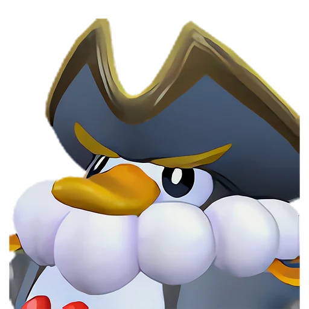

# Пенкинг Лакс

<canvas id="fx"></canvas>

№ 18B · Penking Lux

ВодаМолния

Слабость: Молния <b class="mx">×1,5</b>Земля <b class="mx">×1,5</b> <button class="hlp" data-tip="Множители перемножаются по обеим стихиям пала: ×1,5 за каждую стихию, которую атака бьёт, ×0,65 за каждую, которая её держит. Если одна стихия слаба, а другая устойчива (×1,5 × 0,65 ≈ ×0,98), слабости нет.">?</button>

Устойчив: Огонь <b class="mx">×0,65</b>Вода <b class="mx">×0,65</b>

💧 Полив <b>2</b>⚡ Генерация энергии <b>3</b>🖐️ Ручная работа <b>2</b>⛏️ Добыча <b>3</b>📦 Транспортировка <b>3</b>

<b>Непреклонный водный генерал</b> 🎒 из команды

❤️ 100 · ⚔️ 100 · 🛡 100

Основное

💎Редкость <button class="hlp" data-tip="Чем выше число, тем реже встречается пал. 1–4 — обычные, 5–7 — редкие, 8+ — легендарные.">?</button><b>7</b>

📏Размер<b>M</b>

💰Цена продажи <button class="hlp" data-tip="Сколько золота даст торговец за пала.">?</button><b>1683</b>

Бой

🎯Множитель поимки <button class="hlp" data-tip="Насколько легче или труднее поймать: ×1 — обычно, меньше — сложнее.">?</button><b>×1</b>

🐎Скорость рывка верхом <button class="hlp" data-tip="Скорость, если сесть на пала и бежать рывком.">?</button><b>600</b>

Ферма и еда

🍖Сколько ест <button class="hlp" data-tip="Сколько сытости пал тратит — чем больше, тем больше еды нужно на базе.">?</button><b>270</b>

Разведение

🧬Сила разведения <button class="hlp" data-tip="Скрытое число игры: у детёныша оно примерно среднее от родителей. Чем меньше — тем «сильнее» пал.">?</button><b>1850</b>

💞Особая пара <button class="hlp" data-tip="Этого пала можно вывести только от этой пары.">?</button><b>Пенкинг + Райхаунд</b>

=== "Обзор"

    #### Работа на базе
    - Полив — ур. 2
    - Генерация энергии — ур. 3
    - Ручная работа — ур. 2
    - Добыча — ур. 3
    - Транспортировка — ур. 3

    #### Партнёрский навык: Непреклонный водный генерал
    Пока находится в команде, урон игрока и Пала при поражении элементальной слабости врага с помощью Вода увеличивается на 25–40%. (Эффект не суммируется). По звёздам: 0★ 25 · 1★ 27 · 2★ 30 · 3★ 34 · 4★ 40

    #### Чем хорош / чем плох
    - ✅ хорошая атака (100)
    - ❌ разводится только особой парой

    > Он получил электрическую силу для подводной охоты, и его окрас изменился. В результате Пенгуллет перестал тянуться к нему. Но по какой-то причине у него появился новый подчинённый — Пенгуллет Лакс .

    См. также: [Стихии](../../guide/06_stihii.md) · [Разведение](../../guide/07_razvedenie.md) · [Все палы](README.md)

=== "Атаки"

    #### Атаки по уровням
    - ур. 1: Грозовое копьё (Молния, сила 40)
    - ур. 7: Плазмомёт (Молния, сила 120)
    - ур. 15: Пузырьковый выстрел (Вода, сила 80)
    - ур. 22: Тройной разряд (Молния, сила 250)
    - ур. 30: Грозовое скольжение (Молния, сила 400)
    - ур. 40: Цунами (Вода, сила 500)
    - ур. 50: Грозовая буря (Молния, сила 600)
    - ур. 70: Водяные столпы (Вода, сила 600)

=== "Где живёт"

    #### Где водится

    

<button data-k="d" class="on">☀️ День</button><button data-k="n">🌙 Ночь</button>

<a class="btn hm-full" href="../../../map/?pal=">Показать на большой карте</a>

СакурадзимаОстров Ветровой эрозииОстров призраковКричащий остров

🥚 Яйцо<b>Большое яйцо воды</b>

=== "Дроп"

    #### Дроп
    - Электрический орган — 1–3 шт., 100%
    - Перо Пенкинга — 1 шт., 50%

    **Дроп альфы:**
    - Деталь древней цивилизации — 2–3 шт., 100%
    - Ценные внутренности — 2–3 шт., 100%

=== "Разведение"

    #### Разведение
    - Ранг разведения (CombiRank): 1850
    - **Особая пара:** [Пенкинг](../../4_spravochniki/paly/penking.md) + [Райхаунд](../../4_spravochniki/paly/rayhound.md)

=== "Пассивки"

    #### Лучшие пассивки по роли

    

⚔️ Боец

максимум урона и живучести в бою

<a class="psv r-4" data-psv="Легенда" href="../../../passivki/legend/">Легенда</a><a class="psv r-4" data-psv="Демон-бог" href="../../../passivki/demon_god/">Демон-бог</a><a class="psv r-3" data-psv="Владыка морей" href="../../../passivki/lord_of_the_sea/">Владыка морей</a><a class="psv r-3" data-psv="Хладнокровный" href="../../../passivki/serenity/">Хладнокровный</a>

🛠 Рабочий

работает быстрее и меньше устаёт на базе

<a class="psv r-5" data-psv="Дьявольские руки" href="../../../passivki/demons_hand/">Дьявольские руки</a><a class="psv r-4" data-psv="Виртуоз" href="../../../passivki/remarkable_craftsmanship/">Виртуоз</a><a class="psv r-3" data-psv="Мастеровитый" href="../../../passivki/artisan/">Мастеровитый</a><a class="psv r-3" data-psv="Трудоголик" href="../../../passivki/workaholic/">Трудоголик</a>

    <small>Нажми на пассивку, чтобы узнать, что она даёт и где её взять.</small>

<a class="card-link" href="../penking/">← Пенкинг</a><a class="card-link" href="../hoocrates/">Хукрат →</a>

