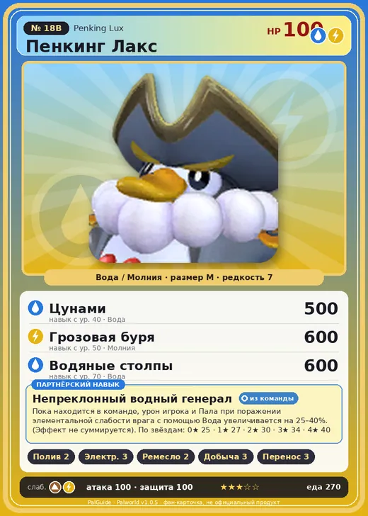

# #18B Пенкинг Лакс (Penking Lux)

#18B · Penking Lux

ВодаМолния

Слабость: ЗемляМолния

💧 Полив <b>2</b>⚡ Генерация энергии <b>3</b>🖐️ Ручная работа <b>2</b>⛏️ Добыча <b>3</b>📦 Транспортировка <b>3</b>

<b>Непреклонный водный генерал</b> 🎒 из команды

❤️ 100 · ⚔️ 100 · 🛡 100

| Поле | Значение |
|---|---|
| Стихия | Вода, Молния |
| Слабость (кто бьёт сильнее) | Земля, Молния |
| Редкость | 7 |
| Размер | M |
| HP / Атака / Защита (база вида) | 100 / 100 / 100 |
| Сколько ест | 270 |
| Цена продажи | 1683 |
| Множитель поимки | ×1 |
| Скорость рывка верхом | 600 |

## Работа на базе
- Полив — ур. 2
- Генерация энергии — ур. 3
- Ручная работа — ур. 2
- Добыча — ур. 3
- Транспортировка — ур. 3

## Партнёрский навык: Непреклонный водный генерал
Пока находится в команде, урон игрока и Пала при поражении элементальной слабости врага с помощью Вода увеличивается на (25~40)% . (Эффект не суммируется) level value 1 ElementBoostWeakness_Water_PartnerSkill 25 2 ElementBoostWeakness_Water_PartnerSkill 27 3 ElementBoostWeakness_Water_PartnerSkill 30 4 ElementBoostWeakness_Water_PartnerSkill 34 5 ElementBoostWeakness_Water_PartnerSkill 40

## Атаки по уровням
- ур. 1: Грозовое копьё (Молния, сила 40)
- ур. 7: Плазмомёт (Молния, сила 120)
- ур. 15: Пузырьковый выстрел (Вода, сила 80)
- ур. 22: Тройной разряд (Молния, сила 250)
- ур. 30: Грозовое скольжение (Молния, сила 400)
- ур. 40: Цунами (Вода, сила 500)
- ур. 50: Грозовая буря (Молния, сила 600)
- ур. 70: Водяные столпы (Вода, сила 600)

## Где водится
- В дикой природе: да; точек появления днём: 252, ночью: 252
- Яйцо: Большое яйцо воды

## Дроп
- Электрический орган — 1–3 шт., 100%
- Перо Пенкинга — 1 шт., 50%

**Дроп альфы:**
- Деталь древней цивилизации — 2–3 шт., 100%
- Ценные внутренности — 2–3 шт., 100%

## Разведение
- Ранг разведения (CombiRank): 1850
- **Особая пара:** [Пенкинг](../../4_spravochniki/paly/penking.md) + [Райхаунд](../../4_spravochniki/paly/rayhound.md)

## Лучшие пассивки по роли
- боец: Легенда, Демон-бог, Хладнокровный, Бессмертие, Владыка морей (вместо Бессмертия, если нет мутации)
- рабочий: Дьявольские руки, Виртуоз, Мастеровитый, Небожитель/Трудоголик
- ездовой: Божественная скорость, Легенда, Вечный двигатель, Небесное скольжение

## Чем хорош / чем плох
- ✅ хорошая атака (100); можно оседлать
- ❌ разводится только особой парой

> Он получил электрическую силу для подводной охоты, и его окрас изменился. В результате Пенгуллет перестал тянуться к нему. Но по какой-то причине у него появился новый подчинённый — Пенгуллет Лакс .

См. также: [Стихии](../../2_mehaniki/stihii.md) · [Разведение](../../2_mehaniki/razvedenie.md) · [Все палы](README.md)
