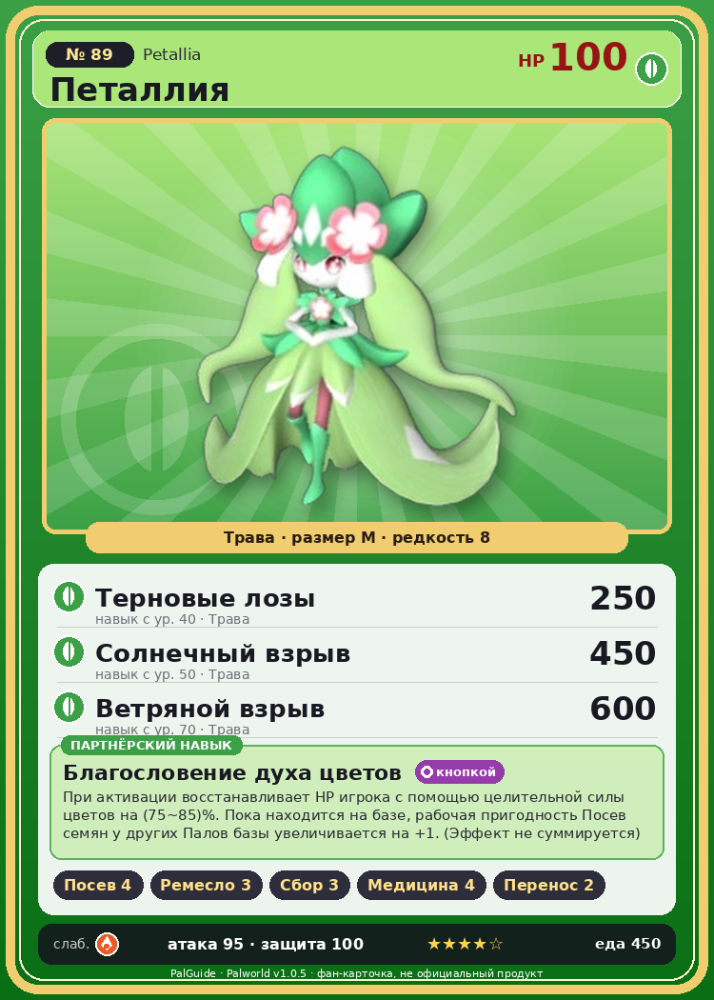

# #89 Петаллия (Petallia)

{ width=360 }

| Поле | Значение |
|---|---|
| Стихия | Трава |
| Слабость (кто бьёт сильнее) | Огонь |
| Редкость | 8 |
| Размер | M |
| HP / Атака / Защита (база вида) | 100 / 95 / 100 |
| Сколько ест | 450 |
| Цена продажи | 1769 |
| Множитель поимки | ×1 |
| Скорость рывка верхом | 700 |

## Работа на базе
- Посев семян — ур. 4
- Ручная работа — ур. 3
- Сбор — ур. 3
- Фармацевтика — ур. 4
- Транспортировка — ур. 2

## Партнёрский навык: Благословение духа цветов
При активации восстанавливает HP игрока с помощью целительной силы цветов на (75~85)% . Пока находится на базе, рабочая пригодность Посев семян у других Палов базы увеличивается на +1 . (Эффект не суммируется) level value 1 WorkSuitabilityAddRank_Seeding 1 MainValue 75 2 WorkSuitabilityAddRank_Seeding 1 MainValue 77 3 WorkSuitabilityAddRank_Seeding 1 MainValue 79 4 WorkSuitabilityAddRank_Seeding 1 MainValue 82 5 WorkSuitabilityAddRank_Seeding 1 MainValue 85

## Атаки по уровням
- ур. 1: Ветряной клинок (Трава, сила 40)
- ур. 7: Водяной выстрел (Вода, сила 50)
- ур. 15: Семенной пулемёт (Трава, сила 80)
- ур. 22: Пузырьковый выстрел (Вода, сила 80)
- ур. 30: Травяной торнадо (Трава, сила 200)
- ур. 40: Терновые лозы (Трава, сила 250)
- ур. 50: Солнечный взрыв (Трава, сила 450)
- ур. 70: Ветряной взрыв (Трава, сила 600)

## Где водится
- В дикой природе: да; точек появления днём: 106, ночью: 106; уровни в первых точках: 28–30
- Яйцо: Огромное яйцо свежей листвы

## Дроп
- Красивый цветок — 2–3 шт., 100%
- Семенной картофель — 1 шт., 100%

**Дроп альфы:**
- Деталь древней цивилизации — 2–4 шт., 100%
- Ценные внутренности — 2–4 шт., 100%

## Разведение
- Ранг разведения (CombiRank): 1720
- Участвует в особых парах: Буси → Петаллия Игнис; Найтмери → Найтмери Ботан

## Лучшие пассивки по роли
- по обзору: Легенда, Особая конституция, Алмазное тело, Хладнокровный
- боец: Легенда, Демон-бог, Хладнокровный, Бессмертие, Король духов (вместо Бессмертия, если нет мутации)
- рабочий: Дьявольские руки, Виртуоз, Мастеровитый, Небожитель/Трудоголик
- ездовой: Божественная скорость, Легенда, Вечный двигатель, Небесное скольжение

## Чем хорош / чем плох
- ✅ Лечит игрока; можно оседлать
- ❌ Хрупкая

> Когда срок жизни подходит к концу, превращается в огромное растение. Раз в десять лет распускается прекрасный цветок, из которого появляется новый Петаллия .

См. также: [Стихии](../../2_mehaniki/stihii.md) · [Разведение](../../2_mehaniki/razvedenie.md) · [Все палы](README.md)
_Источник: paldb.cc v1.0.5_
