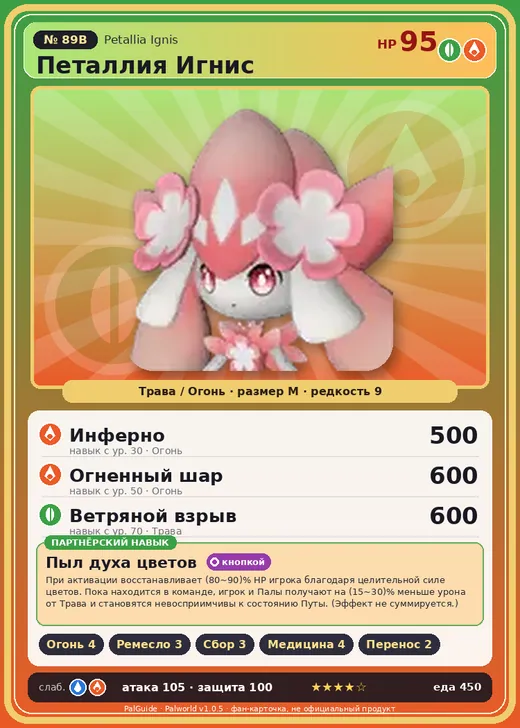

# #89B Петаллия Игнис (Petallia Ignis)

#89B · Petallia Ignis

ТраваОгонь

Слабость: ВодаОгонь

🔥 Разжигание огня <b>4</b>🖐️ Ручная работа <b>3</b>🌾 Сбор <b>3</b>💊 Фармацевтика <b>4</b>📦 Транспортировка <b>2</b>

<b>Пыл духа цветов</b> 🎒 из команды 🔘 кнопкой

❤️ 95 · ⚔️ 105 · 🛡 100

| Поле | Значение |
|---|---|
| Стихия | Трава, Огонь |
| Слабость (кто бьёт сильнее) | Вода, Огонь |
| Редкость | 9 |
| Размер | M |
| HP / Атака / Защита (база вида) | 95 / 105 / 100 |
| Сколько ест | 450 |
| Цена продажи | 2357 |
| Множитель поимки | ×1 |
| Скорость рывка верхом | 700 |

## Работа на базе
- Разжигание огня — ур. 4
- Ручная работа — ур. 3
- Сбор — ур. 3
- Фармацевтика — ур. 4
- Транспортировка — ур. 2

## Партнёрский навык: Пыл духа цветов
При активации восстанавливает (80~90)% HP игрока благодаря целительной силе цветов. Пока находится в команде, игрок и Палы получают на (15~30)% меньше урона от Трава и становятся невосприимчивы к состоянию Путы . (Эффект не суммируется.) level value 1 FlowerDoll_Fire_PartnerSkill 15, 100 MainValue 80 2 FlowerDoll_Fire_PartnerSkill 17, 100 MainValue 82 3 FlowerDoll_Fire_PartnerSkill 20, 100 MainValue 84 4 FlowerDoll_Fire_PartnerSkill 24, 100 MainValue 86 5 FlowerDoll_Fire_PartnerSkill 30, 100 MainValue 90

## Атаки по уровням
- ур. 1: Огненный выстрел (Огонь, сила 40)
- ур. 7: Расщеплённый огонь (Огонь, сила 80)
- ур. 15: Огненная стрела (Огонь, сила 120)
- ур. 22: Огненный шторм (Огонь, сила 200)
- ур. 30: Инферно (Огонь, сила 500)
- ур. 40: Огненная воронка (Огонь, сила 300)
- ур. 50: Огненный шар (Огонь, сила 600)
- ур. 70: Ветряной взрыв (Трава, сила 600)

## Где водится
- В дикой природе: нет/особый способ; точек появления днём: 0, ночью: 0
- Яйцо: Огромное яйцо свежей листвы

## Дроп
- Красивый цветок — 2–3 шт., 100%
- Огненный орган — 1–2 шт., 100%

**Дроп альфы:**
- Деталь древней цивилизации — 2–4 шт., 100%
- Ценные внутренности — 2–3 шт., 100%

## Разведение
- Ранг разведения (CombiRank): 820
- **Особая пара:** [Петаллия](../../4_spravochniki/paly/petallia.md) + [Буси](../../4_spravochniki/paly/bushi.md)

## Лучшие пассивки по роли
- боец: Легенда, Демон-бог, Хладнокровный, Бессмертие, Король духов (вместо Бессмертия, если нет мутации)
- рабочий: Дьявольские руки, Виртуоз, Мастеровитый, Небожитель/Трудоголик
- ездовой: Божественная скорость, Легенда, Вечный двигатель, Небесное скольжение

## Чем хорош / чем плох
- ✅ хорошая атака (105); можно оседлать
- ❌ разводится только особой парой

> Когда срок жизни подходит к концу, сгорает дотла, обращаясь в пепел. Почва вокруг становится чрезвычайно плодородной, и в последующие десять лет там буйно разрастается растительность.

См. также: [Стихии](../../2_mehaniki/stihii.md) · [Разведение](../../2_mehaniki/razvedenie.md) · [Все палы](README.md)
_Источник: paldb.cc v1.0.5_
