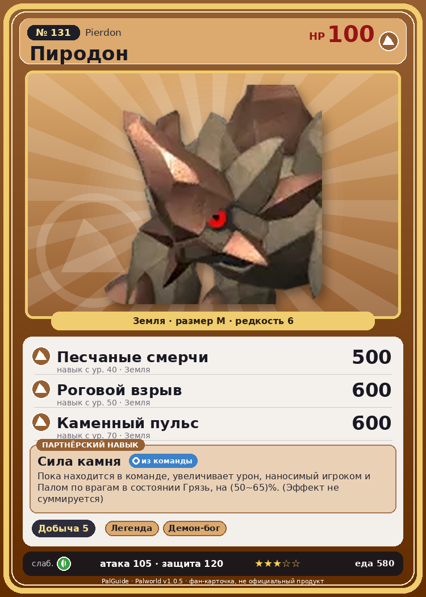

# #131 Пиродон (Pierdon)

{ width=360 }

| Поле | Значение |
|---|---|
| Стихия | Земля |
| Слабость (кто бьёт сильнее) | Трава |
| Редкость | 6 |
| Размер | M |
| HP / Атака / Защита (база вида) | 100 / 105 / 120 |
| Сколько ест | 580 |
| Цена продажи | 2306 |
| Множитель поимки | ×1 |
| Скорость рывка верхом | 550 |

## Работа на базе
- Добыча — ур. 5

## Партнёрский навык: Сила камня
Пока находится в команде, увеличивает урон, наносимый игроком и Палом по врагам в состоянии Грязь , на (50~65)% . (Эффект не суммируется) level value 1 DamageUpTrainerAndOtomo_ToMuddy_PartnerSkill_RockBeast 50 2 DamageUpTrainerAndOtomo_ToMuddy_PartnerSkill_RockBeast 53 3 DamageUpTrainerAndOtomo_ToMuddy_PartnerSkill_RockBeast 56 4 DamageUpTrainerAndOtomo_ToMuddy_PartnerSkill_RockBeast 60 5 DamageUpTrainerAndOtomo_ToMuddy_PartnerSkill_RockBeast 65

## Атаки по уровням
- ур. 1: Грязевой выстрел (Земля, сила 40)
- ур. 7: Каменный залп (Земля, сила 80)
- ур. 15: Камнемёт (Земля, сила 120)
- ур. 22: Камнепад (Земля, сила 300)
- ур. 30: Каменные копья (Земля, сила 400)
- ур. 40: Песчаные смерчи (Земля, сила 500)
- ур. 50: Роговой взрыв (Земля, сила 600)
- ур. 70: Каменный пульс (Земля, сила 600)

## Где водится
- В дикой природе: да; точек появления днём: 17, ночью: 17
- Яйцо: Большое яйцо земли

## Дроп
- Металлическая руда — 4–5 шт., 100%
- Уголь — 4–5 шт., 100%
- Сера — 4–5 шт., 100%

**Дроп альфы:**
- Деталь древней цивилизации — 4–6 шт., 100%
- Ценные внутренности — 2–3 шт., 100%

## Разведение
- Ранг разведения (CombiRank): 1110
- Участвует в особых парах: Вумпо → Пиродон Крист

## Лучшие пассивки по роли
- боец: Легенда, Демон-бог, Хладнокровный, Бессмертие, Император земли (вместо Бессмертия, если нет мутации)
- рабочий: Дьявольские руки, Виртуоз, Мастеровитый, Небожитель/Трудоголик
- ездовой: Божественная скорость, Легенда, Вечный двигатель, Небесное скольжение

## Чем хорош / чем плох
- ✅ хорошая атака (105); крепкая защита (120); отличный рабочий (пригодность 5); можно оседлать
- ❌ много ест (580)

> Бьётся о твёрдые камни, чтобы держать тело в желаемой форме. Особей с вмятинами лучше просто оставить в покое. Если провести аналогию с людьми, это как если бы слишком коротко подстричь челку.

См. также: [Стихии](../../2_mehaniki/stihii.md) · [Разведение](../../2_mehaniki/razvedenie.md) · [Все палы](README.md)
_Источник: paldb.cc v1.0.5_
