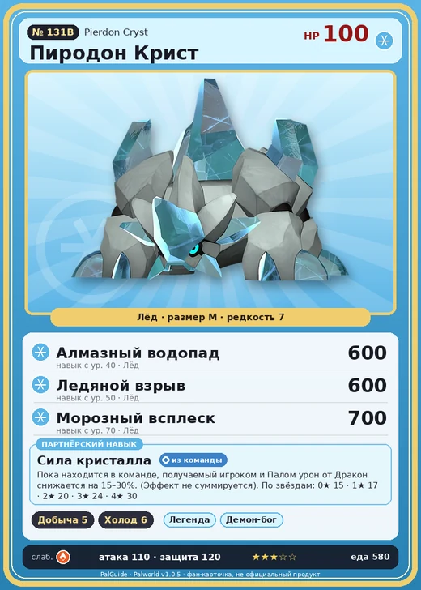

# Пиродон Крист

<canvas id="fx"></canvas>

№ 131B

Лёд

Слабость: Огонь <b class="mx">×1,5</b> <button class="hlp" data-tip="Множители перемножаются по обеим стихиям: ×1,5 за стихию, которую атака бьёт, ×0,65 за ту, что её держит.">?</button>

Устойчив: Дракон <b class="mx">×0,65</b>

⛏️ Добыча <b>5</b>❄️ Охлаждение <b>6</b>

<b>Сила кристалла</b> 🎒 Работает из команды

❤️ 100 · ⚔️ 110 · 🛡 120

Основное

💎Редкость <button class="hlp" data-tip="Чем выше число, тем реже встречается пал. 1–4 — обычные, 5–7 — редкие, 8+ — легендарные.">?</button><b>7</b>

📏Размер<b>M</b>

💰Цена продажи <button class="hlp" data-tip="Сколько золота даст торговец за пала.">?</button><b>2685</b>

Бой

🎯Множитель поимки <button class="hlp" data-tip="Насколько легче или труднее поймать: ×1 — обычно, меньше — сложнее.">?</button><b>×1</b>

🐎Скорость рывка верхом <button class="hlp" data-tip="Скорость, если сесть на пала и бежать рывком.">?</button><b>550</b>

Ферма и еда

🍖Сколько ест <button class="hlp" data-tip="Сколько сытости пал тратит — чем больше, тем больше еды нужно на базе.">?</button><b>580</b>

Разведение

🧬Сила разведения <button class="hlp" data-tip="Скрытое число игры: у детёныша оно примерно среднее от родителей. Чем меньше — тем «сильнее» пал.">?</button><b>460</b>

💞Особая пара <button class="hlp" data-tip="Этого пала можно вывести только от этой пары.">?</button><b>Пиродон + Вумпо</b>

=== "Обзор"

    #### Работа на базе

    
⛏️ Добыча<i style="--v:50%"></i><b>5</b>❄️ Охлаждение<i style="--v:60%"></i><b>6</b>

    #### Партнёрский навык: Сила кристалла
    Пока находится в команде, получаемый игроком и Палом урон от Дракон снижается на 15–30%. (Эффект не суммируется). По звёздам: 0★ 15 · 1★ 17 · 2★ 20 · 3★ 24 · 4★ 30

    #### Чем хорош / чем плох
    - ✅ хорошая атака (110); крепкая защита (120); отличный рабочий (пригодность 6)
    - ❌ много ест (580); разводится только особой парой

    > Загорает, поворачиваясь под разными углами, растапливая лёд до желаемой формы. Тем, кто потерял баланс, лучше не мешать. Если провести аналогию с людьми, это как слишком увлечься стрижкой висков.

    См. также: [Стихии](../../guide/06_stihii.md) · [Разведение](../../guide/07_razvedenie.md) · [Все палы](README.md)

=== "Атаки"

    #### Атаки по уровням
    - ур. 1: Ледяная ракета (Лёд, сила 40)
    - ур. 7: Ледяной резак (Лёд, сила 80)
    - ур. 15: Айсберг (Лёд, сила 120)
    - ур. 22: Ледяной след (Лёд, сила 300)
    - ур. 30: Шип метели (Лёд, сила 450)
    - ур. 40: Алмазный водопад (Лёд, сила 600)
    - ур. 50: Ледяной взрыв (Лёд, сила 600)
    - ур. 70: Морозный всплеск (Лёд, сила 700)

=== "Где живёт"

    #### Где водится

    

<button data-k="d" class="on">☀️ День</button><button data-k="n">🌙 Ночь</button>

ур. 68–68<a class="btn hm-full" href="../../../map/?pal=RockBeast_Ice">Показать на большой карте</a>

Солнечный предел

🥚 Яйцо<b>Большое яйцо льда</b>

=== "Дроп"

    #### Дроп
    - Соллайт — 4–5 шт., 100%
    - Ледяной орган — 4–5 шт., 100%
    - Чистый кварц — 4–5 шт., 100%

    **Дроп альфы:**

    - Деталь древней цивилизации — 4–6 шт., 100%
    - Ценные внутренности — 2–3 шт., 100%

=== "Разведение"

    #### Разведение
    - Ранг разведения: 460
    - **Особая пара:** [Пиродон](../../4_spravochniki/paly/pierdon.md) + [Вумпо](../../4_spravochniki/paly/wumpo.md)
    - Участвует в особых парах: [Элгрув](elgrove.md) → [Элгрув Крист](elgrove_cryst.md)

=== "Пассивки"

    #### Лучшие пассивки по роли

    

⚔️ Боец

максимум урона и живучести в бою

<a class="psv r-4" data-psv="Легенда" href="../../../passivki/legend/">Легенда</a><a class="psv r-4" data-psv="Демон-бог" href="../../../passivki/demon_god/">Демон-бог</a><a class="psv r-3" data-psv="Император льда" href="../../../passivki/ice_emperor/">Император льда</a><a class="psv r-3" data-psv="Хладнокровный" href="../../../passivki/serenity/">Хладнокровный</a>

🛠 Рабочий

работает быстрее и меньше устаёт на базе

<a class="psv r-5" data-psv="Дьявольские руки" href="../../../passivki/demons_hand/">Дьявольские руки</a><a class="psv r-4" data-psv="Виртуоз" href="../../../passivki/remarkable_craftsmanship/">Виртуоз</a><a class="psv r-3" data-psv="Мастеровитый" href="../../../passivki/artisan/">Мастеровитый</a><a class="psv r-3" data-psv="Трудоголик" href="../../../passivki/workaholic/">Трудоголик</a>

    <small>Нажми на пассивку, чтобы узнать, что она даёт и где её взять.</small>

<a class="card-link" href="../pierdon/">← Пиродон</a><a class="card-link" href="../cryolinx/">Криолинкс →</a>

