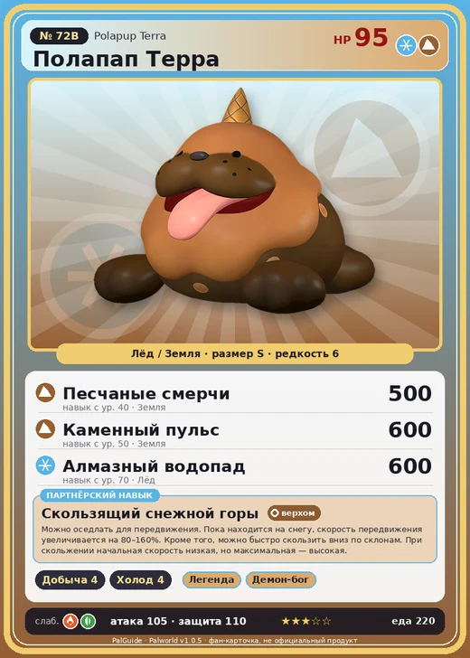

# #72B Полапап Терра (Polapup Terra)

#72B · Polapup Terra

ЛёдЗемля

Слабость: ОгоньТрава

⛏️ Добыча <b>4</b>❄️ Охлаждение <b>4</b>

<b>Скользящий снежной горы</b> 🐎 верхом

❤️ 95 · ⚔️ 105 · 🛡 110

| Поле | Значение |
|---|---|
| Стихия | Лёд, Земля |
| Слабость (кто бьёт сильнее) | Огонь, Трава |
| Редкость | 6 |
| Размер | S |
| HP / Атака / Защита (база вида) | 95 / 105 / 110 |
| Сколько ест | 220 |
| Цена продажи | 1942 |
| Множитель поимки | ×1 |
| Скорость рывка верхом | 375 |

## Работа на базе
- Добыча — ур. 4
- Охлаждение — ур. 4

## Партнёрский навык: Скользящий снежной горы
Можно оседлать для передвижения. Пока находится на снегу , скорость передвижения увеличивается на (80~160)% . Кроме того, можно быстро скользить вниз по склонам. При скольжении начальная скорость низкая, но максимальная — высокая. Технологии 55 level value 1 MoveSpeed_Up_SnowType_PartnerSkill_IceSeal_Ground 80 MainValue 300 2 MoveSpeed_Up_SnowType_PartnerSkill_IceSeal_Ground 100 MainValue 550 3 MoveSpeed_Up_SnowType_PartnerSkill_IceSeal_Ground 120 MainValue 800 4 MoveSpeed_Up_SnowType_PartnerSkill_IceSeal_Ground 140 MainValue 1050 5 MoveSpeed_Up_SnowType_PartnerSkill_IceSeal_Ground 160 MainValue 1300

## Атаки по уровням
- ур. 1: Ледяная ракета (Лёд, сила 40)
- ур. 7: Каменный залп (Земля, сила 80)
- ур. 15: Айсберг (Лёд, сила 120)
- ур. 22: Камнепад (Земля, сила 300)
- ур. 30: Шип метели (Лёд, сила 450)
- ур. 40: Песчаные смерчи (Земля, сила 500)
- ур. 50: Каменный пульс (Земля, сила 600)
- ур. 70: Алмазный водопад (Лёд, сила 600)

## Где водится
- В дикой природе: да; точек появления днём: 26, ночью: 26
- Яйцо: Большое яйцо льда

## Дроп
- Кожа — 1–2 шт., 100%
- Жидкость водного Пала — 1–2 шт., 100%

**Дроп альфы:**
- Деталь древней цивилизации — 2–3 шт., 100%
- Ценные внутренности — 2–3 шт., 100%

## Разведение
- Ранг разведения (CombiRank): 1100
- **Особая пара:** [Полапап](../../4_spravochniki/paly/polapup.md) + [Серфент Терра](../../4_spravochniki/paly/surfent_terra.md)

## Лучшие пассивки по роли
- боец: Легенда, Демон-бог, Хладнокровный, Бессмертие, Император льда (вместо Бессмертия, если нет мутации)
- рабочий: Дьявольские руки, Виртуоз, Мастеровитый, Небожитель/Трудоголик
- ездовой: Божественная скорость, Легенда, Вечный двигатель, Небесное скольжение

## Чем хорош / чем плох
- ✅ хорошая атака (105); можно оседлать
- ❌ разводится только особой парой

> Самым уважаемым считается тот, кто быстрее всех скользит по снегу. Иногда особо разогнавшиеся особи подпрыгивают и зарываются в снег. В период борьбы за лидерство такое случается особенно часто. Прогноз заторов — Полапап Терра .

См. также: [Стихии](../../2_mehaniki/stihii.md) · [Разведение](../../2_mehaniki/razvedenie.md) · [Все палы](README.md)
