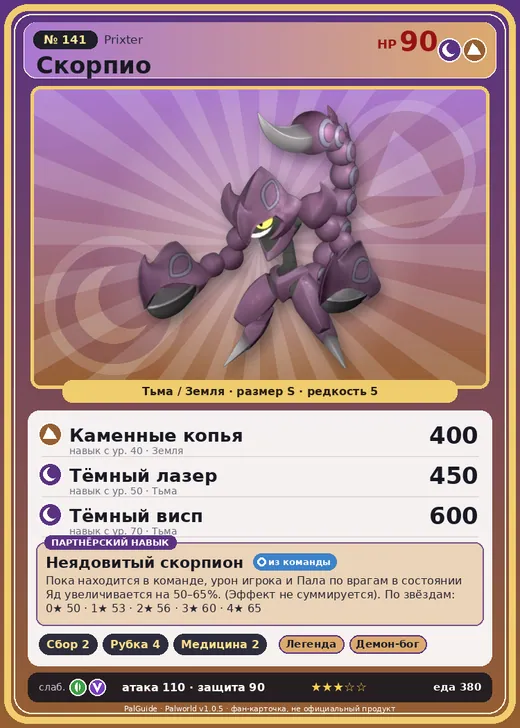

# #141 Скорпио (Prixter)

#141 · Prixter

ТьмаЗемля

Слабость: ДраконТрава

🌾 Сбор <b>2</b>🪓 Рубка деревьев <b>4</b>💊 Фармацевтика <b>2</b>

<b>Неядовитый скорпион</b> 🎒 из команды

❤️ 90 · ⚔️ 110 · 🛡 90

| Поле | Значение |
|---|---|
| Стихия | Тьма, Земля |
| Слабость (кто бьёт сильнее) | Дракон, Трава |
| Редкость | 5 |
| Размер | S |
| HP / Атака / Защита (база вида) | 90 / 110 / 90 |
| Сколько ест | 380 |
| Цена продажи | 1649 |
| Множитель поимки | ×1 |
| Скорость рывка верхом | — |

## Работа на базе
- Сбор — ур. 2
- Рубка деревьев — ур. 4
- Фармацевтика — ур. 2

## Партнёрский навык: Неядовитый скорпион
Пока находится в команде, урон игрока и Пала по врагам в состоянии Яд увеличивается на (50~65)% . (Эффект не суммируется) level value 1 DamageUpTrainerAndOtomo_ToPoison_PartnerSkill_ScorpionMan 50 OverWriteCoolTime 60 2 DamageUpTrainerAndOtomo_ToPoison_PartnerSkill_ScorpionMan 53 OverWriteCoolTime 45 3 DamageUpTrainerAndOtomo_ToPoison_PartnerSkill_ScorpionMan 56 OverWriteCoolTime 30 4 DamageUpTrainerAndOtomo_ToPoison_PartnerSkill_ScorpionMan 60 OverWriteCoolTime 20 5 DamageUpTrainerAndOtomo_ToPoison_PartnerSkill_ScorpionMan 65 OverWriteCoolTime 10

## Атаки по уровням
- ур. 1: Ядовитый выстрел (Тьма, сила 30)
- ур. 7: Тёмная пушка (Тьма, сила 70)
- ур. 15: Каменный залп (Земля, сила 80)
- ур. 22: Песчаный вихрь (Земля, сила 200)
- ур. 30: Апперкот (Тьма, сила 350)
- ур. 40: Каменные копья (Земля, сила 400)
- ур. 50: Тёмный лазер (Тьма, сила 450)
- ур. 70: Тёмный висп (Тьма, сила 600)

## Где водится
- В дикой природе: да; точек появления днём: 70, ночью: 70; уровни в первых точках: 48–49
- Яйцо: Большое яйцо тьмы

## Дроп
- Ядовитая железа — 4–5 шт., 100%

**Дроп альфы:**
- Деталь древней цивилизации — 2–3 шт., 100%
- Ценный коготь — 2–3 шт., 100%

## Разведение
- Ранг разведения (CombiRank): 1510
- Участвует в особых парах: Хэлзефир Лакс → Скорпио Лакс

## Лучшие пассивки по роли
- боец: Легенда, Демон-бог, Хладнокровный, Бессмертие, Король тьмы (вместо Бессмертия, если нет мутации)
- рабочий: Дьявольские руки, Виртуоз, Мастеровитый, Небожитель/Трудоголик

## Чем хорош / чем плох
- ✅ хорошая атака (110)
- ❌ явных минусов нет

> Обладает примерно 5000 видами яда. Среди них есть и такие, что могут убить мгновенно. Но концентрация у всех настолько низкая, что толку от них — никакого.

См. также: [Стихии](../../2_mehaniki/stihii.md) · [Разведение](../../2_mehaniki/razvedenie.md) · [Все палы](README.md)
