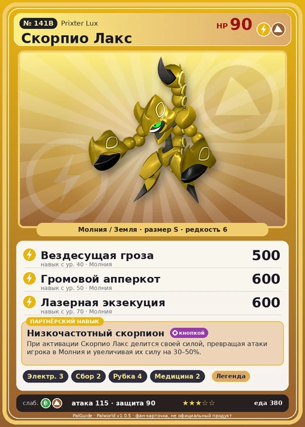

# #141B Скорпио Лакс (Prixter Lux)

№ 141B

МолнияЗемля

Слабость: ЗемляТрава

⚡ Генерация энергии <b>3</b>🌾 Сбор <b>2</b>🪓 Рубка деревьев <b>4</b>💊 Фармацевтика <b>2</b>

<b>Низкочастотный скорпион</b> 🔘 кнопкой

❤️ 90 · ⚔️ 115 · 🛡 90

| Поле | Значение |
|---|---|
| Стихия | Молния, Земля |
| Слабость (кто бьёт сильнее) | Земля, Трава |
| Редкость | 6 |
| Размер | S |
| HP / Атака / Защита (база вида) | 90 / 115 / 90 |
| Сколько ест | 380 |
| Цена продажи | 1773 |
| Множитель поимки | ×1 |
| Скорость рывка верхом | — |

=== "Обзор"

    #### Работа на базе
    - Генерация энергии — ур. 3
    - Сбор — ур. 2
    - Рубка деревьев — ур. 4
    - Фармацевтика — ур. 2

    #### Партнёрский навык: Низкочастотный скорпион
    При активации Скорпио Лакс делится своей силой, превращая атаки игрока в Молния и увеличивая их силу на 30–50%.

    #### Чем хорош / чем плох
    - ✅ хорошая атака (115)
    - ❌ разводится только особой парой

    > Вонзает хвост в тело врага, пропуская через него электрический разряд. Но заряд слишком слабый — гораздо эффективнее просто хорошенько врезать.

    См. также: [Стихии](../../guide/06_stihii.md) · [Разведение](../../guide/07_razvedenie.md) · [Все палы](README.md)

=== "Атаки"

    #### Атаки по уровням
    - ур. 1: Грязевой выстрел (Земля, сила 40)
    - ур. 7: Шоковая волна (Молния, сила 80)
    - ур. 15: Грозовая линия (Молния, сила 160)
    - ур. 22: Песчаный вихрь (Земля, сила 200)
    - ур. 30: Тройной разряд (Молния, сила 250)
    - ур. 40: Вездесущая гроза (Молния, сила 500)
    - ур. 50: Громовой апперкот (Молния, сила 600)
    - ур. 70: Лазерная экзекуция (Молния, сила 600)

=== "Где живёт"

    #### Где водится
    - В дикой природе: да; точек появления днём: 36, ночью: 36
    - Яйцо: Большое яйцо молнии

=== "Дроп"

    #### Дроп
    - Электрический орган — 4–5 шт., 100%

    **Дроп альфы:**
    - Деталь древней цивилизации — 2–3 шт., 100%
    - Ценные внутренности — 2–3 шт., 100%

=== "Разведение"

    #### Разведение
    - Ранг разведения (CombiRank): 850
    - **Особая пара:** [Скорпио](../../4_spravochniki/paly/prixter.md) + [Хэлзефир Лакс](../../4_spravochniki/paly/helzephyr_lux.md)

=== "Пассивки"

    #### Лучшие пассивки по роли

    

⚔️ Боец

максимум урона и живучести в бою

<a class="psv r-4" data-psv="Легенда" href="../../../passivki/legend/">Легенда</a><a class="psv r-4" data-psv="Демон-бог" href="../../../passivki/demon_god/">Демон-бог</a><a class="psv r-3" data-psv="Император молнии" href="../../../passivki/lord_of_lightning/">Император молнии</a><a class="psv r-3" data-psv="Хладнокровный" href="../../../passivki/serenity/">Хладнокровный</a>

🛠 Рабочий

работает быстрее и меньше устаёт на базе

<a class="psv r-5" data-psv="Дьявольские руки" href="../../../passivki/demons_hand/">Дьявольские руки</a><a class="psv r-4" data-psv="Виртуоз" href="../../../passivki/remarkable_craftsmanship/">Виртуоз</a><a class="psv r-3" data-psv="Мастеровитый" href="../../../passivki/artisan/">Мастеровитый</a><a class="psv r-3" data-psv="Трудоголик" href="../../../passivki/workaholic/">Трудоголик</a>

    <small>Нажми на пассивку, чтобы узнать, что она даёт и где её взять.</small>

<a class="card-link" href="../prixter/">← Скорпио</a><a class="card-link" href="../tetroise/">Тетроис →</a>

