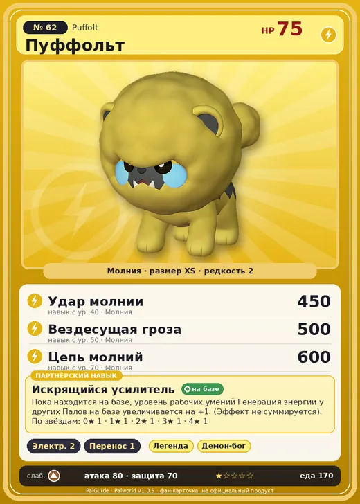

# Пуффольт

<canvas id="fx"></canvas>

№ 62 · Puffolt

Молния

Слабость: Земля

⚡ Генерация энергии <b>2</b>📦 Транспортировка <b>1</b>

<b>Искрящийся усилитель</b> 🏠 на базе

❤️ 75 · ⚔️ 80 · 🛡 70

Основное

💎Редкость <button class="hlp" data-tip="Чем выше число, тем реже встречается пал. 1–4 — обычные, 5–7 — редкие, 8+ — легендарные.">?</button><b>2</b>

📏Размер<b>XS</b>

💰Цена продажи <button class="hlp" data-tip="Сколько золота даст торговец за пала.">?</button><b>556</b>

Бой

🎯Множитель поимки <button class="hlp" data-tip="Насколько легче или труднее поймать: ×1 — обычно, меньше — сложнее.">?</button><b>×1</b>

🐎Скорость рывка верхом <button class="hlp" data-tip="Скорость, если сесть на пала и бежать рывком.">?</button><b>400</b>

Ферма и еда

🍖Сколько ест <button class="hlp" data-tip="Сколько сытости пал тратит — чем больше, тем больше еды нужно на базе.">?</button><b>170</b>

Разведение

🧬Сила разведения <button class="hlp" data-tip="Скрытое число игры: у детёныша оно примерно среднее от родителей. Чем меньше — тем «сильнее» пал.">?</button><b>2360</b>

=== "Обзор"

    #### Работа на базе
    - Генерация энергии — ур. 2
    - Транспортировка — ур. 1

    #### Партнёрский навык: Искрящийся усилитель
    Пока находится на базе, уровень рабочих умений Генерация энергии у других Палов на базе увеличивается на +1. (Эффект не суммируется). По звёздам: 0★ 1 · 1★ 1 · 2★ 1 · 3★ 1 · 4★ 1

    #### Чем хорош / чем плох
    - ✅
    - ❌ явных минусов нет

    > При намокании пушистый мех впитывает большое количество воды. При её стряхивании происходит мощнейший электрический разряд, и купание вместе с ним становится вопросом жизни и смерти.

    См. также: [Стихии](../../guide/06_stihii.md) · [Разведение](../../guide/07_razvedenie.md) · [Все палы](README.md)

=== "Атаки"

    #### Атаки по уровням
    - ур. 1: Двойные клыки (молния) (Молния, сила 40)
    - ур. 2: Дикие клыки (молния) (Молния, сила 50)
    - ур. 7: Шоковая волна (Молния, сила 80)
    - ур. 15: Шаровая молния (Молния, сила 100)
    - ур. 22: Тройной разряд (Молния, сила 250)
    - ур. 30: Грозовой удар (Молния, сила 300)
    - ур. 40: Удар молнии (Молния, сила 450)
    - ур. 50: Вездесущая гроза (Молния, сила 500)
    - ур. 70: Цепь молний (Молния, сила 600)

=== "Где живёт"

    #### Где водится
    - В дикой природе: да; точек появления днём: 114, ночью: 114
    - Яйцо: Яйцо молнии

=== "Дроп"

    #### Дроп
    - Электрический орган — 1 шт., 100%

    **Дроп альфы:**
    - Деталь древней цивилизации — 1–2 шт., 100%
    - Ценные внутренности — 2–3 шт., 100%

=== "Разведение"

    #### Разведение
    - Ранг разведения (CombiRank): 2360

=== "Пассивки"

    #### Лучшие пассивки по роли

    

⚔️ Боец

максимум урона и живучести в бою

<a class="psv r-4" data-psv="Легенда" href="../../../passivki/legend/">Легенда</a><a class="psv r-4" data-psv="Демон-бог" href="../../../passivki/demon_god/">Демон-бог</a><a class="psv r-3" data-psv="Император молнии" href="../../../passivki/lord_of_lightning/">Император молнии</a><a class="psv r-3" data-psv="Хладнокровный" href="../../../passivki/serenity/">Хладнокровный</a>

    <small>Нажми на пассивку, чтобы узнать, что она даёт и где её взять.</small>

<a class="card-link" href="../cinnamoth/">← Синнамос</a><a class="card-link" href="../elphidran/">Элфидран →</a>

