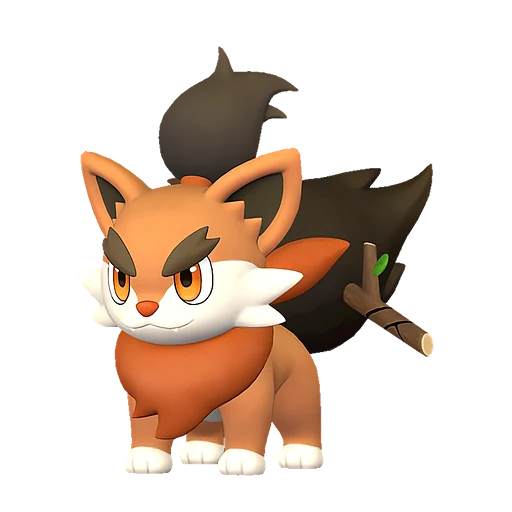

# Паппирай

<canvas id="fx"></canvas>

№ 13

Земля

Слабость: Трава <b class="mx">×1,5</b> <button class="hlp" data-tip="Множители перемножаются по обеим стихиям: ×1,5 за стихию, которую атака бьёт, ×0,65 за ту, что её держит.">?</button>

Устойчив: Молния <b class="mx">×0,65</b>

🌾 Сбор <b>1</b>🪓 Рубка деревьев <b>1</b>📦 Транспортировка <b>1</b>

<b>Старательная поддержка</b> 🎒 Работает из команды

❤️ 70 · ⚔️ 80 · 🛡 70

Основное

💎Редкость <button class="hlp" data-tip="Чем выше число, тем реже встречается пал. 1–4 — обычные, 5–7 — редкие, 8+ — легендарные.">?</button><b>2</b>

📏Размер<b>XS</b>

💰Цена продажи <button class="hlp" data-tip="Сколько золота даст торговец за пала.">?</button><b>476</b>

Бой

🎯Множитель поимки <button class="hlp" data-tip="Насколько легче или труднее поймать: ×1 — обычно, меньше — сложнее.">?</button><b>×1</b>

🐎Скорость рывка верхом <button class="hlp" data-tip="Скорость, если сесть на пала и бежать рывком.">?</button><b>600</b>

Ферма и еда

🍖Сколько ест <button class="hlp" data-tip="Сколько сытости пал тратит — чем больше, тем больше еды нужно на базе.">?</button><b>100</b>

Разведение

🧬Сила разведения <button class="hlp" data-tip="Скрытое число игры: у детёныша оно примерно среднее от родителей. Чем меньше — тем «сильнее» пал.">?</button><b>2930</b>

=== "Обзор"

    #### Работа на базе

    
<a class="wbar" href="../../../2_mehaniki/rabota/?w=gathering&lv=1">🧺 Сбор<i style="--v:10%"></i><b>1</b></a><a class="wbar" href="../../../2_mehaniki/rabota/?w=lumbering&lv=1">🪓 Рубка деревьев<i style="--v:10%"></i><b>1</b></a><a class="wbar" href="../../../2_mehaniki/rabota/?w=transporting&lv=1">📦 Транспортировка<i style="--v:10%"></i><b>1</b></a><a class="wb-more" href="../../../2_mehaniki/rabota/">Что значат уровни работы →</a>

    #### Партнёрский навык: Старательная поддержка
    Пока находится в команде, урон от оружия ближнего боя игрока увеличивается на 10–35%. (Эффект не суммируется). По звёздам: 0★ 10 · 1★ 15 · 2★ 20 · 3★ 25 · 4★ 35

    #### Чем хорош / чем плох
    - ✅ хорошая атака (80)
    - ❌ явных минусов нет

    > Их территориальные стычки начинаются с взаимного взгляда и мгновенного удара. Приручённых особей лучше не учить команде «Жди». Инстинктивная реакция после «Можно!» неизбежна.

    См. также: [Стихии](../../guide/06_stihii.md) · [Разведение](../../guide/07_razvedenie.md) · [Все палы](README.md)

=== "Атаки"

    #### Атаки по уровням
    - ур. 1: Двойные клыки (земля) (Земля, сила 40)
    - ур. 2: Дикие клыки (земля) (Земля, сила 50)
    - ур. 7: Каменный залп (Земля, сила 80)
    - ур. 15: Старательный рубящий удар (Земля, сила 90)
    - ур. 22: Камнемёт (Земля, сила 120)
    - ур. 30: Песчаный вихрь (Земля, сила 200)
    - ур. 40: Каменные копья (Земля, сила 400)
    - ур. 50: Песчаные смерчи (Земля, сила 500)
    - ур. 70: Каменный пульс (Земля, сила 600)

=== "Где живёт"

    #### Где водится

    

<button data-k="d" class="on">☀️ День</button><button data-k="n">🌙 Ночь</button>

ур. 2–2<a class="btn hm-full" href="../../../map/?pal=SamuraiDog">Показать на большой карте</a>

Остров восходящих ветров

🥚 Яйцо<b>Яйцо земли</b>

=== "Дроп"

    #### Дроп
    - Кость — 1 шт., 100%

    **Дроп альфы:**
    - Деталь древней цивилизации — 1–2 шт., 100%
    - Ценные внутренности — 2–3 шт., 100%

=== "Разведение"

    #### Разведение
    - Ранг разведения: 2930

=== "Пассивки"

    #### Лучшие пассивки по роли

    

⚔️ Боец

максимум урона и живучести в бою

<a class="psv r-4" data-psv="Легенда" href="../../../passivki/legend/">Легенда</a><a class="psv r-4" data-psv="Демон-бог" href="../../../passivki/demon_god/">Демон-бог</a><a class="psv r-3" data-psv="Император земли" href="../../../passivki/earth_emperor/">Император земли</a><a class="psv r-3" data-psv="Хладнокровный" href="../../../passivki/serenity/">Хладнокровный</a>

    <small>Нажми на пассивку, чтобы узнать, что она даёт и где её взять.</small>

<a class="card-link" href="../gumoss/">← Гумосс</a><a class="card-link" href="../clovee/">Клови →</a>

