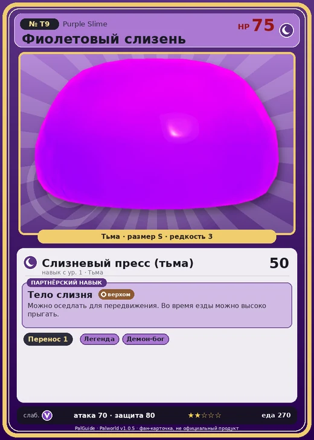

# #T9 Фиолетовый слизень (Purple Slime)

#T9 · Purple Slime

Тьма

Слабость: Дракон

📦 Транспортировка <b>1</b>

<b>Тело слизня</b> 🐎 верхом

❤️ 75 · ⚔️ 70 · 🛡 80

| Поле | Значение |
|---|---|
| Стихия | Тьма |
| Слабость (кто бьёт сильнее) | Дракон |
| Редкость | 3 |
| Размер | S |
| HP / Атака / Защита (база вида) | 75 / 70 / 80 |
| Сколько ест | 270 |
| Цена продажи | 800 |
| Множитель поимки | ×1 |
| Скорость рывка верхом | 450 |
| Коллаборация | Terraria (остров Якусима) (нет в Палпедии) |

## Работа на базе
- Транспортировка — ур. 1

## Партнёрский навык: Тело слизня
Можно оседлать для передвижения. Во время езды можно высоко прыгать.

## Атаки по уровням
- ур. 1: Слизневый пресс (тьма) (Тьма, сила 50)

## Где водится
- В дикой природе: да; точек появления днём: ?, ночью: ?
- Яйцо: Яйцо тьмы

## Дроп
- Святой слиток — 2–3 шт., 100%

## Разведение
- Ранг разведения (CombiRank): 3100

## Лучшие пассивки по роли
- боец: Легенда, Демон-бог, Хладнокровный, Бессмертие, Король тьмы (вместо Бессмертия, если нет мутации)
- ездовой: Божественная скорость, Легенда, Вечный двигатель, Небесное скольжение

## Чем хорош / чем плох
- ✅ можно оседлать
- ❌ слабая атака (70)

> [Коллаборация с Terraria] Монстр из другого мира. Похоже, здесь его можно приручить.

См. также: [Стихии](../../guide/06_stihii.md) · [Разведение](../../guide/07_razvedenie.md) · [Все палы](README.md)
