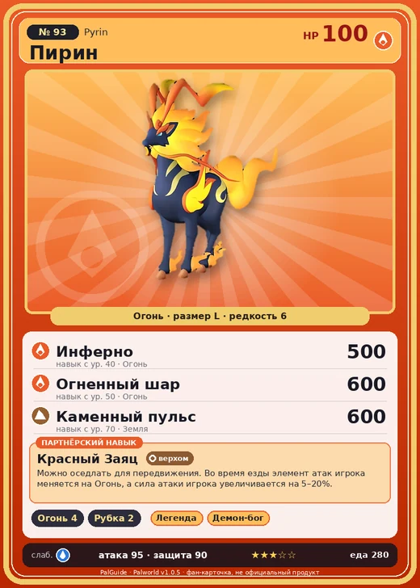

# #93 Пирин (Pyrin)

#93 · Pyrin

Огонь

Слабость: Вода

🔥 Разжигание огня <b>4</b>🪓 Рубка деревьев <b>2</b>

<b>Красный Заяц</b> 🐎 верхом

❤️ 100 · ⚔️ 95 · 🛡 90

| Поле | Значение |
|---|---|
| Стихия | Огонь |
| Слабость (кто бьёт сильнее) | Вода |
| Редкость | 6 |
| Размер | L |
| HP / Атака / Защита (база вида) | 100 / 95 / 90 |
| Сколько ест | 280 |
| Цена продажи | 1464 |
| Множитель поимки | ×1 |
| Скорость рывка верхом | 1300 |

## Работа на базе
- Разжигание огня — ур. 4
- Рубка деревьев — ур. 2

## Партнёрский навык: Красный Заяц
Можно оседлать для передвижения. Во время езды элемент атак игрока меняется на Огонь , а сила атаки игрока увеличивается на (5~20)% . Технологии 29 level value 1 GiveAFire_Ride 1 GiveElement_TrainerATK_UP_PartnerSkill_Ride 5 2 GiveAFire_Ride 1 GiveElement_TrainerATK_UP_PartnerSkill_Ride 7 3 GiveAFire_Ride 1 GiveElement_TrainerATK_UP_PartnerSkill_Ride 10 4 GiveAFire_Ride 1 GiveElement_TrainerATK_UP_PartnerSkill_Ride 14 5 GiveAFire_Ride 1 GiveElement_TrainerATK_UP_PartnerSkill_Ride 20

## Атаки по уровням
- ур. 1: Грязевой выстрел (Земля, сила 40)
- ур. 7: Огненный выстрел (Огонь, сила 40)
- ур. 15: Расщеплённый огонь (Огонь, сила 80)
- ур. 22: Огненная стрела (Огонь, сила 120)
- ур. 30: Огненный заряд (Огонь, сила 300)
- ур. 40: Инферно (Огонь, сила 500)
- ур. 50: Огненный шар (Огонь, сила 600)
- ур. 70: Каменный пульс (Земля, сила 600)

## Где водится
- В дикой природе: да; точек появления днём: 95, ночью: 95; уровни в первых точках: 30–34
- Подземелья: Пещера Вулкана
- Может продаваться у торговца/рекрутера
- Яйцо: Большое раскалённое яйцо

## Дроп
- Огненный орган — 4–5 шт., 100%
- Кожа — 2–3 шт., 100%

**Дроп альфы:**
- Деталь древней цивилизации — 2–3 шт., 100%
- Ценный коготь — 2–3 шт., 100%

## Разведение
- Ранг разведения (CombiRank): 1980
- Участвует в особых парах: Катресс → Пирин Нокт

## Лучшие пассивки по роли
- боец: Легенда, Демон-бог, Хладнокровный, Бессмертие, Император огня (вместо Бессмертия, если нет мутации)
- рабочий: Дьявольские руки, Виртуоз, Мастеровитый, Небожитель/Трудоголик
- ездовой: Божественная скорость, Легенда, Вечный двигатель, Небесное скольжение

## Чем хорош / чем плох
- ✅ можно оседлать
- ❌ явных минусов нет

> Всё его тело — это сверхэффективный теплоотвод, что даёт ему поразительную выносливость. Если кто-то садится верхом, он осторожно снижает жар, чтобы не обжечь наездника.

См. также: [Стихии](../../guide/06_stihii.md) · [Разведение](../../guide/07_razvedenie.md) · [Все палы](README.md)
