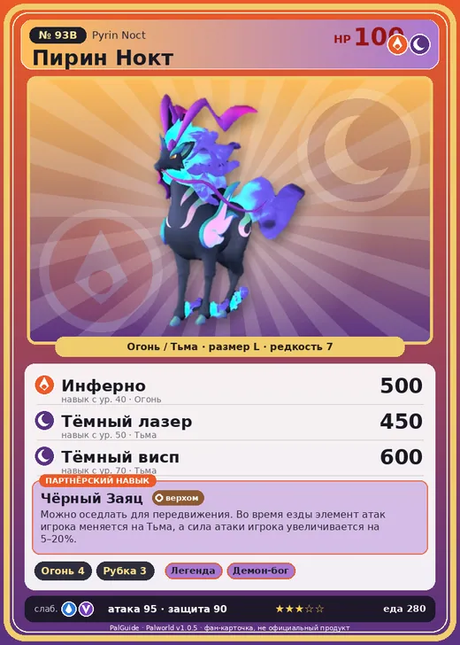

# #93B Пирин Нокт (Pyrin Noct)

№ 93B

ОгоньТьма

Слабость: ВодаДракон

🔥 Разжигание огня <b>4</b>🪓 Рубка деревьев <b>3</b>

<b>Чёрный Заяц</b> 🐎 верхом

❤️ 100 · ⚔️ 95 · 🛡 90

| Поле | Значение |
|---|---|
| Стихия | Огонь, Тьма |
| Слабость (кто бьёт сильнее) | Вода, Дракон |
| Редкость | 7 |
| Размер | L |
| HP / Атака / Защита (база вида) | 100 / 95 / 90 |
| Сколько ест | 280 |
| Цена продажи | 2034 |
| Множитель поимки | ×1 |
| Скорость рывка верхом | 1300 |

=== "Обзор"

    #### Работа на базе
    - Разжигание огня — ур. 4
    - Рубка деревьев — ур. 3

    #### Партнёрский навык: Чёрный Заяц
    Можно оседлать для передвижения. Во время езды элемент атак игрока меняется на Тьма, а сила атаки игрока увеличивается на 5–20%. Технологии 34.

    #### Чем хорош / чем плох
    - ✅ можно оседлать
    - ❌ разводится только особой парой

    > Сжигает загадочную тёмную материю, превращая её в энергию. Остаточные тёмные частицы рассеиваются по его телу. Когда кто-то садится на него верхом, он старается, чтобы тот не поддался тьме.

    См. также: [Стихии](../../guide/06_stihii.md) · [Разведение](../../guide/07_razvedenie.md) · [Все палы](README.md)

=== "Атаки"

    #### Атаки по уровням
    - ур. 1: Огненный выстрел (Огонь, сила 40)
    - ур. 7: Теневой взрыв (Тьма, сила 80)
    - ур. 15: Огненное дыхание (Огонь, сила 160)
    - ур. 22: Духовное пламя (Тьма, сила 200)
    - ур. 30: Тёмный заряд (Тьма, сила 300)
    - ур. 40: Инферно (Огонь, сила 500)
    - ур. 50: Тёмный лазер (Тьма, сила 450)
    - ур. 70: Тёмный висп (Тьма, сила 600)

=== "Где живёт"

    #### Где водится
    - В дикой природе: да; точек появления днём: 10, ночью: 412
    - Яйцо: Большое раскалённое яйцо

=== "Дроп"

    #### Дроп
    - Огненный орган — 4–5 шт., 100%
    - Кожа — 2–3 шт., 100%

    **Дроп альфы:**
    - Деталь древней цивилизации — 2–3 шт., 100%
    - Ценный коготь — 2–3 шт., 100%

=== "Разведение"

    #### Разведение
    - Ранг разведения (CombiRank): 1870
    - **Особая пара:** [Пирин](../../4_spravochniki/paly/pyrin.md) + [Катресс](../../4_spravochniki/paly/katress.md)

=== "Пассивки"

    #### Лучшие пассивки по роли

    

⚔️ Боец

максимум урона и живучести в бою

<a class="psv r-4" data-psv="Легенда" href="../../../passivki/legend/">Легенда</a><a class="psv r-4" data-psv="Демон-бог" href="../../../passivki/demon_god/">Демон-бог</a><a class="psv r-3" data-psv="Император огня" href="../../../passivki/flame_emperor/">Император огня</a><a class="psv r-3" data-psv="Хладнокровный" href="../../../passivki/serenity/">Хладнокровный</a>

🛠 Рабочий

работает быстрее и меньше устаёт на базе

<a class="psv r-5" data-psv="Дьявольские руки" href="../../../passivki/demons_hand/">Дьявольские руки</a><a class="psv r-4" data-psv="Виртуоз" href="../../../passivki/remarkable_craftsmanship/">Виртуоз</a><a class="psv r-3" data-psv="Мастеровитый" href="../../../passivki/artisan/">Мастеровитый</a><a class="psv r-3" data-psv="Трудоголик" href="../../../passivki/workaholic/">Трудоголик</a>

🐎 Ездовой

быстрее бегает или летает с тобой верхом

<a class="psv r-4" data-psv="Божественная скорость" href="../../../passivki/swift/">Божественная скорость</a><a class="psv r-4" data-psv="Легенда" href="../../../passivki/legend/">Легенда</a><a class="psv r-4" data-psv="Вечный двигатель" href="../../../passivki/eternal_engine/">Вечный двигатель</a><a class="psv r-4" data-psv="Небесное скольжение" href="../../../passivki/sky_strider/">Небесное скольжение</a>

    <small>Нажми на пассивку, чтобы узнать, что она даёт и где её взять.</small>

<a class="card-link" href="../pyrin/">← Пирин</a><a class="card-link" href="../relaxaurus/">Релаксаурус →</a>

