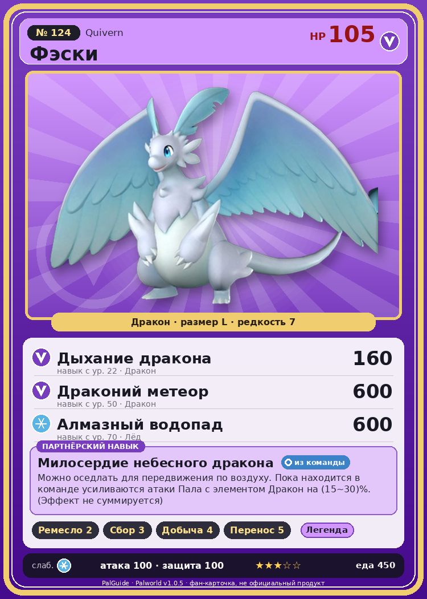

# #124 Фэски (Quivern)

{ width=360 }

| Поле | Значение |
|---|---|
| Стихия | Дракон |
| Слабость (кто бьёт сильнее) | Лёд |
| Редкость | 7 |
| Размер | L |
| HP / Атака / Защита (база вида) | 105 / 100 / 100 |
| Сколько ест | 450 |
| Цена продажи | 2081 |
| Множитель поимки | ×1 |
| Скорость рывка верхом | 1400 |

## Работа на базе
- Ручная работа — ур. 2
- Сбор — ур. 3
- Добыча — ур. 4
- Транспортировка — ур. 5

## Партнёрский навык: Милосердие небесного дракона
Можно оседлать для передвижения по воздуху. Пока находится в команде усиливаются атаки Пала с элементом Дракон на (15~30)% . (Эффект не суммируется) Технологии 38 level value 1 AttackUp_Dragon_PartnerSkill 15 2 AttackUp_Dragon_PartnerSkill 17 3 AttackUp_Dragon_PartnerSkill 20 4 AttackUp_Dragon_PartnerSkill 24 5 AttackUp_Dragon_PartnerSkill 30

## Атаки по уровням
- ур. 1: Драконья пушка (Дракон, сила 40)
- ур. 7: Расщеплённый огонь (Огонь, сила 80)
- ур. 15: Кислотный дождь (Вода, сила 120)
- ур. 22: Дыхание дракона (Дракон, сила 160)
- ур. 30: Травяной торнадо (Трава, сила 200)
- ур. 40: Водяная бомба (Вода, сила 200)
- ур. 50: Драконий метеор (Дракон, сила 600)
- ур. 70: Алмазный водопад (Лёд, сила 600)

## Где водится
- В дикой природе: да; точек появления днём: 423, ночью: 423; уровни в первых точках: 40–44
- Подземелья: Пещера Священной Горы
- Может продаваться у торговца/рекрутера
- Яйцо: Большое яйцо дракона

## Дроп
- Качественное масло Пала — 3 шт., 100%

**Дроп альфы:**
- Деталь древней цивилизации — 2–4 шт., 100%
- Ценное перо — 2–4 шт., 100%

## Разведение
- Ранг разведения (CombiRank): 1210
- Участвует в особых парах: Нежноцвет → Фэски Ботан

## Лучшие пассивки по роли
- по обзору: Легенда, Божественная скорость, Вечный двигатель, Божественный дракон
- боец: Легенда, Демон-бог, Хладнокровный, Бессмертие, Божественный дракон (вместо Бессмертия, если нет мутации)
- рабочий: Дьявольские руки, Виртуоз, Мастеровитый, Небожитель/Трудоголик
- ездовой: Божественная скорость, Легенда, Вечный двигатель, Небесное скольжение

## Чем хорош / чем плох
- ✅ Летающий маунт, бафф драконов; хорошая атака (100); отличный рабочий (пригодность 5); можно оседлать; летает (ездовой)
- ❌ Средний урон

> Засыпать в обнимку с Фэски — райское наслаждение. Но если он ворочается во сне, то может вас раздавить, и вы отправитесь в рай в прямом смысле.

См. также: [Стихии](../../2_mehaniki/stihii.md) · [Разведение](../../2_mehaniki/razvedenie.md) · [Все палы](README.md)
_Источник: paldb.cc v1.0.5_
