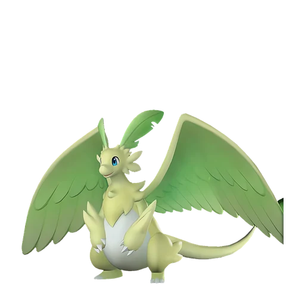

# Фэски Ботан

<canvas id="fx"></canvas>

№ 124B · Quivern Botan

ДраконТрава

Слабость: Огонь <b class="mx">×1,5</b>Лёд <b class="mx">×1,5</b> <button class="hlp" data-tip="Множители перемножаются по обеим стихиям пала: ×1,5 за каждую стихию, которую атака бьёт, ×0,65 за каждую, которая её держит. Если одна стихия слаба, а другая устойчива (×1,5 × 0,65 ≈ ×0,98), слабости нет.">?</button>

Устойчив: Земля <b class="mx">×0,65</b>Тьма <b class="mx">×0,65</b>

🌱 Посев семян <b>5</b>🖐️ Ручная работа <b>2</b>🌾 Сбор <b>4</b>⛏️ Добыча <b>3</b>📦 Транспортировка <b>4</b>

<b>Милосердие травяного дракона</b> 🐎 верхом

❤️ 105 · ⚔️ 105 · 🛡 100

Основное

💎Редкость <button class="hlp" data-tip="Чем выше число, тем реже встречается пал. 1–4 — обычные, 5–7 — редкие, 8+ — легендарные.">?</button><b>8</b>

📏Размер<b>L</b>

💰Цена продажи <button class="hlp" data-tip="Сколько золота даст торговец за пала.">?</button><b>2235</b>

Бой

🎯Множитель поимки <button class="hlp" data-tip="Насколько легче или труднее поймать: ×1 — обычно, меньше — сложнее.">?</button><b>×1</b>

🐎Скорость рывка верхом <button class="hlp" data-tip="Скорость, если сесть на пала и бежать рывком.">?</button><b>1400</b>

Ферма и еда

🍖Сколько ест <button class="hlp" data-tip="Сколько сытости пал тратит — чем больше, тем больше еды нужно на базе.">?</button><b>450</b>

Разведение

🧬Сила разведения <button class="hlp" data-tip="Скрытое число игры: у детёныша оно примерно среднее от родителей. Чем меньше — тем «сильнее» пал.">?</button><b>1300</b>

💞Особая пара <button class="hlp" data-tip="Этого пала можно вывести только от этой пары.">?</button><b>Фэски + Нежноцвет</b>

=== "Обзор"

    #### Работа на базе
    - Посев семян — ур. 5
    - Ручная работа — ур. 2
    - Сбор — ур. 4
    - Добыча — ур. 3
    - Транспортировка — ур. 4

    #### Партнёрский навык: Милосердие травяного дракона
    Можно оседлать для передвижения по воздуху. Во время езды атаки игрока меняются на Трава, а сила атаки увеличивается на 5–20%. Технологии 45.

    #### Чем хорош / чем плох
    - ✅ хорошая атака (105); отличный рабочий (пригодность 5); можно оседлать; летает (ездовой)
    - ❌ разводится только особой парой

    > Если обнять Фэски Ботан и почувствовать запах солнца и лугов — завтра будет ясно. А если от него пахнет сыростью — ждите проливной дождь.

    См. также: [Стихии](../../guide/06_stihii.md) · [Разведение](../../guide/07_razvedenie.md) · [Все палы](README.md)

=== "Атаки"

    #### Атаки по уровням
    - ур. 1: Драконья пушка (Дракон, сила 40)
    - ур. 7: Ветряной клинок (Трава, сила 40)
    - ур. 15: Семенной пулемёт (Трава, сила 80)
    - ур. 22: Дыхание дракона (Дракон, сила 160)
    - ур. 30: Травяной торнадо (Трава, сила 200)
    - ур. 40: Комета (Дракон, сила 180)
    - ур. 50: Кольцевая лоза (Трава, сила 300)
    - ур. 70: Ветряной взрыв (Трава, сила 600)

=== "Где живёт"

    #### Где водится

    

<button data-k="d" class="on">☀️ День</button><button data-k="n">🌙 Ночь</button>

<button data-w=p class=on>Палпагос</button><button data-w=t>Мировое древо</button>

ур. 45–80<a class="btn hm-full" href="../../../map/?pal=">Показать на большой карте</a>

СакурадзимаПодножие Астральных гор

🕳 Подземелье<b>Пещера Цветущей Сакуры</b>

🥚 Яйцо<b>Огромное яйцо дракона</b>

=== "Дроп"

    #### Дроп
    - Качественное масло Пала — 3 шт., 100%
    - Красивый цветок — 2–3 шт., 100%
    - Красная ягода — 1–2 шт., 60%

    **Дроп альфы:**
    - Деталь древней цивилизации — 2–3 шт., 100%
    - Ценное перо — 2–3 шт., 100%

=== "Разведение"

    #### Разведение
    - Ранг разведения (CombiRank): 1300
    - **Особая пара:** [Фэски](../../4_spravochniki/paly/quivern.md) + [Нежноцвет](../../4_spravochniki/paly/lullu.md)

=== "Пассивки"

    #### Лучшие пассивки по роли

    

⚔️ Боец

максимум урона и живучести в бою

<a class="psv r-4" data-psv="Легенда" href="../../../passivki/legend/">Легенда</a><a class="psv r-4" data-psv="Демон-бог" href="../../../passivki/demon_god/">Демон-бог</a><a class="psv r-3" data-psv="Божественный дракон" href="../../../passivki/divine_dragon/">Божественный дракон</a><a class="psv r-3" data-psv="Хладнокровный" href="../../../passivki/serenity/">Хладнокровный</a>

🛠 Рабочий

работает быстрее и меньше устаёт на базе

<a class="psv r-5" data-psv="Дьявольские руки" href="../../../passivki/demons_hand/">Дьявольские руки</a><a class="psv r-4" data-psv="Виртуоз" href="../../../passivki/remarkable_craftsmanship/">Виртуоз</a><a class="psv r-3" data-psv="Мастеровитый" href="../../../passivki/artisan/">Мастеровитый</a><a class="psv r-3" data-psv="Трудоголик" href="../../../passivki/workaholic/">Трудоголик</a>

🐎 Ездовой

быстрее бегает или летает с тобой верхом

<a class="psv r-4" data-psv="Божественная скорость" href="../../../passivki/swift/">Божественная скорость</a><a class="psv r-4" data-psv="Легенда" href="../../../passivki/legend/">Легенда</a><a class="psv r-4" data-psv="Вечный двигатель" href="../../../passivki/eternal_engine/">Вечный двигатель</a><a class="psv r-3" data-psv="Умелый бегун" href="../../../passivki/runner/">Умелый бегун</a>

    <small>Нажми на пассивку, чтобы узнать, что она даёт и где её взять.</small>

<a class="card-link" href="../quivern/">← Фэски</a><a class="card-link" href="../lullu/">Нежноцвет →</a>

