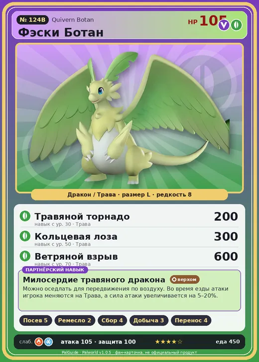

# #124B Фэски Ботан (Quivern Botan)

№ 124B

ДраконТрава

Слабость: ЛёдОгонь

🌱 Посев семян <b>5</b>🖐️ Ручная работа <b>2</b>🌾 Сбор <b>4</b>⛏️ Добыча <b>3</b>📦 Транспортировка <b>4</b>

<b>Милосердие травяного дракона</b> 🐎 верхом

❤️ 105 · ⚔️ 105 · 🛡 100

| Поле | Значение |
|---|---|
| Стихия | Дракон, Трава |
| Слабость (кто бьёт сильнее) | Лёд, Огонь |
| Редкость | 8 |
| Размер | L |
| HP / Атака / Защита (база вида) | 105 / 105 / 100 |
| Сколько ест | 450 |
| Цена продажи | 2235 |
| Множитель поимки | ×1 |
| Скорость рывка верхом | 1400 |

=== "Обзор"

    #### Работа на базе
    - Посев семян — ур. 5
    - Ручная работа — ур. 2
    - Сбор — ур. 4
    - Добыча — ур. 3
    - Транспортировка — ур. 4

    #### Партнёрский навык: Милосердие травяного дракона
    Можно оседлать для передвижения по воздуху. Во время езды атаки игрока меняются на Трава, а сила атаки увеличивается на 5–20%. Технологии 45.

    #### Чем хорош / чем плох
    - ✅ хорошая атака (105); отличный рабочий (пригодность 5); можно оседлать; летает (ездовой)
    - ❌ разводится только особой парой

    > Если обнять Фэски Ботан и почувствовать запах солнца и лугов — завтра будет ясно. А если от него пахнет сыростью — ждите проливной дождь.

    См. также: [Стихии](../../guide/06_stihii.md) · [Разведение](../../guide/07_razvedenie.md) · [Все палы](README.md)

=== "Атаки"

    #### Атаки по уровням
    - ур. 1: Драконья пушка (Дракон, сила 40)
    - ур. 7: Ветряной клинок (Трава, сила 40)
    - ур. 15: Семенной пулемёт (Трава, сила 80)
    - ур. 22: Дыхание дракона (Дракон, сила 160)
    - ур. 30: Травяной торнадо (Трава, сила 200)
    - ур. 40: Комета (Дракон, сила 180)
    - ур. 50: Кольцевая лоза (Трава, сила 300)
    - ур. 70: Ветряной взрыв (Трава, сила 600)

=== "Где живёт"

    #### Где водится
    - В дикой природе: да; точек появления днём: 59, ночью: 59; уровни в первых точках: 45–48
    - Подземелья: Пещера Цветущей Сакуры
    - Яйцо: Огромное яйцо дракона

=== "Дроп"

    #### Дроп
    - Качественное масло Пала — 3 шт., 100%
    - Красивый цветок — 2–3 шт., 100%
    - Красная ягода — 1–2 шт., 60%

    **Дроп альфы:**
    - Деталь древней цивилизации — 2–3 шт., 100%
    - Ценное перо — 2–3 шт., 100%

=== "Разведение"

    #### Разведение
    - Ранг разведения (CombiRank): 1300
    - **Особая пара:** [Фэски](../../4_spravochniki/paly/quivern.md) + [Нежноцвет](../../4_spravochniki/paly/lullu.md)

=== "Пассивки"

    #### Лучшие пассивки по роли

    

⚔️ Боец

максимум урона и живучести в бою

<a class="psv r-4" data-psv="Легенда" href="../../../passivki/legend/">Легенда</a><a class="psv r-4" data-psv="Демон-бог" href="../../../passivki/demon_god/">Демон-бог</a><a class="psv r-3" data-psv="Божественный дракон" href="../../../passivki/divine_dragon/">Божественный дракон</a><a class="psv r-3" data-psv="Хладнокровный" href="../../../passivki/serenity/">Хладнокровный</a>

🛠 Рабочий

работает быстрее и меньше устаёт на базе

<a class="psv r-5" data-psv="Дьявольские руки" href="../../../passivki/demons_hand/">Дьявольские руки</a><a class="psv r-4" data-psv="Виртуоз" href="../../../passivki/remarkable_craftsmanship/">Виртуоз</a><a class="psv r-3" data-psv="Мастеровитый" href="../../../passivki/artisan/">Мастеровитый</a><a class="psv r-3" data-psv="Трудоголик" href="../../../passivki/workaholic/">Трудоголик</a>

🐎 Ездовой

быстрее бегает или летает с тобой верхом

<a class="psv r-4" data-psv="Божественная скорость" href="../../../passivki/swift/">Божественная скорость</a><a class="psv r-4" data-psv="Легенда" href="../../../passivki/legend/">Легенда</a><a class="psv r-4" data-psv="Вечный двигатель" href="../../../passivki/eternal_engine/">Вечный двигатель</a><a class="psv r-3" data-psv="Умелый бегун" href="../../../passivki/runner/">Умелый бегун</a>

    <small>Нажми на пассивку, чтобы узнать, что она даёт и где её взять.</small>

<a class="card-link" href="../quivern/">← Фэски</a><a class="card-link" href="../lullu/">Нежноцвет →</a>

