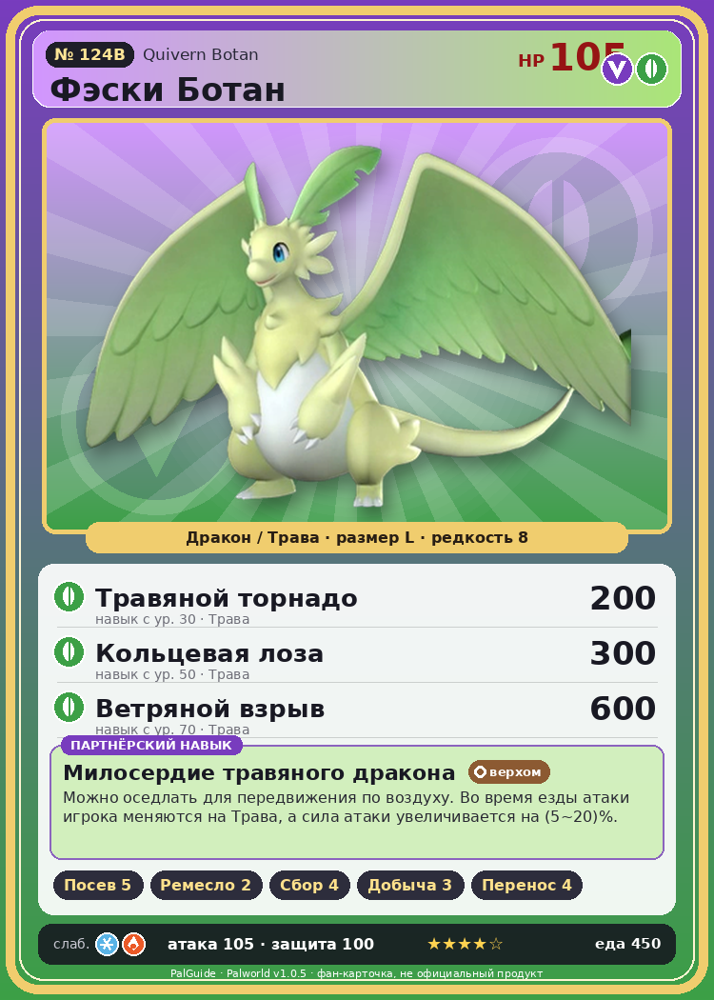

# #124B Фэски Ботан (Quivern Botan)

{ width=360 }

| Поле | Значение |
|---|---|
| Стихия | Дракон, Трава |
| Слабость (кто бьёт сильнее) | Лёд, Огонь |
| Редкость | 8 |
| Размер | L |
| HP / Атака / Защита (база вида) | 105 / 105 / 100 |
| Сколько ест | 450 |
| Цена продажи | 2235 |
| Множитель поимки | ×1 |
| Скорость рывка верхом | 1400 |

## Работа на базе
- Посев семян — ур. 5
- Ручная работа — ур. 2
- Сбор — ур. 4
- Добыча — ур. 3
- Транспортировка — ур. 4

## Партнёрский навык: Милосердие травяного дракона
Можно оседлать для передвижения по воздуху. Во время езды атаки игрока меняются на Трава , а сила атаки увеличивается на (5~20)% . Технологии 45 level value 1 GiveALeaf_Ride 1 GiveElement_TrainerATK_UP_PartnerSkill_Ride 5 2 GiveALeaf_Ride 1 GiveElement_TrainerATK_UP_PartnerSkill_Ride 7 3 GiveALeaf_Ride 1 GiveElement_TrainerATK_UP_PartnerSkill_Ride 10 4 GiveALeaf_Ride 1 GiveElement_TrainerATK_UP_PartnerSkill_Ride 14 5 GiveALeaf_Ride 1 GiveElement_TrainerATK_UP_PartnerSkill_Ride 20

## Атаки по уровням
- ур. 1: Драконья пушка (Дракон, сила 40)
- ур. 7: Ветряной клинок (Трава, сила 40)
- ур. 15: Семенной пулемёт (Трава, сила 80)
- ур. 22: Дыхание дракона (Дракон, сила 160)
- ур. 30: Травяной торнадо (Трава, сила 200)
- ур. 40: Комета (Дракон, сила 180)
- ур. 50: Кольцевая лоза (Трава, сила 300)
- ур. 70: Ветряной взрыв (Трава, сила 600)

## Где водится
- В дикой природе: да; точек появления днём: 59, ночью: 59; уровни в первых точках: 45–48
- Подземелья: Пещера Цветущей Сакуры
- Яйцо: Огромное яйцо дракона

## Дроп
- Качественное масло Пала — 3 шт., 100%
- Красивый цветок — 2–3 шт., 100%
- Красная ягода — 1–2 шт., 60%

**Дроп альфы:**
- Деталь древней цивилизации — 2–3 шт., 100%
- Ценное перо — 2–3 шт., 100%

## Разведение
- Ранг разведения (CombiRank): 1300
- **Особая пара:** [Фэски](../../4_spravochniki/paly/quivern.md) + [Нежноцвет](../../4_spravochniki/paly/lullu.md)

## Лучшие пассивки по роли
- боец: Легенда, Демон-бог, Хладнокровный, Бессмертие, Божественный дракон (вместо Бессмертия, если нет мутации)
- рабочий: Дьявольские руки, Виртуоз, Мастеровитый, Небожитель/Трудоголик
- ездовой: Божественная скорость, Легенда, Вечный двигатель, Небесное скольжение

## Чем хорош / чем плох
- ✅ хорошая атака (105); отличный рабочий (пригодность 5); можно оседлать; летает (ездовой)
- ❌ разводится только особой парой

> Если обнять Фэски Ботан и почувствовать запах солнца и лугов — завтра будет ясно. А если от него пахнет сыростью — ждите проливной дождь.

См. также: [Стихии](../../2_mehaniki/stihii.md) · [Разведение](../../2_mehaniki/razvedenie.md) · [Все палы](README.md)
_Источник: paldb.cc v1.0.5_
