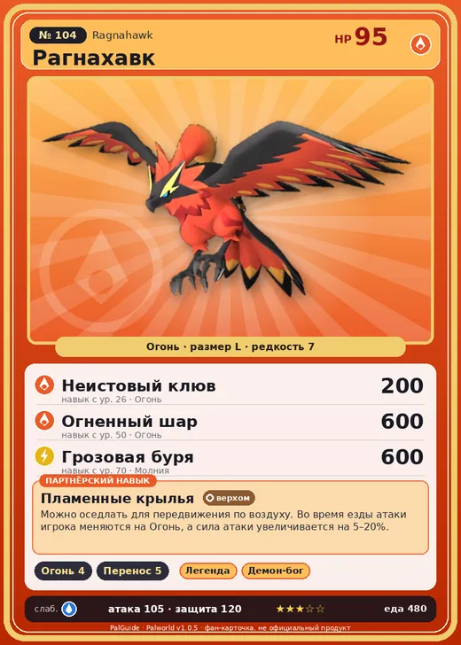

# Рагнахавк

<canvas id="fx"></canvas>

№ 104 · Ragnahawk

Огонь

Слабость: Вода

🔥 Разжигание огня <b>4</b>📦 Транспортировка <b>5</b>

<b>Пламенные крылья</b> 🐎 верхом

❤️ 95 · ⚔️ 105 · 🛡 120

| Поле | Значение |
|---|---|
| Стихия | Огонь |
| Слабость (кто бьёт сильнее) | Вода |
| Редкость | 7 |
| Размер | L |
| HP / Атака / Защита (база вида) | 95 / 105 / 120 |
| Сколько ест | 480 |
| Цена продажи | 2263 |
| Множитель поимки | ×1 |
| Скорость рывка верхом | 1300 |

=== "Обзор"

    #### Работа на базе
    - Разжигание огня — ур. 4
    - Транспортировка — ур. 5

    #### Партнёрский навык: Пламенные крылья
    Можно оседлать для передвижения по воздуху. Во время езды атаки игрока меняются на Огонь, а сила атаки увеличивается на 5–20%. Технологии 33.

    #### Чем хорош / чем плох
    - ✅ Огненный летун; хорошая атака (105); крепкая защита (120); отличный рабочий (пригодность 5); можно оседлать; летает (ездовой)
    - ❌ Средний урон

    > Можно подумать, что он — близкий сородич Райберд , но на самом деле между ними нет никакой связи. В его рацион входят горные породы, и с течением лет затвердел не только клюв, но и вся голова.

    См. также: [Стихии](../../guide/06_stihii.md) · [Разведение](../../guide/07_razvedenie.md) · [Все палы](README.md)

=== "Атаки"

    #### Атаки по уровням
    - ур. 1: Воздушная пушка (Нейтральный, сила 40)
    - ур. 7: Расщеплённый огонь (Огонь, сила 80)
    - ур. 15: Огненная стрела (Огонь, сила 120)
    - ур. 22: Песчаный вихрь (Земля, сила 200)
    - ур. 26: Неистовый клюв (Огонь, сила 200)
    - ур. 30: Огненный шторм (Огонь, сила 200)
    - ур. 40: Огненное дыхание (Огонь, сила 160)
    - ур. 50: Огненный шар (Огонь, сила 600)
    - ур. 70: Грозовая буря (Молния, сила 600)

=== "Где живёт"

    #### Где водится
    - В дикой природе: да; точек появления днём: 155, ночью: 155; уровни в первых точках: 32–34
    - Подземелья: Пещера Вулкана
    - Может продаваться у торговца/рекрутера
    - Яйцо: Большое раскалённое яйцо

=== "Дроп"

    #### Дроп
    - Огненный орган — 5–7 шт., 100%

    **Дроп альфы:**
    - Деталь древней цивилизации — 4–6 шт., 100%
    - Ценное перо — 4–6 шт., 100%

=== "Разведение"

    #### Разведение
    - Ранг разведения (CombiRank): 1050
    - Участвует в особых парах: Теранайт → Теранайт Игнис

=== "Пассивки"

    #### Лучшие пассивки по роли

    

⚔️ Боец

максимум урона и живучести в бою

<a class="psv r-4" data-psv="Легенда" href="../../../passivki/legend/">Легенда</a><a class="psv r-4" data-psv="Демон-бог" href="../../../passivki/demon_god/">Демон-бог</a><a class="psv r-3" data-psv="Император огня" href="../../../passivki/flame_emperor/">Император огня</a><a class="psv r-3" data-psv="Хладнокровный" href="../../../passivki/serenity/">Хладнокровный</a>

🛠 Рабочий

работает быстрее и меньше устаёт на базе

<a class="psv r-5" data-psv="Дьявольские руки" href="../../../passivki/demons_hand/">Дьявольские руки</a><a class="psv r-4" data-psv="Виртуоз" href="../../../passivki/remarkable_craftsmanship/">Виртуоз</a><a class="psv r-3" data-psv="Мастеровитый" href="../../../passivki/artisan/">Мастеровитый</a><a class="psv r-3" data-psv="Трудоголик" href="../../../passivki/workaholic/">Трудоголик</a>

🐎 Ездовой

быстрее бегает или летает с тобой верхом

<a class="psv r-4" data-psv="Божественная скорость" href="../../../passivki/swift/">Божественная скорость</a><a class="psv r-4" data-psv="Легенда" href="../../../passivki/legend/">Легенда</a><a class="psv r-4" data-psv="Вечный двигатель" href="../../../passivki/eternal_engine/">Вечный двигатель</a><a class="psv r-3" data-psv="Умелый бегун" href="../../../passivki/runner/">Умелый бегун</a>

    <small>Нажми на пассивку, чтобы узнать, что она даёт и где её взять.</small>

<a class="card-link" href="../chillet_ignis/">← Чиллет Игнис</a><a class="card-link" href="../moldron/">Молдрон →</a>

