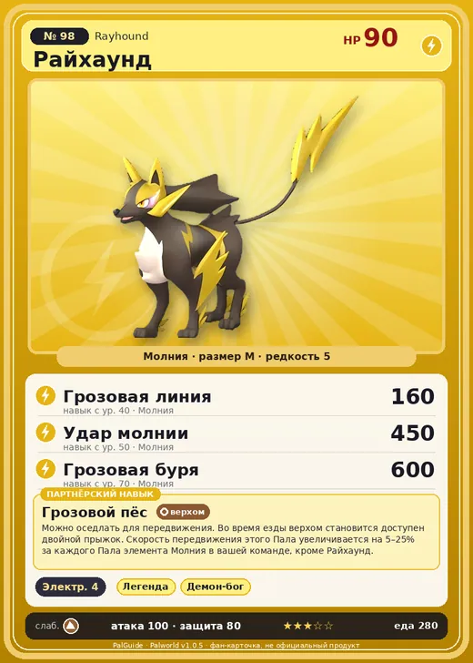

# #98 Райхаунд (Rayhound)

№ 98

Молния

Слабость: Земля

⚡ Генерация энергии <b>4</b>

<b>Грозовой пёс</b> 🐾 выпущен 🐎 верхом

❤️ 90 · ⚔️ 100 · 🛡 80

| Поле | Значение |
|---|---|
| Стихия | Молния |
| Слабость (кто бьёт сильнее) | Земля |
| Редкость | 5 |
| Размер | M |
| HP / Атака / Защита (база вида) | 90 / 100 / 80 |
| Сколько ест | 280 |
| Цена продажи | 1205 |
| Множитель поимки | ×1 |
| Скорость рывка верхом | 1150 |

## Работа на базе
- Генерация энергии — ур. 4

## Партнёрский навык: Грозовой пёс
Можно оседлать для передвижения. Во время езды верхом становится доступен двойной прыжок . Скорость передвижения этого Пала увеличивается на (5~25)% за каждого Пала элемента Молния в вашей команде, кроме Райхаунд . Технологии 30 level value 1 MoveSpeed_PartnerSkill_SpecificElement 5 2 MoveSpeed_PartnerSkill_SpecificElement 9 3 MoveSpeed_PartnerSkill_SpecificElement 13 4 MoveSpeed_PartnerSkill_SpecificElement 18 5 MoveSpeed_PartnerSkill_SpecificElement 25

## Атаки по уровням
- ур. 1: Двойные клыки (молния) (Молния, сила 40)
- ур. 2: Дикие клыки (молния) (Молния, сила 50)
- ур. 3: Грязевой выстрел (Земля, сила 40)
- ур. 7: Шоковая волна (Молния, сила 80)
- ур. 15: Искровой выстрел (Молния, сила 50)
- ур. 22: Каменный залп (Земля, сила 80)
- ур. 26: Призыв молнии (Молния, сила 100)
- ур. 30: Шаровая молния (Молния, сила 100)
- ур. 40: Грозовая линия (Молния, сила 160)
- ур. 50: Удар молнии (Молния, сила 450)
- ур. 70: Грозовая буря (Молния, сила 600)

## Где водится
- В дикой природе: да; точек появления днём: 238, ночью: 238; уровни в первых точках: 31–35
- Подземелья: Пещера Песчаных Дюн
- Яйцо: Большое яйцо молнии

## Дроп
- Электрический орган — 1–2 шт., 100%

**Дроп альфы:**
- Деталь древней цивилизации — 4–6 шт., 100%
- Ценное перо — 4–6 шт., 100%

## Разведение
- Ранг разведения (CombiRank): 1920
- Участвует в особых парах: Пенкинг → Пенкинг Лакс; Диноссум → Диноссум Лакс; Фоксайкл → Райхаунд Крист

## Лучшие пассивки по роли
- боец: Легенда, Демон-бог, Хладнокровный, Бессмертие, Император молнии (вместо Бессмертия, если нет мутации)
- рабочий: Дьявольские руки, Виртуоз, Мастеровитый, Небожитель/Трудоголик
- ездовой: Божественная скорость, Легенда, Вечный двигатель, Небесное скольжение

## Чем хорош / чем плох
- ✅ хорошая атака (100); можно оседлать
- ❌ явных минусов нет

> При полном разгоне скорость подобна молнии. Столкновение двух Райхаунд сопровождается грохотом, напоминающим раскат грома.

См. также: [Стихии](../../guide/06_stihii.md) · [Разведение](../../guide/07_razvedenie.md) · [Все палы](README.md)
