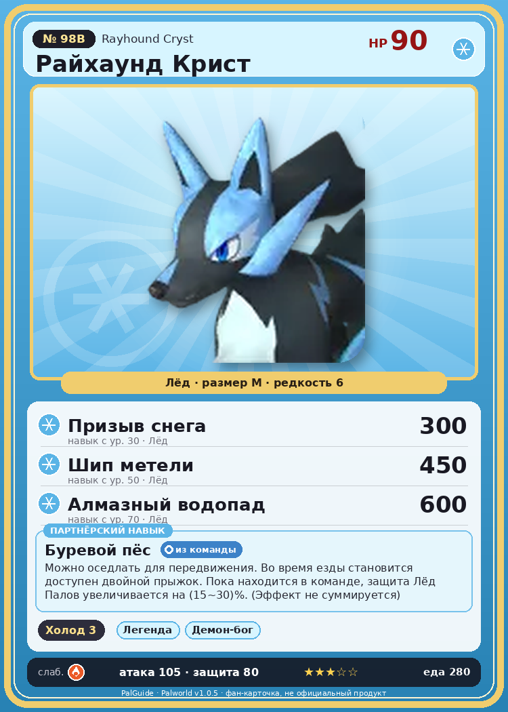

# #98B Райхаунд Крист (Rayhound Cryst)

{ width=360 }

| Поле | Значение |
|---|---|
| Стихия | Лёд |
| Слабость (кто бьёт сильнее) | Огонь |
| Редкость | 6 |
| Размер | M |
| HP / Атака / Защита (база вида) | 90 / 105 / 80 |
| Сколько ест | 280 |
| Цена продажи | 1138 |
| Множитель поимки | ×1 |
| Скорость рывка верхом | 1150 |

## Работа на базе
- Охлаждение — ур. 3

## Партнёрский навык: Буревой пёс
Можно оседлать для передвижения. Во время езды становится доступен двойной прыжок . Пока находится в команде, защита Лёд Палов увеличивается на (15~30)% . (Эффект не суммируется) Технологии 32 level value 1 DefenseUp_Ice_PartnerSkill 15 Пробуждение : 2 DefenseUp_Ice_PartnerSkill 17 MoveSpeed_up_PartnerSkill_Ride_1 10 Пробуждение : (Скорость передвижения верхом: +10% ) 3 DefenseUp_Ice_PartnerSkill 20 MoveSpeed_up_PartnerSkill_Ride_2 12 Пробуждение : (Скорость передвижения верхом: +12% ) 4 DefenseUp_Ice_PartnerSkill 24 MoveSpeed_up_PartnerSkill_Ride_3 15 Пробуждение : (Скорость передвижения верхом: +15% ) 5 DefenseUp_Ice_PartnerSkill 30 MoveSpeed_up_PartnerSkill_Ride_4 20 Пробуждение : (Скорость передвижения верхом: +20% )

## Атаки по уровням
- ур. 1: Двойные клыки (лед) (Лёд, сила 40)
- ур. 2: Дикие клыки (лед) (Лёд, сила 50)
- ур. 3: Грязевой выстрел (Земля, сила 40)
- ур. 7: Ледяной резак (Лёд, сила 80)
- ур. 15: Айсберг (Лёд, сила 120)
- ур. 22: Ледяное дыхание (Лёд, сила 160)
- ур. 30: Призыв снега (Лёд, сила 300)
- ур. 40: Ледяной след (Лёд, сила 300)
- ур. 50: Шип метели (Лёд, сила 450)
- ур. 70: Алмазный водопад (Лёд, сила 600)

## Где водится
- В дикой природе: да; точек появления днём: 76, ночью: 76
- Яйцо: Большое яйцо льда

## Дроп
- Ледяной орган — 1–2 шт., 100%

**Дроп альфы:**
- Деталь древней цивилизации — 4–6 шт., 100%
- Ценный мех — 2–3 шт., 100%

## Разведение
- Ранг разведения (CombiRank): 1600
- **Особая пара:** [Райхаунд](../../4_spravochniki/paly/rayhound.md) + [Фоксайкл](../../4_spravochniki/paly/foxcicle.md)

## Лучшие пассивки по роли
- боец: Легенда, Демон-бог, Хладнокровный, Бессмертие, Император льда (вместо Бессмертия, если нет мутации)
- рабочий: Дьявольские руки, Виртуоз, Мастеровитый, Небожитель/Трудоголик
- ездовой: Божественная скорость, Легенда, Вечный двигатель, Небесное скольжение

## Чем хорош / чем плох
- ✅ хорошая атака (105); можно оседлать
- ❌ разводится только особой парой

> При беге во весь опор по снежной равнине поднимается снежная буря. Из-за плохой видимости Райхаунд Крист нередко сталкиваются друг с другом.

См. также: [Стихии](../../2_mehaniki/stihii.md) · [Разведение](../../2_mehaniki/razvedenie.md) · [Все палы](README.md)
_Источник: paldb.cc v1.0.5_
