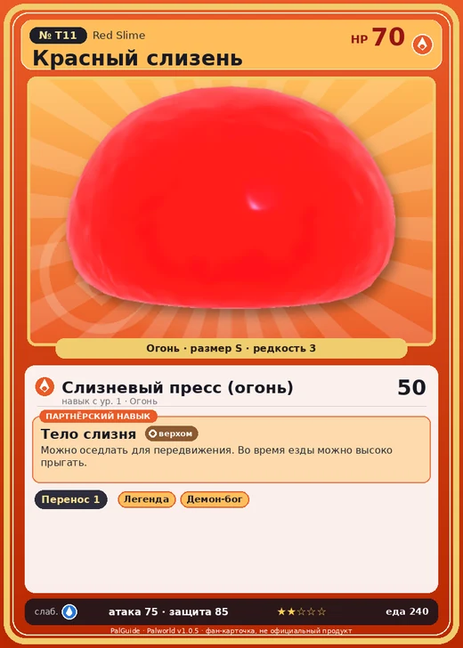

# #T11 Красный слизень (Red Slime)

#T11 · Red Slime

Огонь

Слабость: Вода

📦 Транспортировка <b>1</b>

<b>Тело слизня</b> 🐎 верхом

❤️ 70 · ⚔️ 75 · 🛡 85

| Поле | Значение |
|---|---|
| Стихия | Огонь |
| Слабость (кто бьёт сильнее) | Вода |
| Редкость | 3 |
| Размер | S |
| HP / Атака / Защита (база вида) | 70 / 75 / 85 |
| Сколько ест | 240 |
| Цена продажи | 700 |
| Множитель поимки | ×1 |
| Скорость рывка верхом | 450 |
| Коллаборация | Terraria (остров Якусима) (нет в Палпедии) |

## Работа на базе
- Транспортировка — ур. 1

## Партнёрский навык: Тело слизня
Можно оседлать для передвижения. Во время езды можно высоко прыгать.

## Атаки по уровням
- ур. 1: Слизневый пресс (огонь) (Огонь, сила 50)

## Где водится
- В дикой природе: да; точек появления днём: ?, ночью: ?
- Яйцо: Раскалённое яйцо

## Дроп
- Святой слиток — 1 шт., 100%

## Разведение
- Ранг разведения (CombiRank): 3100

## Лучшие пассивки по роли
- боец: Легенда, Демон-бог, Хладнокровный, Бессмертие, Император огня (вместо Бессмертия, если нет мутации)
- ездовой: Божественная скорость, Легенда, Вечный двигатель, Небесное скольжение

## Чем хорош / чем плох
- ✅ можно оседлать
- ❌ слабая атака (75)

> [Коллаборация с Terraria] Монстр из другого мира. Похоже, здесь его можно приручить.

См. также: [Стихии](../../2_mehaniki/stihii.md) · [Разведение](../../2_mehaniki/razvedenie.md) · [Все палы](README.md)
_Источник: paldb.cc v1.0.5_
